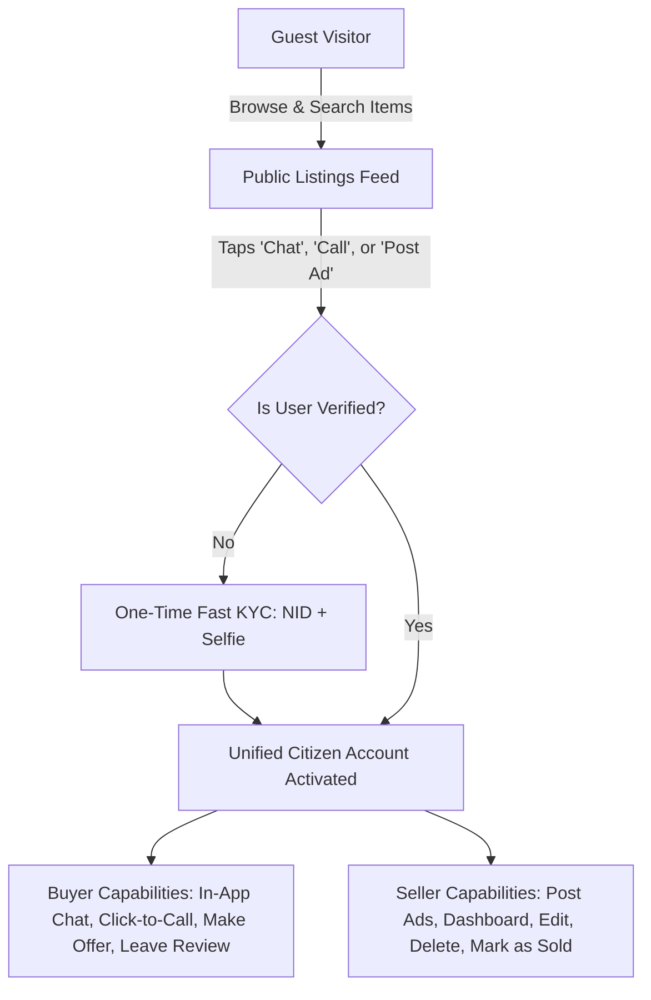
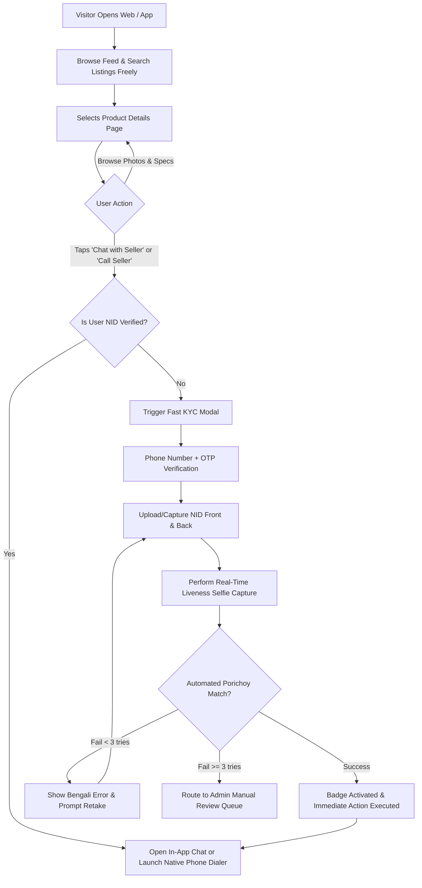
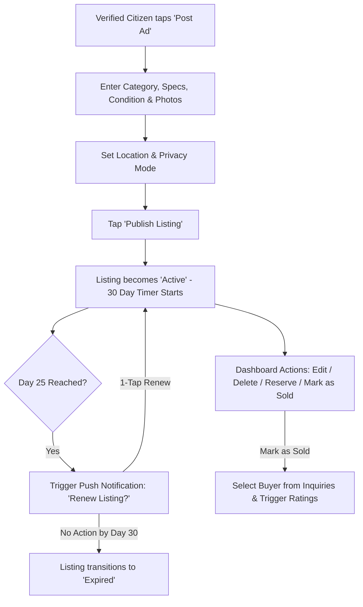
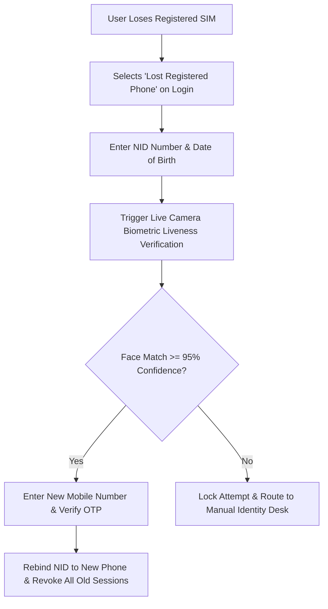
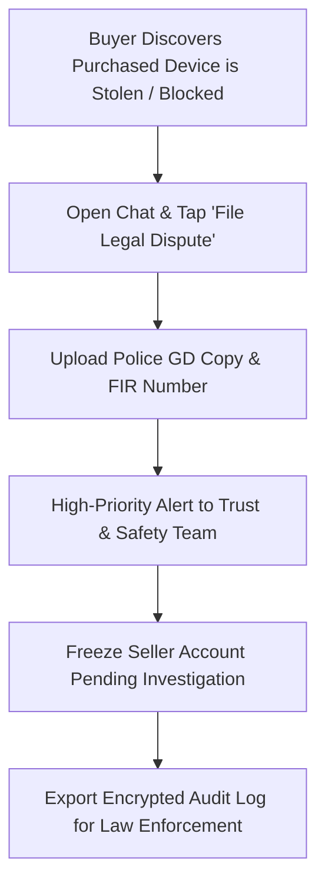

# Product Requirements Document (PRD)

## Project: Becha-Kena
**Tagline:** Bangladesh’s First NID-Verified Peer-to-Peer Resale Marketplace  
**Document Version:** 2.0 (Integrated Technical, Security & Validation Architecture)  
**Status:** Approved for Implementation & Engineering Handoff  
**Author:** Senior Product Analyst & Technical Business Analyst Team  

---

## 1. Project Overview

### 1.1 Executive Summary
**Becha-Kena** is a trust-first Consumer-to-Consumer (C2C) resale marketplace engineered specifically for Bangladesh. Unlike conventional classified platforms (e.g., Bikroy, Facebook Marketplace) plagued by anonymous burner profiles, advance-payment scams (bKash/Nagad), stolen gadgets, fake courier links, and personal harassment, Becha-Kena introduces **mandatory dual-sided National ID (NID) authentication** with automated liveness selfie verification.

By replacing anonymous accounts with verified, accountable citizens, Becha-Kena creates a closed-loop, safe marketplace where bad actors are permanently excluded.

### 1.2 Core Problem Statement
The digital classifieds ecosystem in Bangladesh suffers from structural trust failure:
- **Anonymity & Burner Profiles:** Fraudsters spin up disposable accounts using unverified SIMs or fake Facebook accounts.
- **Advance-Fee Scams:** Fake sellers demand advance "booking/courier fees" via MFS (bKash/Nagad) and vanish.
- **Stolen & Counterfeit Goods:** High prevalence of stolen smartphones (blocked IMEIs) and counterfeit electronics with zero seller traceability.
- **Harassment & Time-Wasting:** Unsolicited aggressive bargaining, vulgar messaging, and ghosting during in-person meetups.
- **Zero Platform Recourse:** Incumbent classifieds operate on zero-liability models, leaving fraud victims with no legal recourse.

### 1.3 Solution & Unique Value Proposition (UVP)
Becha-Kena retains the intuitive classifieds workflow (**Open Browse $\rightarrow$ Gated Chat/Call $\rightarrow$ Negotiate $\rightarrow$ In-Person Deal Closure**) while introducing an immutable trust layer:
- **Dual-Sided Verification:** Both buyers and sellers must authenticate via Bangladesh National ID (Smart Card / classic NID) and biometric face match before interacting.
- **Open Discovery ("Browse Freely"):** Visitors can freely search and inspect listings without an upfront login wall, maximizing top-of-funnel conversion.
- **Permanent Fraud Deterrence:** Any confirmed scammer is permanently blacklisted by NID hash, phone number, and device footprint.
- **Scraping & Privacy Protection:** Verified buyers can view seller numbers to click-and-call, protected by seller privacy toggles, rate limits (max 10 reveals/24hr), and audit logging.
- **Lean C2C Model:** Focuses strictly on individual peer-to-peer deals without the regulatory burden of escrow banking licenses or delivery warehousing for MVP.

### 1.4 Business & Product Metrics (KPIs)
| Metric | Target | Measurement Method |
| :--- | :--- | :--- |
| **KYC Pass Rate** | $\ge 88\%$ completion within $\le 90$ seconds | Automated Porichoy API + Liveness success logs |
| **Scam / Fraud Rate** | $< 0.05\%$ of all initiated contacts | Safety reports confirmed by Trust & Safety Team |
| **Lead Quality (Response Rate)** | $\ge 75\%$ responses within 2 hours | In-app messaging timestamp analytics |
| **Listing-to-Deal Conversion** | $\ge 25\%$ marked "Sold" within 14 days | Seller Dashboard status updates |
| **Account Recidivism** | 0% repeat accounts from banned NIDs | Automated NID hash blacklist collision checks |

---

## 2. User Architecture & Access Control (RBAC)

### 2.1 Unified Account Architecture (Dual-Role)
Becha-Kena operates on a **Single Citizen Profile Model**. A user does not register separately as a "Buyer" or "Seller". Once verified via NID, an individual account can seamlessly buy, sell, negotiate, and manage listings from the same profile.



### 2.2 Role-Based Access Control (RBAC) Matrix
| Feature / Action | Guest Visitor | Unverified User | Verified Citizen (Buyer/Seller) | Trust & Safety Moderator | Super Admin |
| :--- | :---: | :---: | :---: | :---: | :---: |
| **Browse & Search Listings** | ✅ Full | ✅ Full | ✅ Full | ✅ Full | ✅ Full |
| **View Product Details Page** | ✅ Full | ✅ Full | ✅ Full | ✅ Full | ✅ Full |
| **View Seller Phone / Click-to-Call** | ❌ Blocked | ❌ Blocked | ✅ Permitted (Rate limited & logged) | ✅ Permitted | ✅ Permitted |
| **Send In-App Chat / Offer** | ❌ Blocked | ❌ Blocked | ✅ Permitted | ❌ Blocked | ❌ Blocked |
| **Post / Edit / Delete Own Ad** | ❌ Blocked | ❌ Blocked | ✅ Permitted (Max 5 active/mo) | ❌ Blocked | ❌ Blocked |
| **Access Seller Dashboard** | ❌ Blocked | ❌ Blocked | ✅ Permitted | ❌ Blocked | ❌ Blocked |
| **Submit Star Rating & Review** | ❌ Blocked | ❌ Blocked | ✅ Permitted (Post-Deal) | ❌ Blocked | ❌ Blocked |
| **Submit Scam / Abuse Report** | ❌ Blocked | ❌ Blocked | ✅ Permitted | ❌ Blocked | ❌ Blocked |
| **File Stolen Item Dispute (GD/FIR)** | ❌ Blocked | ❌ Blocked | ✅ Permitted (Post-Deal) | ❌ Blocked | ❌ Blocked |
| **Manual KYC Review Queue** | ❌ Blocked | ❌ Blocked | ❌ Blocked | ✅ Permitted | ✅ Full |
| **Review Reported Chats, Ads & Disputes** | ❌ Blocked | ❌ Blocked | ❌ Blocked | ✅ Permitted | ✅ Full |
| **Propose / Initiate Account Ban** | ❌ Blocked | ❌ Blocked | ❌ Blocked | ✅ Initiate (`BAN_PROPOSED`) | ✅ Instant |
| **Confirm NID Blacklist / Ban Account** | ❌ Blocked | ❌ Blocked | ❌ Blocked | ⚠️ Dual Approval Required | ✅ Instant / Final |
| **Export Legal Audit Logs (GD/FIR)** | ❌ Blocked | ❌ Blocked | ❌ Blocked | ❌ Blocked | ✅ MFA Required |

---

## 3. Core Functional Requirements & Business Rules

### 3.1 Fast Identity Verification & KYC Engine (REQ-01)
1. **Multi-Format NID Support:** Integrates with official identity verification APIs (e.g., Porichoy API) supporting 10-digit Smart NID cards and 13/17-digit legacy laminated NIDs.
2. **Biometric Liveness Match:** Front camera captures active blink/turn detection matched against election database photo.
3. **Automated Retry & Fallback Pipeline:**
   - User receives up to **3 automated attempts** with clear guidance (e.g., *"Please take a clear photo of your NID in good lighting"*).
   - If 3 automated attempts fail, user can submit for **Manual Admin Review** (processed within $< 4$ business hours SLA).
4. **Manual KYC SLA & Queue Aging Engine:**
   - Submissions in the manual review queue are prioritized by submission timestamp and attempt history.
   - If a submission remains pending for $> 3$ hours without moderator triage, an automated high-priority Slack/SMS escalation alert is dispatched to the Trust & Safety Lead.
   - Working hours definition: 9:00 AM – 9:00 PM BD time (BST). Submissions after hours are queued for next-morning opening.
5. **Hardware & Unique Identity Binding:**
   - Exactly 1 NID is bound to 1 active citizen profile and 1 registered primary mobile number.
   - Up to **2 authorized devices** can be active per citizen.
   - **Device Change Protocol ("New Phone, Same SIM"):** When an existing SIM logs in from an unrecognized device, SMS OTP is required followed by a quick 3-second biometric selfie confirmation to ensure the physical SIM wasn't temporarily hijacked.
6. **Permanent Blacklisting Registry:** Confirmed fraud triggers an immediate, irreversible permanent ban across NID hash, phone, and device UUID.

### 3.2 Verified Profiles & Privacy Controls (REQ-03, REQ-05, REQ-07)
1. **Trust Badging:** Green "NID Verified" shield displayed on listings, user profiles, and chat headers.
2. **Masked Public Name:** Real legal names are masked for safety (e.g., "Farhana R. [NID Verified]"), while official records are vaulted securely.
3. **Seller Phone Number Privacy & Scraping Defense:**
   - **Default Display:** Visible only to logged-in, NID-verified buyers via a single-tap click-to-call button.
   - **Seller Privacy Toggle:** Sellers can toggle *"Chat-Only Mode"* during ad creation or editing if they wish to keep their number private.
   - **Anti-Scraping Rate Limit:** Verified buyers can reveal a maximum of **10 seller phone numbers per 24 hours**. Exceeding triggers a CAPTCHA and 6-hour cooldown.
   - **Audit Logging:** Every phone number reveal is logged: `{buyer_nid_hash, seller_id, listing_id, timestamp, ip_address}`.

### 3.3 Listing Lifecycle & C2C Discovery (REQ-02, REQ-06)
1. **Ad Lifecycle State Machine:**
   ```
   [Draft] ──> [Active] ──> [Under Offer / Reserved] ──> [Sold]
                  │                     │
                  │                     └──> [Cancelled / Active]
                  └──> [Expired (Day 30)] ──> [Archived]
   ```
   - **Active:** Discoverable in search and feed.
   - **Under Offer / Reserved:** Temporarily held during physical inspection; hidden from top search.
   - **Sold:** Deal completed; prompts bilateral rating.
   - **Expired:** Automatically transitions after 30 days. Seller can 1-tap renew at Day 25.
   - **Archived / Soft-Deleted:** Removed from public view with `deletedAt` timestamp; retained in database for fraud and audit compliance.
2. **Strict C2C Anti-Spam Quota & Renewal Limits:**
   - Maximum of **5 active listings** per verified individual per rolling 30-day window to prevent commercial shop invasion.
   - **Renewal Quota Rules:** An ad may be renewed a maximum of **2 times** (max 90-day total active lifespan). Each active renewed ad consumes 1 slot of the seller's active quota, preventing infinite ghost ads.
3. **Automated Image Content Moderation:**
   - All uploaded listing photos pass through automated image filtering (checking for NSFW, explicit content, QR codes containing phishing links, or blacklisted watermarks) prior to public display.
   - Flagged images prevent ad activation and route the listing to moderator triage with clear user feedback: *"Prohibited content detected in your uploaded image. Please upload a new image."*
4. **Location Hierarchy:** Division $\rightarrow$ District $\rightarrow$ Thana/Upazila $\rightarrow$ Popular Area/Landmark.

### 3.4 In-App Secure Negotiation & Safety Alerts (REQ-04)
1. **Gated Chat Access:** Only NID-verified accounts can send messages or make offers.
2. **Real-Time Scam Detection Shield:**
   - In-app chat regex engine flags advance-payment keywords (`advance`, `bkash`, `courier fee`, `booking fee`).
   - Action: Displays an instant red warning banner: *"Warning: Never send advance money via bKash/Nagad before physically verifying the product."*
3. **Link Stripping:** External URLs (`http://`, `https://`, `.apk`) are automatically blocked to prevent phishing courier tracking scams.
4. **Structured "Make Offer" & Counter-Offer Lifecycle:**
   - Formal binding offers submitted directly inside chat (`amount`, `expiresAt` = 24 hours).
   - Sellers can **Accept**, **Decline**, or **Counter-Offer**.
   - **Counter-Offer Chain:** When a counter-offer is proposed, the previous offer status changes to `countered` and references `parentOfferId`. The negotiation chain retains immutable history.
   - **Auto-Expiry:** BullMQ cron worker checks expiring offers every 5 minutes; unaccepted offers automatically transition to `expired` after 24 hours with buyer notification.
   - **Anti-Spam Offer Limit:** A buyer can submit a maximum of **3 offers per listing** to curb lowball nuisance messaging.

### 3.5 Deal Closure & Bilateral Reputation System (REQ-09)
1. **Offer $\rightarrow$ Deal Pipeline (Primary Flow):**
   - Once a Seller **Accepts** an Offer, a `Deal` document is created: `{ listingId, offerId, sellerId, buyerId, finalPrice, isReviewedBySeller: false, isReviewedByBuyer: false, disputeStatus: 'none', completedAt }`.
   - The Listing status is atomically updated to `Sold` using a MongoDB `findOneAndUpdate` with a status guard — preventing race conditions when multiple buyers submit offers concurrently:
     ```js
     await session.withTransaction(async () => {
       const listing = await Listing.findOneAndUpdate(
         { _id: listingId, status: { $in: ['active', 'under_offer'] } },
         { $set: { status: 'sold', soldToBuyerId: buyerId } },
         { session, new: true }
       );
       if (!listing) throw new Error('Listing no longer available');
     });
     ```
2. **Direct "Mark as Sold" without Formal Offer (Fallback Flow):**
   - If buyer and seller agreed verbally or via in-person inspection without formal in-app offer clicks, seller can select "Mark as Sold" from dashboard.
   - System prompts seller: *"Select the buyer you sold this item to"* listing only verified citizens with whom the seller has an active chat history on this listing.
   - Selecting the buyer creates a zero-dispute `Deal` record linking `buyerId`, preventing phantom ratings and unlocking mutual review privileges.
3. **Review Gating:** Star ratings and trust badges are **only unlocked** after a confirmed `Deal` document exists for the buyer-seller pair, and only once per party (`isReviewedBySeller` / `isReviewedByBuyer` flags). This prevents unsolicited, unverified reviews.
4. **Mutual Rating & Review:** Both parties unlock:
   - 1 to 5 Star Rating.
   - Trust badges: *"Punctual"*, *"Item Exactly as Described"*, *"Friendly Communication"*, *"Quick Payment"*.
5. **Public Trust Score:** Cumulative rating and total completed deals displayed on the citizen's verified profile.

### 3.6 Multi-Channel Notification Framework & Debounce Engine (REQ-08)
| Event Trigger | Recipient | In-App Banner | Push Notification (FCM) | SMS Fallback Alert |
| :--- | :--- | :---: | :---: | :---: |
| **KYC Approved / Rejected** | User | ✅ Immediate | ✅ Instant | ✅ Short confirmation |
| **New Chat Message** | Buyer / Seller | ✅ Tab badge | ✅ Instant | ⚠️ Fallback if offline $>15\text{m}$ |
| **Formal Offer Received** | Seller | ✅ Header alert | ✅ Instant with sound | ⚠️ Fallback if offline $>15\text{m}$ |
| **Offer Accepted / Countered** | Buyer | ✅ Header alert | ✅ Instant | ❌ No |
| **Offer Auto-Expired (24hr)** | Buyer | ✅ Toast notification | ✅ Soft reminder | ❌ No |
| **Ad Nearing Expiry (Day 25)** | Seller | ✅ Dashboard alert | ✅ Day 25 reminder | ❌ No |
| **Item Marked Sold (Review Prompt)** | Buyer & Seller | ✅ Dialog modal | ✅ High Priority | ❌ No |
| **Favorited Item Price Drop** | Buyer | ✅ Feed badge | ✅ Price drop alert | ❌ No |
| **Security Login from New Device** | User | ✅ Security toast | ✅ Instant alert | ✅ Immediate SMS alert |
| **Dispute / GD Filing Update** | Buyer & Seller | ✅ Urgent modal | ✅ High Priority | ✅ SMS Alert |

1. **Price Drop Debounce Engine:** To eliminate notification spam if a seller edits asking prices multiple times within minutes, price-drop push notifications are delayed via BullMQ with a **5-minute debounce window** (`jobId = price_drop:${listingId}`). Only the net price difference is broadcast.
2. **User Notification Preferences:**
   - Users can customize preferences for push and SMS channels (`chat_messages`, `price_alerts`, `marketing`).
   - Security alerts (New Device Login, NID Status, Legal Dispute Notices) are system-critical and cannot be opted out of.

### 3.7 User Safety, Flagging & Dispute Resolution (REQ-12 & REQ-13)
1. **Community Flagging & Reporting Engine (REQ-12):**
   - Verified citizens can flag any listing, chat message, or user profile for reasons: `scam_advance_demanded`, `stolen_goods_suspected`, `harassment`, `counterfeit`, `spam`.
   - Creating a report captures context snapshot: reported entity ID, reporter ID, timestamp, category, and optional screenshot/text proof.
   - Threshold-Based Auto-Protection: If a listing receives $\ge 3$ distinct verified reports within 2 hours, it is automatically shifted to `under_review` and hidden from search until moderator signoff.
2. **Stolen Gadget Dispute & Police GD Escalation (REQ-13):**
   - For closed deals where a buyer discovers a purchased gadget is stolen or IMEI-blocked, the buyer can initiate a **Legal Dispute** from the deal receipt.
   - Required Evidence: General Diary (GD) number, Thana name, filing date, and photo attachment of the police GD document.
   - Platform Action:
     - Freezes seller account privileges (`freezeWithdrawalOrPosting: true`).
     - Flags seller profile with an internal legal hold.
     - Generates an encrypted law enforcement audit log ready for authorized cybercrime investigation units.

### 3.8 Favorites & Wishlist (REQ-11)
1. **Save Listing:** Any verified buyer can save a listing to their Favorites list. The system records `priceAtSave` at the moment of saving.
2. **Price Drop Alerts:** Fans out debounced push notifications to favorited users: *"Your saved item price dropped! Reduced from BDT X to BDT Y."*
3. **Availability Awareness:** If a favorited listing is marked `Sold`, `Expired`, or `Deleted`, the Favorites list shows a visual `Unavailable` state without removing the saved record.

### 3.9 Input & Business Rule Validation Matrix
| Field / Action | Validation Rules | Error Response Message |
| :--- | :--- | :--- |
| **Phone Number** | BD Regex: `^(?:\+8801\|01)[3-9]\d{8}$` (11 digits, valid BD telco prefixes). | *"Please enter a valid 11-digit Bangladeshi mobile number."* |
| **NID Number** | 10-digit Smart NID (`^\d{10}$`) OR 13/17-digit legacy NID (`^\d{13}$` / `^\d{17}$`). | *"Please provide a valid 10, 13, or 17-digit National ID number."* |
| **Listing Title** | Min 10 characters, Max 100 characters. No continuous uppercase / spam symbols. | *"Title must be between 10 and 100 characters."* |
| **Asking Price** | Integer between 50 and 2,500,000 BDT. Must be greater than 0. | *"Please set a valid price (minimum 50 BDT and maximum 2,500,000 BDT)."* |
| **Listing Images** | Min 1 photo, Max 8 photos. Dimensions $\ge 480\times 480\text{px}$. Pre-screened for adult/prohibited content. | *"You must upload at least 1 and at most 8 photos for the listing."* |
| **Item Description** | Min 20 characters, Max 2,000 characters. | *"Please write a detailed description of the product (at least 20 characters)."* |
| **Location** | Must match verified Division $\rightarrow$ District $\rightarrow$ Thana ID from system master database. | *"Please select a valid location from the list."* |
| **Listing Condition** | Strict enum: `brand_new`, `like_new`, `gently_used`, `heavily_used`. | *"Selecting the item condition is required."* |

---

## 4. User Flows & System Interaction Diagrams

### Flow 1: Onboarding, Discovery & Gated KYC Verification


---

### Flow 2: Seller Dashboard & 30-Day Listing Lifecycle


---

### Flow 3: Lost SIM / Phone Number Rebinding (Biometric-First)


---

### Flow 4: Stolen Item Claim & Police GD Escalation


---

## 5. Edge Cases & Error Handling Architecture

### 5.1 System Edge Cases Matrix
| # | Edge Case Scenario | System Behavior & Mitigation Rule | Fallback Mechanism |
| :--- | :--- | :--- | :--- |
| **EC-01** | **NID Impersonation Attempt:** Stolen physical NID used with fraudster's face. | Porichoy checks ID details; **biometric liveness match fails** due to facial feature divergence. | System logs failure; after 3 attempts, flags IP/device for fraud review. |
| **EC-02** | **C2C Quota Exhaustion:** User attempts to post 6th listing in 30 days. | Post button blocked: *"A personal account can post a maximum of 5 listings per month."* | Prevents commercial retailer abuse; user must wait for 30-day reset. |
| **EC-03** | **Concurrent Competing Offers:** Multiple buyers submit offers simultaneously. | Seller views both offers with buyer trust badges. Accepting Buyer A marks ad `Reserved`; Buyer B is auto-notified. | If Buyer A fails inspection, seller reopens Buyer B with 1 tap. |
| **EC-04** | **Mid-Negotiation Price Change:** Seller increases price during active chats. | Automated tag in chat: *"Seller updated price from BDT X to BDT Y."* Accepted offers remain locked. | Prevents bait-and-switch price manipulation. |
| **EC-05** | **Ad Deleted During In-Person Transit:** Seller deletes listing while buyer travels. | Listing removed from public feed, but **chat thread remains active** with deletion notice. | Buyer retains ability to communicate and verify meetup. |
| **EC-06** | **NID Banned Mid-Transaction:** Account banned while ongoing chats exist. | All listings unpublished immediately. Active chats locked with red security alert. | Protects buyers from finalizing deals with confirmed bad actors. |

### 5.2 External Dependency Error Handling & Resilience
| Component | Failure Mode | Circuit Breaker & Retry Strategy | User-Facing Experience (Bangla) |
| :--- | :--- | :--- | :--- |
| **Porichoy NID API** | HTTP 500, 502, 504 (Server Outage) | Timeout at 10s. Exponential backoff (1s, 3s, 5s). Trip breaker after 5 timeouts. | *"Identity verification server is temporarily busy. It will be verified automatically shortly."* |
| **SMS Gateway (OTP)** | Network latency / undelivered SMS | Resend locked for 60s. Auto-route to secondary gateway (e.g., Banglalink $\rightarrow$ WhatsApp). | *"Didn't receive code? Resend after 60 seconds."* |
| **Media Uploads** | S3 / Cloud Storage upload drops | Client-side chunked upload with checksum validation. Auto-retry dropped chunks 3 times. | *"Image upload failed. Please check your internet connection and try again."* |
| **WebSockets (Chat)** | Mobile signal drops in transit | Client ping/heartbeat (25s). Auto-reconnect with backoff. Local SQLite/IndexedDB queue. | *"Connection disconnected... reconnecting."* |

---

## 6. Non-Functional Requirements (NFRs) & Security

### 6.1 Cryptographic Storage of Identity Data
```
Raw NID Number ──> [Pepper + Salt] ──> HMAC-SHA256 ──> Indexed Lookup Hash (DB)
                                                  └──> AES-256-GCM Encrypted Vault (Law Enforcement Access Only)
```
- **Zero Plaintext NID Storage:** NID numbers must **never** be stored in plaintext. Indexed lookups use salted `HMAC-SHA256` hashes.
- **Encrypted Legal Vault:** Official names and NID documents are encrypted with `AES-256-GCM` using rotating KMS keys.
- **Ephemeral Biometric Frames:** Camera frames are analyzed in-memory and discarded immediately; raw video is never stored.
- **Data Compliance:** Full adherence to Bangladesh Cyber Security Act standards and draft Personal Data Protection Act (PDPA).

### 6.2 Concurrency & Database Transactional Integrity (MongoDB)
To prevent race conditions during deal closures and concurrent offer collisions, all listing status transitions use **MongoDB atomic transactions with a status guard** (not SQL-style pessimistic locking):
```javascript
// src/modules/deal/deal.service.ts
await session.withTransaction(async () => {
  // Atomically transition: listing must still be 'active' or 'under_offer'
  const listing = await Listing.findOneAndUpdate(
    { _id: listingId, status: { $in: ['active', 'under_offer'] } },
    { $set: { status: 'sold', soldToBuyerId: buyerId, updatedAt: new Date() } },
    { session, new: true }
  );
  if (!listing) throw new ConflictError('Listing is no longer available');

  // Create the immutable Deal record
  await Deal.create([{ listingId, offerId, sellerId, buyerId, finalPrice }], { session });

  // Reject all other pending offers for this listing
  await Offer.updateMany(
    { listingId, status: 'pending', _id: { $ne: acceptedOfferId } },
    { $set: { status: 'declined' } },
    { session }
  );
});
```

### 6.3 Performance, Latency & Disaster Recovery
- **Search Query Latency:** $\le 250\text{ ms}$ response time via full-text indexed caching.
- **Client-Side Image Optimization:** Images automatically converted to **WebP (max 1280x1280px, ~200KB)** before network transmission.
- **Disaster Recovery Target:** Recovery Point Objective (RPO) $\le 5\text{ minutes}$; Recovery Time Objective (RTO) $\le 30\text{ minutes}$.

---

## 7. Out of Scope (Items Excluded from MVP / V1)

The following items are strictly **Out of Scope** for Phase 1:
1. **In-App Payment Escrow / Stored-Value Wallets:** Excluded to avoid Bangladesh Bank PSP licensing and dispute liability. Deals are settled offline upon physical inspection.
2. **First-Party Logistics Fleet:** No company-owned delivery fleet or fulfillment hubs.
3. **Commercial B2C Storefronts:** No wholesale merchants or commercial retailer shops permitted.
4. **Live Auction Bidding Timers:** No automated bidding bots or timer mechanics.
5. **Physical Hardware Inspection Hubs:** No physical diagnostic centers in V1.

---

## 8. Primary User Stories (Acceptance Criteria Format)

### US-01: Open Discovery & Search
- **As a** Visitor / Buyer,
- **I want to** browse the marketplace, search by item title, and filter by division/thana,
- **So that** I can explore available pre-owned goods without being forced into an upfront registration wall.
- **Acceptance Criteria:**
  - Public feed displays active items with thumbnail, price, location, and "Verified Seller" shield.
  - Search returns results within $< 300\text{ ms}$.
  - Clicking any listing opens the full Product Details page without authentication.

### US-02: Gated Seller Contact (Chat & Click-to-Call)
- **As a** Verified Buyer,
- **I want to** click "Chat with Seller" or click the seller's displayed phone number,
- **So that** I can immediately negotiate and arrange an inspection.
- **Acceptance Criteria:**
  - If unverified, clicking either action immediately opens the Fast KYC Modal.
  - Once verified, clicking "Chat" opens the secure message thread.
  - Clicking the phone number launches the native smartphone dialer with the seller's number prefilled.
  - Each phone reveal action logs the buyer ID and timestamp in the audit database.
  - Maximum 10 phone reveals permitted per verified buyer per 24 hours.

### US-03: Fast KYC Onboarding & Fallback
- **As a** Citizen User,
- **I want to** verify my identity in under 90 seconds by scanning my NID and taking a selfie,
- **So that** I can unlock full buying and selling privileges safely.
- **Acceptance Criteria:**
  - Accepts both 10-digit Smart NID and 13/17-digit legacy NID.
  - Real-time liveness test prevents photo spoofs.
  - Upon success, the green "NID Verified" badge appears instantly on the user's profile.
  - If 3 attempts fail, user is offered a 1-tap submission for manual admin review.

### US-04: Seller Ad Management & 30-Day Lifecycle
- **As a** Verified Seller,
- **I want to** add, edit, reserve, and delete listings from my Seller Dashboard,
- **So that** I have complete control over my inventory and deal states.
- **Acceptance Criteria:**
  - Dashboard categorizes listings into Active, Under Offer/Reserved, and Sold.
  - Active listings have a 30-day expiry timer with Day-25 1-tap renewal notification.
  - Maximum 5 active listings permitted per month per citizen account.
  - Marking an item as "Sold" prompts the seller to select the buyer and triggers mutual rating.

### US-05: Lost SIM Account Recovery
- **As a** Verified Citizen who lost their registered SIM card,
- **I want to** authenticate using my NID and biometric facial scan,
- **So that** I can rebind my account to a new mobile number without losing my verified history.
- **Acceptance Criteria:**
  - Liveness match against original NID biometric vector must achieve $\ge 95\%$ confidence.
  - Upon new phone OTP confirmation, all sessions on the lost SIM are terminated immediately.

### US-06: Flag & Report Scam / Abusive Behavior
- **As a** Verified Citizen,
- **I want to** report suspicious listings, advance payment requests, or abusive chat messages,
- **So that** the platform moderators can investigate and protect other buyers.
- **Acceptance Criteria:**
  - In-app report button available on listing pages and within active chat threads.
  - User can select categorized reason codes (`scam_advance_demanded`, `stolen_goods`, `harassment`, `fake_listing`) and attach brief notes/proof.
  - Confirmation toast displayed immediately upon submission.
  - Listings receiving 3+ unique verified reports automatically hide from search results pending admin review.

### US-07: Stolen Item Legal Dispute & GD Escalation
- **As a** Buyer who purchased a blocked/stolen device,
- **I want to** upload my police General Diary (GD) copy and initiate a dispute from my deal receipt,
- **So that** the seller is frozen and evidence is preserved for law enforcement.
- **Acceptance Criteria:**
  - Dispute filing button enabled only for completed deals within 30 days of closure.
  - Requires GD number, police station name, and clear photo of the stamped GD document.
  - Upon submission, seller account is immediately frozen from posting or editing ads.
  - Both parties receive high-priority in-app and SMS notifications of the active investigation.

### US-08: Notification Preferences & Quiet Controls
- **As a** Citizen User,
- **I want to** configure which push notifications and SMS alerts I receive,
- **So that** I stay informed without being overwhelmed by marketing or price alerts.
- **Acceptance Criteria:**
  - Preferences settings screen allows toggling: Price Drop Alerts, Marketing Alerts, In-App Chat SMS fallbacks.
  - Critical security alerts (new device login, KYC updates, legal disputes) remain mandatory and cannot be disabled.

