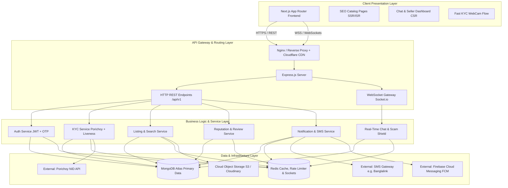
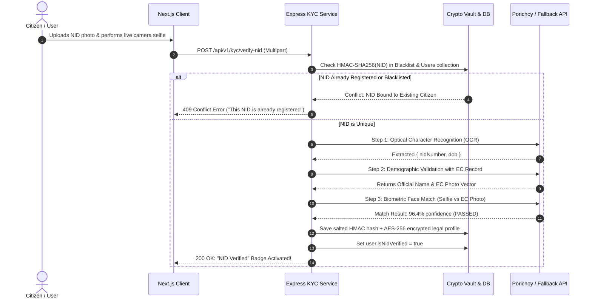
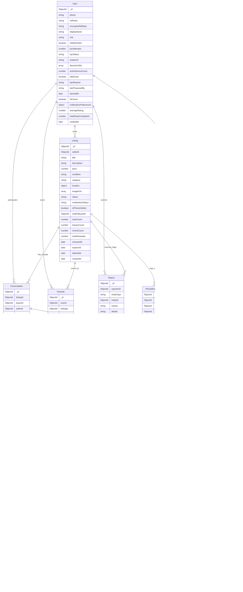

# System Architecture Document: Becha-Kena

**Architecture Paradigm:** Layered Monolith (Modular Monolith)  
**Frontend Framework:** Next.js (App Router, React 19, TypeScript)  
**Backend Framework:** Express.js (Node.js, TypeScript)  
**Primary Database:** MongoDB Atlas (Mongoose ODM)  
**Cache & Message Broker:** Redis (Upstash / Redis Cloud)  
**Document Version:** 1.0  
**Target File:** `architecture.md`  

---

## 1. High-Level Architecture Overview

Becha-Kena follows a clean **Layered Monolith Architecture**. While the entire backend lives in a single, cohesive codebase for rapid iteration and operational simplicity, internal concerns are strictly separated into isolated horizontal layers (Controller $\rightarrow$ Service $\rightarrow$ Repository/Model $\rightarrow$ Infrastructure).



---

## 2. Recommended Technology Strategy & Service Approaches

### 2.1 Authentication & Session Strategy
* **Recommendation: Dual-Token Architecture with Stateless Access & Stateful Refresh in HTTP-Only Cookies.**
  * **Access Token:** Short-lived JWT (15-minute expiry) carrying minimal payload (`userId`, `role`, `isNidVerified`, `deviceId`). Verified statelessly on incoming API requests without hitting the database.
  * **Refresh Token:** Long-lived opaque token (30-day expiry) stored in a secure, strict, `HTTP-Only` cookie. Stored in Redis with device fingerprinting and token family rotation (detects token reuse and revokes compromised sessions).
  * **Phone-First OTP:** Authentication begins via phone number + SMS OTP (6 digits, 120-second TTL in Redis).

### 2.2 Verification API Architecture & Provider Options (E-KYC)

Identity verification is the foundational trust moat of Becha-Kena. The system employs an **Adapter-Based Pluggable Verification Architecture** allowing dynamic failover between multiple Bangladesh e-KYC providers and a local mock sandbox for cost-free testing.

#### 2.2.1 Provider Options Comparison Matrix (Bangladesh Market)
| Feature / Attribute | Option 1: Porichoy API (Recommended Primary) | Option 2: Shadhin / TigerIT E-KYC (Secondary Fallback) | Option 3: Local Sandbox / Mock Provider (Development/Testing) |
| :--- | :--- | :--- | :--- |
| **Data Authority** | Official Bangladesh Election Commission (EC) Gateway | Commercial E-KYC aggregator (EC linked) | In-memory simulated database with fixtures |
| **Supported Credentials** | 10-digit Smart Card & 13/17-digit classic NID | 10-digit Smart Card & 13/17-digit classic NID | Any mock NID matching test regex |
| **Available Endpoints** | • OCR (`/api/v1/ocr/nid`)<br>• Demographic check (`/api/v1/verification/nid`)<br>• Face Match (`/api/v1/verification/face-match`) | • All-in-one e-KYC SDK<br>• Passive Liveness + Face Match<br>• OCR extraction | • Mock verify<br>• Mock face match (configurable score)<br>• Instant pass/fail toggle |
| **Typical Cost** | ~10 - 20 BDT per query | ~15 - 25 BDT per query | 0 BDT (Completely Free) |
| **Response Time** | 1.5s – 3.5s | 2.0s – 4.0s | $< 50\text{ ms}$ |
| **Best Used For** | **Production Primary Gateway** | **Automatic Circuit Breaker Fallback** | **Local Dev, Unit Tests, CI/CD Pipeline** |

#### 2.2.2 Pluggable Adapter Pattern (`IKYCProvider`)
To avoid vendor lock-in and prevent system outages when government gateways experience routine maintenance, the Express backend implements a unified interface:

```typescript
// src/modules/kyc/interfaces/kyc-provider.interface.ts
export interface NidDemographics {
  nidNumber: string;
  fullNameBangla: string;
  fullNameEnglish: string;
  dob: string;
  photoUrl?: string;
}

export interface FaceMatchResult {
  isMatch: boolean;
  confidenceScore: number; // 0 to 100%
  livenessPassed: boolean;
}

export interface IKYCProvider {
  extractOcr(frontImage: Buffer, backImage: Buffer): Promise<{ nidNumber: string; dob: string }>;
  verifyDemographics(nidNumber: string, dob: string): Promise<NidDemographics>;
  matchFace(ecPhotoBase64: string, liveSelfieBase64: string): Promise<FaceMatchResult>;
}
```

* **Provider Factory (`KYCProviderFactory`):**
  - Reads `process.env.KYC_PROVIDER` (`porichoy` | `shadhin` | `mock`).
  - If Porichoy returns consecutive HTTP 502/504 errors, the factory automatically routes requests to the secondary fallback provider or queues them for manual review without crashing the application.

#### 2.2.3 End-to-End Verification Pipeline


#### 2.2.4 Cost Optimization & Abuse Prevention Strategy
1. **Frontend Pre-Validation:** Client validates NID format and image dimensions *before* firing the API, preventing accidental billable calls on invalid data.
2. **Hash-Based Duplicate Check First:** The backend checks the `HMAC-SHA256` NID hash against MongoDB *before* calling Porichoy. If the NID is already used or blacklisted, the request fails instantly at **zero API cost**.
3. **Session Caching:** Once demographic data is retrieved from Porichoy, it is cached in Redis for 15 minutes. If the live selfie fails and the user retakes their photo, the platform only re-bills the cheaper Face-Match endpoint rather than repeating the full demographic query.
4. **Retry Limit:** Strictly throttled to a maximum of **3 automated attempts per account**. After 3 failures, the request escalates to the human admin moderation queue.


### 2.3 Search & Discovery Engine (MongoDB Atlas Search & Bilingual NLP)
* **Recommendation: MongoDB Atlas Search (Built-in Lucene Engine) with Bilingual Tokenization.**
  * **Why not a separate Elasticsearch / Meilisearch cluster for MVP?**
    - MongoDB Atlas provides native Apache Lucene full-text indexing directly within the database cluster.
    - Zero synchronization overhead: updates to listings (price change, status change to `Sold`) are indexed instantly without complex ETL pipelines or Kafka/RabbitMQ syncing.
    - Supports autocomplete, typo tolerance (fuzzy matching in English/Bengali transliteration), and compound geo-filtering (`$geoWithin` by Division/Thana).
  * **Bilingual Bangla & English Transliteration Support:**
    - Custom Atlas Search Analyzer config combines the standard Lucene tokenizer with a curated synonym dictionary mapping common tech terms between English and Bengali script (e.g., `["iphone", "apple phone"]`, `["laptop", "notebook"]`, `["watch", "smartwatch"]`).
    - Bengali edge n-gram filter enables instant prefix-based suggestion matching as users type in phonetic Bangla (Avro-style) or pure Bengali Unicode.

### 2.4 Real-Time Chat & Scam Shield Service
* **Approach:**
  * **Engine:** `Socket.io` attached to the Express HTTP server, backed by the **Redis Adapter** for seamless multi-core scaling.
  * **WebSocket Handshake Authentication & Room Topology:**
    - Socket connections authenticate during the handshake phase by parsing and verifying the signed HTTP-Only session JWT. Unverified/banned sockets are rejected before room ingress.
    - **Room Naming Conventions:**
      - Conversation Threads: `chat:conv_{conversationId}` (only the verified buyer and seller sockets are authorized to join).
      - User Personal Event Channel: `user:events_{userId}` (delivers live badge counts, deal alerts, and price drops).
  * **In-Flight Scam Moderation Pipeline:**
    - Before saving a message or broadcasting to the socket room, the message passes through an **Advance Scam Regex Filter** (`advance`, `bKash`, `courier fee`, `booking fee`).
    - If triggered, the message is delivered accompanied by an automated red warning banner.
    - External hyperlinks (`http://`, `https://`, `.apk`) are stripped to prevent phishing courier link attacks.

### 2.5 Phone Number Privacy & Scraping Defense
* **Approach:**
  * Seller phone numbers are **never embedded in the initial HTML or public listing payload**.
  * When an NID-verified buyer clicks **"Call Seller"**, an explicit API request is dispatched: `POST /api/v1/listings/:id/reveal-phone`.
  * **Redis Sliding-Window Rate Limiter:** Enforces max 10 reveals per 24 hours per verified user ID.
  * Audit logging automatically records `{buyerId, sellerId, listingId, ip, timestamp}` into MongoDB collection `PhoneRevealAudit`.

### 2.6 Background Jobs, Notification Debounce & Content Safety (BullMQ + Redis)
* **Approach:**
  * Asynchronous tasks (sending SMS OTPs, FCM push notifications, expiring 30-day ads, generating audit exports) are offloaded to **BullMQ** running on Redis.
  * **Price Drop Alert Debouncing:** When a seller edits their price downward, a BullMQ delayed job is enqueued with a **5-minute delay** (`jobId = price_drop:${listingId}`). Successive edits within the 5-minute window overwrite the delayed payload, ensuring favorited buyers receive only 1 debounced notification with the final discounted price.
  * **Offer Auto-Expiry Cron:** A recurring BullMQ cron runs every 5 minutes to sweep `pending` offers older than 24 hours, atomically transitioning them to `expired` and alerting buyers.
  * **Automated Image Moderation Pipeline:** Presigned S3 uploads fire an asynchronous image screening job. If nudity, violent symbols, or blacklisted scam watermarks are detected, the listing is quarantined (`moderationStatus = 'flagged'`) and alerted to the seller for replacement.

### 2.7 Trust & Safety Admin Hierarchy & Dual-Approval Workflow
* **Role Hierarchy:**
  - `citizen`: Default verified peer-to-peer user.
  - `moderator`: T&S reviewer with access to manual KYC queue, user reports, and dispute docs.
  - `super_admin`: Full system access, KMS legal log decryption, instant account termination.
* **Dual-Approval Ban Enforcement:**
  - Permanent citizen blacklisting requires 2-party signoff: a `moderator` initiates a ban proposal (`BAN_PROPOSED` with attached evidence notes), and a `super_admin` or secondary senior reviewer confirms (`BAN_CONFIRMED`), guaranteeing no single disgruntled moderator can maliciously revoke citizen NID access.

---

## 3. Layered Monolith Architecture Breakdown

```
src/
├── app.ts                  # Express application setup & middleware stack
├── server.ts               # HTTP & WebSocket server bootstrap
├── config/                 # Environment variables, database, redis, external API keys
├── common/                 # Global utilities, custom error classes, response wrappers
│   ├── errors/             # AppError, BadRequestError, UnauthorizedError, NotFoundError
│   ├── middlewares/        # authMiddleware, requireRole, rateLimiter, errorHandler, validateRequest
│   └── utils/              # cryptoHelper (AES-256/HMAC), logger (Pino/Winston)
├── modules/                # Feature-oriented modular vertical slices
│   ├── auth/               # OTP generation, login, refresh, logout, device binding
│   ├── user/               # Profile, verified trust badge, settings, notification preferences
│   ├── kyc/                # Porichoy integration, liveness check, NID blacklist, manual SLA queue
│   ├── listing/            # Ad lifecycle (Draft, Active, Sold), renewal limits, Atlas search
│   ├── chat/               # Conversations, messages, scam regex shield, socket handlers
│   ├── deal/               # Offer management, counter-offers, deal closure, bilateral star rating
│   ├── report/             # Community flagging of listings, chats, and abusive users
│   ├── dispute/            # Post-deal stolen gadget claims, police GD attachment, seller freeze
│   └── admin/              # Manual KYC review desk, dual-approval bans, audit exports
└── jobs/                   # Background queues (BullMQ: Ad expiry, offer expiry, debounce alerts, SMS, FCM)
```

### Layer Responsibilities & Rules
1. **Controller Layer (`*.controller.ts`):** 
   - Handles HTTP/Socket requests and responses.
   - Extracts parameters, queries, and headers.
   - Strictly delegates business logic to the corresponding Service layer.
2. **Service Layer (`*.service.ts`):**
   - Implements all core business rules, validation, security checks, and third-party API calls.
   - Orchestrates multi-step processes (e.g., verifying NID, creating citizen profile, and sending notification).
   - Manages database transaction boundaries (`session.withTransaction`).
3. **Repository / Data Access Layer (`*.model.ts` / `*.repository.ts`):**
   - Interacts directly with MongoDB using Mongoose.
   - Houses schema definitions, indexes, schema hooks, and compound query builders.
4. **Infrastructure Layer (`*.client.ts` / `*.adapter.ts`):**
   - Encapsulates third-party integrations: `PorichoyClient`, `SmsGatewayClient`, `FcmClient`, `S3Uploader`.

---

## 4. Database Schema Design (MongoDB Atlas)



### 4.1 Key Collections & Optimization Indexes
1. **`users` Collection:**
   - Unique Sparse Index: `{ phone: 1 }`, `{ nidHash: 1 }` (ensures 1 NID = 1 account).
   - Index: `{ isNidVerified: 1, role: 1 }`, `{ isBanned: 1 }`, `{ isFrozen: 1 }`.
2. **`listings` Collection:**
   - Compound Indexes: `{ status: 1, category: 1, createdAt: -1 }`.
   - Geo-Spatial Index: `{ "location.coordinates": "2dsphere" }`.
   - Atlas Search Index: Full-text indexing on `{ title: "text", description: "text" }` with bilingual synonym analyzer.
   - Index: `{ expiresAt: 1 }` for 30-day lifecycle expiry monitoring.
   - Index: `{ sellerId: 1, status: 1 }`.
3. **`conversations` Collection:**
   - **Unique Compound Index: `{ listingId: 1, buyerId: 1, sellerId: 1 }`** — enforces 1 thread per buyer-seller-listing trio. New chat requests use `findOneAndUpdate` with `upsert: true`.
   - Index on Messages: `{ conversationId: 1, createdAt: -1 }`.
4. **`offers` Collection:**
   - Compound Index: `{ conversationId: 1, status: 1 }`.
   - Index: `{ listingId: 1, buyerId: 1 }` (enforces max 3 offers rule).
   - Index: `{ expiresAt: 1 }` for BullMQ 24h offer expiry worker queries.
5. **`deals` Collection:**
   - Unique Index: `{ listingId: 1 }` (only 1 deal per listing).
   - Index: `{ sellerId: 1, buyerId: 1, completedAt: -1 }`.
   - Index: `{ disputeStatus: 1 }`.
6. **`reports` Collection:**
   - Compound Index: `{ entityType: 1, entityId: 1, status: 1 }`.
   - Index: `{ reporterId: 1, createdAt: -1 }`.
7. **`disputes` Collection:**
   - Unique Index: `{ dealId: 1 }` (one dispute per closed deal).
   - Index: `{ status: 1, createdAt: -1 }`.
8. **`favorites` Collection:**
   - Unique Compound Index: `{ userId: 1, listingId: 1 }` (1 save per user per listing).
   - Index: `{ listingId: 1 }` (for price-drop fan-out queries).
9. **`nid_blacklists` Collection:**
   - Unique Index: `{ nidHash: 1 }`, `{ phone: 1 }`.

---

## 5. API Surface & Contract Overview

All endpoints follow RESTful conventions under the prefix `/api/v1`.

### 5.1 Authentication & Profile Endpoints
* `POST /api/v1/auth/request-otp` – Request 6-digit SMS OTP.
* `POST /api/v1/auth/verify-otp` – Verify OTP, issue JWT access token & HTTP-only refresh cookie.
* `POST /api/v1/auth/refresh-token` – Rotate refresh token and issue new access token.
* `POST /api/v1/auth/logout` – Invalidate active session in Redis.
* `GET /api/v1/users/me` – Fetch current user profile with verified badge status.
* `PATCH /api/v1/users/me/notification-preferences` – Toggle push/SMS preferences for chats, price drops, and marketing.

### 5.2 Identity Verification (Fast KYC) Endpoints
* `POST /api/v1/kyc/ocr` – Extract NID number, date of birth, and name from uploaded front/back NID card images.
* `POST /api/v1/kyc/verify-demographics` – Validate NID number + DOB against Porichoy/Election Commission database.
* `POST /api/v1/kyc/face-match` – Biometric face comparison (live camera selfie vs official EC record photo).
* `POST /api/v1/kyc/verify-nid` – Complete composite pipeline: Uploads NID images + selfie frames in a single multipart transaction.
* `GET /api/v1/kyc/status` – Query current citizen KYC status (`unverified`, `pending`, `verified`, `retake_required`, `manual_review`).
* `POST /api/v1/kyc/rebind-phone` – Lost SIM recovery: Rebinds verified citizen account to a new mobile number via NID + biometric face match.
* `POST /api/v1/kyc/verify-new-device` – "New Phone, Same SIM" device authorization via fast selfie liveness challenge.

### 5.3 Listing & Discovery Endpoints
* `GET /api/v1/listings` – Public search with keyword, category, price range, and division/thana filters (Atlas Search).
* `GET /api/v1/listings/:id` – Fetch full listing details (publicly accessible).
* `POST /api/v1/listings/:id/reveal-phone` – Reveal seller phone number (`requireVerifiedCitizen`, rate-limited & audit-logged).
* `POST /api/v1/listings` – Create new listing (`requireVerifiedCitizen`, enforces max 5/mo quota & automated image safety check).
* `PUT /api/v1/listings/:id` – Edit listing (owner only).
* `DELETE /api/v1/listings/:id` – Soft-delete listing with `deletedAt` timestamp (owner only).
* `PATCH /api/v1/listings/:id/status` – Update ad state (`active`, `reserved`, `sold`).
* `POST /api/v1/listings/:id/renew` – Renew a Day-25/expired listing for 30 more days (max 2 renewals per ad).

### 5.4 Messaging & Negotiation Endpoints
> **Business Rule:** Chat initiation uses `upsert` — if a Conversation already exists for `(listingId, buyerId, sellerId)`, the existing thread is returned rather than creating a duplicate.
* `POST /api/v1/chats/start` – Initiate or retrieve existing conversation for a listing (`requireVerifiedCitizen`).
* `GET /api/v1/chats` – List all active user conversations.
* `GET /api/v1/chats/:conversationId/messages` – Fetch message history with pagination.
* `POST /api/v1/chats/:conversationId/offers` – Submit a standalone binding offer (`amount`, `expiresAt`) stored as an `Offer` document (enforces max 3 offers/buyer limit).
* `PATCH /api/v1/chats/:conversationId/offers/:offerId` – Accept or decline offer.
* `POST /api/v1/chats/:conversationId/offers/:offerId/counter` – Counter-offer: changes status to `countered` and issues new linked offer in the negotiation chain.

### 5.5 Deals & Reviews Endpoints
* `POST /api/v1/deals` – Seller closes deal via accepted offer: creates `Deal` document, marks listing `Sold` atomically.
* `POST /api/v1/deals/direct-sale` – Seller marks item sold by selecting a buyer from active inquiry chats without formal offer tool.
* `GET /api/v1/deals/:dealId` – Fetch deal details for both parties.
* `POST /api/v1/reviews` – Submit 1–5 star bilateral review, gated by `dealId` existence and `isReviewedBy*` flags.
* `GET /api/v1/users/:userId/reviews` – Fetch public trust profile reviews.

### 5.6 Community Reporting Endpoints (`requireVerifiedCitizen`)
* `POST /api/v1/reports` – Flag a listing, chat message, or user profile (`entityType`, `entityId`, `reason`, `details`). Auto-quarantines listings with $\ge 3$ verified flags.
* `GET /api/v1/reports/me` – View status of user-submitted flags.

### 5.7 Post-Deal Stolen Item Disputes (`requireVerifiedCitizen`)
* `POST /api/v1/deals/:dealId/disputes` – Buyer files legal dispute: attaches police GD number, thana, filing date, and GD document photo. Automatically freezes seller account.
* `GET /api/v1/deals/:dealId/dispute` – Fetch active dispute status for either deal participant.

### 5.8 Favorites / Wishlist Endpoints
* `POST /api/v1/listings/:id/favorite` – Save a listing to favorites (`requireVerifiedCitizen`). Upserts `Favorite` document.
* `DELETE /api/v1/listings/:id/favorite` – Remove listing from favorites.
* `GET /api/v1/users/me/favorites` – Fetch current user's saved listings with current price and availability status.

### 5.9 File Upload Endpoints
* `POST /api/v1/uploads/presign` – Request a time-limited AWS S3 / Cloudinary presigned upload URL for a given `fileType` and `context` (`listing_image` | `nid_front` | `nid_back` | `gd_document` | `avatar`). Direct client-to-storage upload prevents memory pressure.

### 5.10 Admin & Moderator Back-Office Endpoints (`requireRole(['moderator', 'super_admin'])`)
* `GET /api/v1/admin/kyc/queue` – Paginated list of KYC submissions in `manual_review` state with SLA aging markers (< 4 hours target).
* `PATCH /api/v1/admin/kyc/:userId/approve` – Approve manual KYC review; sets `isNidVerified: true`.
* `PATCH /api/v1/admin/kyc/:userId/reject` – Reject KYC with documented reason; increments `kycAttempts`.
* `GET /api/v1/admin/reports` – List reported chats, listings, and users pending moderation.
* `PATCH /api/v1/admin/reports/:reportId/action` – Resolve report with action (`dismiss`, `quarantine`, `warn`, `escalate`).
* `GET /api/v1/admin/disputes` – Queue of police GD legal claims.
* `PATCH /api/v1/admin/disputes/:disputeId/resolve` – Resolve dispute: unfreeze seller or escalate to law enforcement package.
* `POST /api/v1/admin/users/:userId/propose-ban` – Moderator initiates ban proposal (`BAN_PROPOSED`).
* `POST /api/v1/admin/users/:userId/confirm-ban` – Super Admin confirms dual-approval ban: sets `isBanned: true`, permanently blacklists NID hash and device UUIDs (`requireRole('super_admin')`).
* `GET /api/v1/admin/audit-logs` – Export encrypted audit log (MFA required; used for law enforcement GD/FIR compliance).

---

## 6. Frontend Architecture (Next.js App Router)

```
frontend/
├── app/
│   ├── (public)/                   # Open discovery route group (SEO-optimized)
│   │   ├── page.tsx                # Homepage feed with featured verified categories (ISR)
│   │   ├── search/page.tsx         # Search & filter catalog (SSR)
│   │   └── listing/[id]/page.tsx   # Product details page (SSR with dynamic OpenGraph tags)
│   ├── (auth)/                     # Auth & Onboarding route group
│   │   ├── login/page.tsx          # Phone OTP input & verification
│   │   └── kyc/page.tsx            # Camera stream & NID capture modal (CSR)
│   └── (dashboard)/                # Authenticated protected route group
│       ├── seller/page.tsx         # Seller ad management (Draft, Active, Sold)
│       ├── chat/page.tsx           # Real-time WebSocket chat interface
│       └── profile/page.tsx        # Unified profile & trust rating
├── components/
│   ├── ui/                         # Atomic design UI elements (Buttons, Badges, Modals)
│   ├── listing/                    # ListingCard, FilterSidebar, ConditionBadge
│   ├── chat/                       # ChatWindow, ScamWarningBanner, OfferBox
│   └── kyc/                        # LivenessCamera, NidScanner, VerificationStatus
└── lib/
    ├── api/                        # Typed fetch client with automatic token refresh
    ├── socket/                     # Socket.io client singleton
    └── store/                      # Client state management (Zustand)
```

### Rendering Strategy & Performance:
1. **Public Catalog & Details Pages (`(public)/*`):** Rendered using **Server-Side Rendering (SSR)** and **Incremental Static Regeneration (ISR)** for maximum Google/Bing SEO indexing and sub-300ms First Contentful Paint (FCP) across mobile devices in Bangladesh.
2. **Chat & Seller Dashboard (`(dashboard)/*`):** Rendered as **Client Components (CSR)** with optimistic UI updates and WebSockets for zero-latency messaging.
