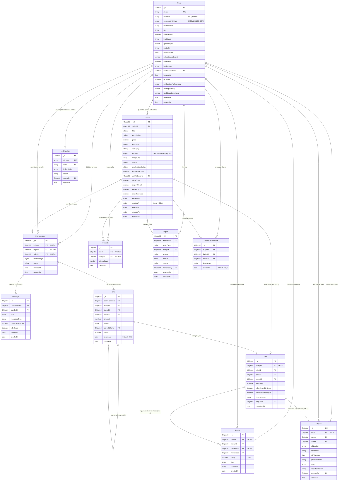

# Database Architecture & Data Modeling Specification: Becha-Kena

**Project Name:** Becha-Kena — NID-Verified C2C Resale Marketplace  
**Document Version:** 1.0  
**Target Specification File:** `database.md`  
**Database Engine:** MongoDB Atlas (v7.0+)  
**Cache & Queue Engine:** Redis (Upstash / Redis Cloud)  
**ODM:** Mongoose (v8.x) with TypeScript  
**Reference Documents:** `PRD.md` (v2.0), `architecture.md` (v1.0), `dfd.md` (v1.0)  

---

## 1. Collection List

Becha-Kena utilizes **12 persistent MongoDB Atlas collections** (mapped to Data Stores D1–D12 from `dfd.md`) and **1 ephemeral Redis cluster** (mapped to D13 for OTPs, sliding-window rate limits, and BullMQ background queues).

| # | Collection Name | Mongoose Model | DFD Store | Primary Key | Retention & Storage Policy | Core Responsibility |
|---|---|---|---|---|---|---|
| 1 | `users` | `User` | **D1** | `_id` (ObjectId) | Permanent (Soft-ban flag) | Citizen profiles, salted HMAC NID hashes, KMS-encrypted legal identity vault, trust scores, device UUIDs, and notification preferences. |
| 2 | `listings` | `Listing` | **D2** | `_id` (ObjectId) | 30-Day Lifecycle (Max 2 renewals, soft-deleted on archive/delete) | C2C second-hand ads, pricing, division/thana geo-coordinates, image moderation state, and lifecycle states. |
| 3 | `conversations` | `Conversation` | **D3** | `_id` (ObjectId) | Indefinite (Legal audit retention) | Unique 1-to-1 buyer-seller-listing chat thread pairs with last message preview. |
| 4 | `messages` | `Message` | **D4** | `_id` (ObjectId) | 180 Days cold storage on soft delete | Individual in-app chat payloads, Bengali advance payment scam regex warnings, and delivery flags. |
| 5 | `offers` | `Offer` | **D5** | `_id` (ObjectId) | Permanent negotiation audit (Status updated to 'expired' at 24h via BullMQ) | Formal monetary offers, counter-offer parent pointers, negotiation rounds (max 3/buyer), and offer statuses. |
| 6 | `deals` | `Deal` | **D6** | `_id` (ObjectId) | Permanent (Immutable financial closure) | Contract fulfillment records, agreed sale price, bilateral review eligibility flags, and dispute associations. |
| 7 | `reviews` | `Review` | **D7** | `_id` (ObjectId) | Permanent (Immutable after 48h) | Bilateral 1–5 star ratings, qualitative trust badges, and transaction feedback. |
| 8 | `favorites` | `Favorite` | **D8** | `_id` (ObjectId) | Dynamic (User lifecycle) | Wishlist bookmarks linking users to listings, capturing historical `priceAtSave` for price drop triggers. |
| 9 | `reports` | `Report` | **D9** | `_id` (ObjectId) | Permanent (Trust & Safety audit) | Community scam and harassment flags submitted against listings, messages, or users; triggers auto-quarantine. |
| 10 | `disputes` | `Dispute` | **D10** | `_id` (ObjectId) | Min 3 Years (Statutory Cybercrime SLA) | Post-deal stolen gadget claims, Bangladesh Police General Diary (GD) numbers, thana records, and evidence images. |
| 11 | `phone_reveal_audits` | `PhoneRevealAudit` | **D11** | `_id` (ObjectId) | 90-Day Rolling TTL | High-velocity click-and-call unmask logs capturing buyer/seller IDs, listing ID, and IP address for anti-scraping forensics. |
| 12 | `nid_blacklists` | `NidBlacklist` | **D12** | `_id` (ObjectId) | Permanent (Cryptographic blacklist) | Barred salted HMAC-SHA256 NID hashes, bar-associated phone numbers, and hardware device UUIDs. |

---

## 2. Detailed Schema Definitions

### 2.1 Collection: `users` (Store D1)
Stores all citizen accounts. Separates public profile data from zero-knowledge biometric and legal identity details.

| Field Name | Type | Required | Default | Constraints & Rules | Description |
|---|---|:---:|---|---|---|
| `_id` | `ObjectId` | Yes | Auto | Unique MongoDB ID | Internal system identifier |
| `phone` | `String` | Yes | — | Regex: `/^(?:\+8801\|01)[3-9]\d{8}$/`, Unique | Bangladeshi mobile number (Primary auth key) |
| `nidHash` | `String` | No | `null` | Index (Sparse), 64-char hex | Salted HMAC-SHA256 hash of NID number for collision check |
| `encryptedNidData` | `Object` | No | `null` | Envelope KMS AES-256-GCM | Encrypted legal vault containing real name, DOB, and EC photo vector |
| `displayName` | `String` | Yes | — | Min 3, Max 50 chars, trimmed | Public citizen name displayed on marketplace |
| `role` | `String` | Yes | `'citizen'` | Enum: `['citizen', 'moderator', 'super_admin']` | Authorization role |
| `isNidVerified` | `Boolean` | Yes | `false` | Index | Flag unlocking seller publishing and phone reveal |
| `kycStatus` | `String` | Yes | `'unverified'` | Enum: `['unverified', 'pending', 'verified', 'retake_required', 'manual_review']` | Identity lifecycle state |
| `kycAttempts` | `Number` | Yes | `0` | Max: 3 per 24 hours | Rate limiter against brute-force Porichoy queries |
| `avatarUrl` | `String` | No | `null` | Valid URI | S3 / Cloudinary public avatar URL |
| `deviceUUIDs` | `[String]` | Yes | `[]` | Array of hardware UUIDs | Bound device footprints for "New SIM, New Phone" challenge |
| `activeDeviceCount`| `Number` | Yes | `1` | Max: 2 active devices | Concurrent active login threshold |
| `isBanned` | `Boolean` | Yes | `false` | Index | Termination status (Dual-approval required) |
| `banReason` | `String` | No | `null` | String | Justification recorded for termination |
| `banProposedBy` | `ObjectId` | No | `null` | Ref: `User` (Moderator role) | Moderator ID proposing account ban |
| `bannedAt` | `Date` | No | `null` | Timestamp | Timestamp when ban was finalized by Super Admin |
| `isFrozen` | `Boolean` | Yes | `false` | Index | Temporary privilege freeze during active police dispute |
| `notificationPreferences` | `Object` | Yes | Defined below | Nested Object | Citizen delivery preferences and quiet hour settings |
| `notificationPreferences.pushEnabled` | `Boolean` | Yes | `true` | — | Enable Firebase Cloud Messaging push |
| `notificationPreferences.smsEnabled` | `Boolean` | Yes | `true` | — | Enable Telco SMS fallback |
| `notificationPreferences.priceDropAlerts`| `Boolean` | Yes | `true` | — | Receive notifications when favorited ad price drops |
| `notificationPreferences.quietHoursStart`| `String` | No | `'23:00'` | 24-hr time format `HH:mm` | Start of muted notification window |
| `notificationPreferences.quietHoursEnd` | `String` | No | `'07:00'` | 24-hr time format `HH:mm` | End of muted notification window |
| `averageRating` | `Number` | Yes | `0.0` | Min 0.0, Max 5.0, Float | Rolling weighted average star rating |
| `totalDealsCompleted` | `Number`| Yes | `0` | Non-negative integer | Total peer-to-peer verified transactions closed |
| `createdAt` | `Date` | Yes | Auto | Timestamp | Account registration timestamp |
| `updatedAt` | `Date` | Yes | Auto | Timestamp | Profile last update timestamp |

---

### 2.2 Collection: `listings` (Store D2)
Manages C2C marketplace listings, media references, and auto-expiry logic.

| Field Name | Type | Required | Default | Constraints & Rules | Description |
|---|---|:---:|---|---|---|
| `_id` | `ObjectId` | Yes | Auto | Unique MongoDB ID | Internal listing identifier |
| `sellerId` | `ObjectId` | Yes | — | Ref: `User`, Index | ID of the verified citizen seller |
| `title` | `String` | Yes | — | Min 10, Max 100 chars, trimmed | Listing headline (Indexed for Atlas bilingual search) |
| `description` | `String` | Yes | — | Min 20, Max 2000 chars | Full item condition description and terms |
| `price` | `Number` | Yes | — | Min: 50, Max: 2,500,000 BDT | Asking price in Bangladeshi Taka |
| `condition` | `String` | Yes | — | Enum: `['brand_new', 'like_new', 'gently_used', 'heavily_used']`| Physical grade of item |
| `category` | `String` | Yes | — | Enum: `['electronics', 'vehicles', 'property', 'fashion', 'home', 'hobbies']` | Category taxonomy |
| `location` | `Object` | Yes | — | GeoJSON Point | Geographical coordinates and administrative hierarchy |
| `location.type` | `String` | Yes | `'Point'` | Enum: `['Point']` | GeoJSON coordinate type |
| `location.coordinates`| `[Number]`| Yes | — | `[longitude, latitude]` | 2dsphere index coordinate pair |
| `location.division`| `String` | Yes | — | Enum of 8 BD Divisions | e.g., `'Dhaka'`, `'Chittagong'` |
| `location.thana` | `String` | Yes | — | Valid Bangladesh Thana | e.g., `'Dhanmondi'`, `'Mirpur'` |
| `imageUrls` | `[String]` | Yes | — | Min 1, Max 8 URLs | Direct S3 / Cloudinary media tokens |
| `status` | `String` | Yes | `'active'` | Enum: `['draft', 'active', 'under_offer', 'sold', 'expired', 'archived', 'under_review']` | Operational listing state |
| `moderationStatus` | `String` | Yes | `'pending'` | Enum: `['pending', 'approved', 'flagged', 'rejected']` | Automated NSFW and scam watermark check status |
| `isPhoneHidden` | `Boolean` | Yes | `true` | Default hidden | Protects seller phone behind the click-and-call reveal gate |
| `soldToBuyerId` | `ObjectId` | No | `null` | Ref: `User` | Buyer ID when marked sold |
| `viewCount` | `Number` | Yes | `0` | Non-negative integer | Unique view count accumulator |
| `inquiryCount` | `Number` | Yes | `0` | Non-negative integer | Total conversation threads opened |
| `renewCount` | `Number` | Yes | `0` | Max: 2 renewals | Total lifecycle renewals applied |
| `maxRenewals` | `Number` | Yes | `2` | Static limit | Cap enforcing maximum 90-day total lifespan |
| `renewedAt` | `Date` | No | `null` | Timestamp | Last renewal execution date |
| `expiresAt` | `Date` | Yes | +30 days | Index (30-day lifecycle) | Expiration timestamp (30 days from publish/renew; monitored by BullMQ/cron) |
| `deletedAt` | `Date` | No | `null` | Index | Soft deletion timestamp |
| `createdAt` | `Date` | Yes | Auto | Timestamp | Listing creation date |
| `updatedAt` | `Date` | Yes | Auto | Timestamp | Last modification date |

---

### 2.3 Collection: `conversations` (Store D3)
Enforces a 1-to-1 communication channel between a buyer, a seller, and a specific listing.

| Field Name | Type | Required | Default | Constraints & Rules | Description |
|---|---|:---:|---|---|---|
| `_id` | `ObjectId` | Yes | Auto | Unique MongoDB ID | Internal conversation identifier |
| `listingId` | `ObjectId` | Yes | — | Ref: `Listing` | Associated listing |
| `buyerId` | `ObjectId` | Yes | — | Ref: `User` | Initiating citizen buyer |
| `sellerId` | `ObjectId` | Yes | — | Ref: `User` | Listing owner |
| `lastMessage` | `Object` | No | `null` | Embedded object | Fast preview cache for chat inbox list |
| `lastMessage.text` | `String` | Yes | — | String preview | Truncated message text |
| `lastMessage.senderId`| `ObjectId`| Yes | — | Ref: `User` | Last sender |
| `lastMessage.createdAt`| `Date` | Yes | — | Timestamp | Timestamp of last message |
| `status` | `String` | Yes | `'active'` | Enum: `['active', 'blocked', 'archived']` | Thread state |
| `createdAt` | `Date` | Yes | Auto | Timestamp | Thread creation date |
| `updatedAt` | `Date` | Yes | Auto | Index | Last activity date |

---

### 2.4 Collection: `messages` (Store D4)
Maintains atomic chat log payloads, soft-delete states, and automated scam warnings.

| Field Name | Type | Required | Default | Constraints & Rules | Description |
|---|---|:---:|---|---|---|
| `_id` | `ObjectId` | Yes | Auto | Unique MongoDB ID | Message identifier |
| `conversationId` | `ObjectId` | Yes | — | Ref: `Conversation`, Index | Parent thread |
| `senderId` | `ObjectId` | Yes | — | Ref: `User` | Author citizen ID |
| `text` | `String` | Yes | — | Max 1000 chars, stripped of URLs | Sanitized chat payload |
| `messageType` | `String` | Yes | `'text'` | Enum: `['text', 'image', 'system', 'offer_event']` | Message archetype |
| `hasScamWarning` | `Boolean` | Yes | `false` | Index | True if Bengali regex detected advance payment words |
| `isDeleted` | `Boolean` | Yes | `false` | Soft-delete flag | User-hidden status |
| `deletedAt` | `Date` | No | `null` | Timestamp | Deletion date |
| `createdAt` | `Date` | Yes | Auto | Index | Timestamp when received |

---

### 2.5 Collection: `offers` (Store D5)
Tracks binding formal price bids, counter-offer parent pointers, and automated 24-hr expirations.

| Field Name | Type | Required | Default | Constraints & Rules | Description |
|---|---|:---:|---|---|---|
| `_id` | `ObjectId` | Yes | Auto | Unique MongoDB ID | Offer identifier |
| `conversationId` | `ObjectId` | Yes | — | Ref: `Conversation`, Index | Chat thread context |
| `listingId` | `ObjectId` | Yes | — | Ref: `Listing`, Index | Targeted listing |
| `buyerId` | `ObjectId` | Yes | — | Ref: `User` | Bidding buyer |
| `sellerId` | `ObjectId` | Yes | — | Ref: `User` | Listing seller |
| `amount` | `Number` | Yes | — | Min: 50 BDT, Positive | Proposed binding purchase amount |
| `status` | `String` | Yes | `'pending'` | Enum: `['pending', 'accepted', 'countered', 'declined', 'expired']` | Offer state |
| `parentOfferId` | `ObjectId` | No | `null` | Ref: `Offer` | Links counter-offer to previous round |
| `round` | `Number` | Yes | `1` | Max: 3 per buyer | Current negotiation counter iteration |
| `expiresAt` | `Date` | Yes | +24 hours | TTL Index | Expiration deadline (Auto-expired via BullMQ) |
| `createdAt` | `Date` | Yes | Auto | Timestamp | Offer creation date |

---

### 2.6 Collection: `deals` (Store D6)
Immutable transaction registry. Forms the legal basis for bilateral reviews and dispute escalations.

| Field Name | Type | Required | Default | Constraints & Rules | Description |
|---|---|:---:|---|---|---|
| `_id` | `ObjectId` | Yes | Auto | Unique MongoDB ID | Deal identifier |
| `listingId` | `ObjectId` | Yes | — | Ref: `Listing`, Unique | Closed listing (1 deal per listing) |
| `offerId` | `ObjectId` | No | `null` | Ref: `Offer` | Accepted offer ID (null if direct sale) |
| `sellerId` | `ObjectId` | Yes | — | Ref: `User`, Index | Seller citizen ID |
| `buyerId` | `ObjectId` | Yes | — | Ref: `User`, Index | Buyer citizen ID |
| `finalPrice` | `Number` | Yes | — | Positive Number | Final agreed transaction price in BDT |
| `isReviewedBySeller`| `Boolean`| Yes | `false` | — | Seller bilateral review completion flag |
| `isReviewedByBuyer` | `Boolean`| Yes | `false` | — | Buyer bilateral review completion flag |
| `disputeStatus` | `String` | Yes | `'none'` | Enum: `['none', 'filed', 'under_review', 'resolved']` | Stolen item / dispute escalation state |
| `disputeId` | `ObjectId` | No | `null` | Ref: `Dispute` | Foreign key linking dispute document |
| `completedAt` | `Date` | Yes | Auto | Timestamp | Date and time deal was executed |

---

### 2.7 Collection: `reviews` (Store D7)
Bilateral star ratings and trust badges submitted between transacting parties.

| Field Name | Type | Required | Default | Constraints & Rules | Description |
|---|---|:---:|---|---|---|
| `_id` | `ObjectId` | Yes | Auto | Unique MongoDB ID | Review identifier |
| `dealId` | `ObjectId` | Yes | — | Ref: `Deal` | Associated transaction |
| `listingId` | `ObjectId` | Yes | — | Ref: `Listing` | Associated listing item |
| `reviewerId` | `ObjectId` | Yes | — | Ref: `User` | Author citizen |
| `revieweeId` | `ObjectId` | Yes | — | Ref: `User`, Index | Rated citizen |
| `rating` | `Number` | Yes | — | Integer: 1 to 5 | Star rating score |
| `tags` | `[String]` | Yes | `[]` | Enum: `['punctual', 'item_as_described', 'friendly_communication', 'quick_payment']` | Trust badges |
| `comment` | `String` | No | `null` | Max 300 chars | Optional text feedback |
| `createdAt` | `Date` | Yes | Auto | Timestamp | Submission date (Locked after 48h) |

---

### 2.8 Collection: `favorites` (Store D8)
Wishlist entries tracking items of interest with historical pricing benchmark.

| Field Name | Type | Required | Default | Constraints & Rules | Description |
|---|---|:---:|---|---|---|
| `_id` | `ObjectId` | Yes | Auto | Unique MongoDB ID | Bookmark identifier |
| `userId` | `ObjectId` | Yes | — | Ref: `User` | Saving citizen |
| `listingId` | `ObjectId` | Yes | — | Ref: `Listing`, Index | Saved ad |
| `priceAtSave` | `Number` | Yes | — | Positive Number | Asking price at moment of saving (benchmark) |
| `createdAt` | `Date` | Yes | Auto | Timestamp | Bookmark creation date |

---

### 2.9 Collection: `reports` (Store D9)
Community moderation queue entries against listings, chat messages, or citizen accounts.

| Field Name | Type | Required | Default | Constraints & Rules | Description |
|---|---|:---:|---|---|---|
| `_id` | `ObjectId` | Yes | Auto | Unique MongoDB ID | Report identifier |
| `reporterId` | `ObjectId` | Yes | — | Ref: `User`, Index | Reporting citizen |
| `entityType` | `String` | Yes | — | Enum: `['listing', 'chat', 'user']` | Target classification |
| `entityId` | `ObjectId` | Yes | — | Index | Target document ID |
| `reason` | `String` | Yes | — | Enum: `['scam_advance_demanded', 'stolen_goods_suspected', 'harassment', 'counterfeit', 'spam']` | Flag reason category |
| `details` | `String` | Yes | — | Max 500 chars | Additional narrative text |
| `status` | `String` | Yes | `'pending'` | Enum: `['pending', 'investigating', 'actioned', 'dismissed']` | Moderator review state |
| `reviewedBy` | `ObjectId` | No | `null` | Ref: `User` (Moderator role) | Operator who triaged the report |
| `resolvedAt` | `Date` | No | `null` | Timestamp | Resolution timestamp |
| `createdAt` | `Date` | Yes | Auto | Timestamp | Incident log timestamp |

---

### 2.10 Collection: `disputes` (Store D10)
Preserves legal dispute claims, official Bangladesh Police General Diary (GD) records, and evidence links.

| Field Name | Type | Required | Default | Constraints & Rules | Description |
|---|---|:---:|---|---|---|
| `_id` | `ObjectId` | Yes | Auto | Unique MongoDB ID | Dispute identifier |
| `dealId` | `ObjectId` | Yes | — | Ref: `Deal`, Unique | Contested transaction |
| `buyerId` | `ObjectId` | Yes | — | Ref: `User` | Claiming buyer |
| `sellerId` | `ObjectId` | Yes | — | Ref: `User`, Index | Accused seller |
| `gdNumber` | `String` | Yes | — | String (Official GD Ref) | Bangladesh Police General Diary number |
| `thanaName` | `String` | Yes | — | Valid Bangladesh Thana | Police station where GD was recorded |
| `gdFilingDate` | `Date` | Yes | — | Past or Present Date | Official GD submission date |
| `gdDocumentUrl` | `String` | Yes | — | Valid S3 URL | Scanned GD image or official seal copy |
| `status` | `String` | Yes | `'pending'` | Enum: `['pending', 'verified', 'rejected', 'escalated_to_police']` | Verification status |
| `resolutionAction`| `String`| No | `null` | Enum: `['seller_banned', 'claim_dismissed', 'legal_hold']` | Outcome |
| `resolvedBy` | `ObjectId` | No | `null` | Ref: `User` (Admin role) | Admin performing the verification |
| `createdAt` | `Date` | Yes | Auto | Timestamp | Submission date |

---

### 2.11 Collection: `phone_reveal_audits` (Store D11)
High-velocity immutable access logs for click-and-call phone unmasks.

| Field Name | Type | Required | Default | Constraints & Rules | Description |
|---|---|:---:|---|---|---|
| `_id` | `ObjectId` | Yes | Auto | Unique MongoDB ID | Audit identifier |
| `buyerId` | `ObjectId` | Yes | — | Ref: `User`, Index | Citizen who unmasked the number |
| `listingId` | `ObjectId` | Yes | — | Ref: `Listing` | Listing whose contact was requested |
| `sellerId` | `ObjectId` | Yes | — | Ref: `User` | Seller owning the phone number |
| `ipAddress` | `String` | Yes | — | IPv4 / IPv6 format | Originating client network address |
| `createdAt` | `Date` | Yes | Auto | TTL Index (90 days) | Execution timestamp |

---

### 2.12 Collection: `nid_blacklists` (Store D12)
Cryptographic registry storing permanently banned NID hashes, phone numbers, and hardware footprints.

| Field Name | Type | Required | Default | Constraints & Rules | Description |
|---|---|:---:|---|---|---|
| `_id` | `ObjectId` | Yes | Auto | Unique MongoDB ID | Blacklist entry identifier |
| `nidHash` | `String` | Yes | — | Unique, 64-char hex | Salted HMAC-SHA256 hash of banned citizen NID |
| `phone` | `String` | Yes | — | Unique, BD Phone Regex | Mobile number associated with banned account |
| `deviceUUID` | `String` | No | `null` | Hardware identifier | Banned device UUID |
| `reason` | `String` | Yes | — | Max 200 chars | Reason for termination (e.g., `'confirmed_scam'`) |
| `bannedBy` | `ObjectId` | Yes | — | Ref: `User` (Super Admin) | Authorized Super Admin confirming ban |
| `createdAt` | `Date` | Yes | Auto | Timestamp | Registry insertion date |

---

## 3. Relationships & Cardinality

### 3.1 Relationship Matrix
The relational structure follows a normalized document pattern with strategic denormalization for read performance:

| Parent Entity | Child Entity | Cardinality | Reference Field in Child | Cascade / Deletion Behavior |
|---|---|:---:|---|---|
| `User` (Seller) | `Listing` | 1 : N | `Listing.sellerId` | Soft-deleted (`deletedAt = now()`); archived on seller ban |
| `User` (Buyer/Seller) | `Conversation` | 1 : N | `Conversation.buyerId`, `sellerId` | Retained indefinitely for legal audit |
| `Conversation` | `Message` | 1 : N | `Message.conversationId` | Retained for 180 days on user soft-delete |
| `Conversation` | `Offer` | 1 : N | `Offer.conversationId` | Auto-expired at 24 hours via BullMQ |
| `Offer` | `Offer` (Counter) | 1 : 1 | `Offer.parentOfferId` | Pointer linked up to 3 rounds |
| `Listing` | `Deal` | 1 : 1 | `Deal.listingId` (Unique) | Immutable; strictly 1 closed deal per listing |
| `Deal` | `Review` | 1 : 2 | `Review.dealId` | Max 2 reviews (1 from buyer, 1 from seller) |
| `Deal` | `Dispute` | 1 : 1 | `Dispute.dealId` (Unique) | Optional; max 1 police dispute escalation per deal |
| `User` | `Favorite` | 1 : N | `Favorite.userId` | Deleted when citizen un-favorites |
| `Listing` | `Favorite` | 1 : N | `Favorite.listingId` | Cascaded when listing is permanently purged |
| `User` | `Report` | 1 : N | `Report.reporterId` | Permanent audit record |
| `Listing` | `Report` | 1 : N | `Report.entityId` | When count $\ge 3$, auto-quarantines parent listing |
| `User` | `PhoneRevealAudit` | 1 : N | `PhoneRevealAudit.buyerId` | Rolling 90-day auto-purge via TTL index |
| `User` | `NidBlacklist` | 1 : 1 | Cryptographic match on `nidHash` | Zero-knowledge collision check |

### 3.2 Denormalization Decisions & Justifications
1. **`Conversation.lastMessage`:**  
   * *Denormalized Fields:* `{ text, senderId, createdAt }` embedded directly in `conversations`.  
   * *Rationale:* Eliminates costly `$lookup` joins on `messages` when loading the citizen inbox view (serves 99% of chat list requests with a single index scan).
2. **`Favorite.priceAtSave`:**  
   * *Denormalized Field:* `priceAtSave` captured at moment of user bookmark.  
   * *Rationale:* Enables instant price delta computation (`currentPrice < priceAtSave`) without querying historical audit logs.
3. **`User.averageRating` & `User.totalDealsCompleted`:**  
   * *Denormalized Fields:* Aggregate float and integer values maintained on `User`.  
   * *Rationale:* Eliminates heavy `$group` recalculation on `reviews` and `deals` whenever listing cards are browsed or seller profiles are loaded. Updated via atomic `$inc` operators upon review submission.
4. **`Listing.location`:**  
   * *Denormalized Fields:* GeoJSON coordinates, division name, and thana name embedded directly in each listing.  
   * *Rationale:* Enables single-stage `$geoNear` and compound geographic filtering without joining external administrative boundary tables.

---

## 4. Indexing Strategy & Performance Optimization

### 4.1 Index Inventory

| Collection | Index Fields | Type | Purpose & Performance SLA |
|---|---|:---:|---|
| **`users`** | `{ phone: 1 }` | Unique | O(1) OTP authentication lookup |
| | `{ nidHash: 1 }` | Unique Sparse | Instant NID collision check at zero Porichoy billing cost |
| | `{ isNidVerified: 1, role: 1 }` | Compound | Fast query filtering verified citizens in admin desk |
| | `{ isBanned: 1, isFrozen: 1 }` | Compound | Fast JWT session verification gate |
| **`listings`** | `{ status: 1, category: 1, createdAt: -1 }` | Compound | Primary catalog browsing and category filter pipeline |
| | `{ "location.coordinates": "2dsphere" }` | GeoSpatial | High-velocity `$nearSphere` geo queries within citizen radius |
| | `{ sellerId: 1, status: 1 }` | Compound | Instant retrieval of active ads in seller profile |
| | `{ expiresAt: 1 }` | Index | 30-day lifecycle expiry monitoring by BullMQ/cron |
| | `{ deletedAt: 1 }` | Sparse | Soft-deletion exclusion filters |
| **`conversations`** | `{ listingId: 1, buyerId: 1, sellerId: 1 }` | **Unique Compound** | Guarantees exactly 1 thread per buyer-seller-ad trio (`upsert: true`) |
| | `{ updatedAt: -1 }` | Single Field | Sorts user chat inbox chronologically |
| **`messages`** | `{ conversationId: 1, createdAt: -1 }` | Compound | Rapid paginated message retrieval (newest first) |
| | `{ hasScamWarning: 1 }` | Sparse | Trust & Safety moderation scan queries |
| **`offers`** | `{ conversationId: 1, status: 1 }` | Compound | Active negotiation state queries inside chat window |
| | `{ listingId: 1, buyerId: 1 }` | Compound | Enforces business rule: **Max 3 offers per buyer per listing** |
| | `{ expiresAt: 1 }` | Index | 24-hr unaccepted offer auto-expiry worker queries (BullMQ cron updates status to 'expired') |
| **`deals`** | `{ listingId: 1 }` | Unique | Guarantees atomic deal exclusivity (no double-sale) |
| | `{ sellerId: 1, completedAt: -1 }` | Compound | Seller deal history queries |
| | `{ buyerId: 1, completedAt: -1 }` | Compound | Buyer purchase history queries |
| | `{ disputeStatus: 1 }` | Sparse | Admin dispute queue tracking |
| **`reviews`** | `{ dealId: 1, reviewerId: 1 }` | Unique Compound | Prevents duplicate review submissions by same party |
| | `{ revieweeId: 1, createdAt: -1 }` | Compound | Public citizen trust profile feedback stream |
| **`favorites`** | `{ userId: 1, listingId: 1 }` | Unique Compound | Prevents duplicate wishlist saves |
| | `{ listingId: 1 }` | Single Field | Rapid fan-out query for BullMQ debounced price drop alerts |
| **`reports`** | `{ entityType: 1, entityId: 1, status: 1 }` | Compound | Auto-quarantine counter query ($\ge 3$ verified flags) |
| | `{ reporterId: 1, createdAt: -1 }` | Compound | Prevents report spamming from a single citizen |
| **`disputes`** | `{ dealId: 1 }` | Unique | Restricts dispute filings to 1 per completed deal |
| | `{ status: 1, createdAt: -1 }` | Compound | High-priority police GD resolution SLA queue |
| **`phone_reveal_audits`**| `{ buyerId: 1, createdAt: -1 }` | Compound | Enforces 10 reveals/24hr anti-scraping limit in Redis/Mongo |
| | `{ createdAt: 1 }` | TTL Index (`expireAfterSeconds: 7776000`)| Automatically purges audit logs after 90 days |
| **`nid_blacklists`** | `{ nidHash: 1 }` | Unique | Zero-knowledge blacklist check during registration |
| | `{ phone: 1 }` | Unique | Instant phone ban check |

### 4.2 MongoDB Atlas Search Definition (Bilingual Engine)
Atlas Search provides full-text search with Lucene English & Bengali linguistic normalization.

```json
{
  "mappings": {
    "dynamic": false,
    "fields": {
      "title": [
        {
          "type": "string",
          "analyzer": "lucene.standard",
          "multi": {
            "bengali": {
              "type": "string",
              "analyzer": "lucene.bengali"
            }
          }
        },
        {
          "type": "autocomplete",
          "tokenization": "edgeGram",
          "minGrams": 2,
          "maxGrams": 15
        }
      ],
      "description": {
        "type": "string",
        "analyzer": "lucene.standard"
      },
      "category": {
        "type": "stringFacet"
      },
      "location.division": {
        "type": "stringFacet"
      },
      "price": {
        "type": "number"
      }
    }
  }
}
```

---

## 5. Validation Rules ($jsonSchema & Mongoose Level)

MongoDB enforces structural data integrity at the database engine layer via `$jsonSchema` collection validators:

### 5.1 JSON Schema Validator for `listings`
```javascript
db.createCollection("listings", {
  validator: {
    $jsonSchema: {
      bsonType: "object",
      required: ["sellerId", "title", "description", "price", "condition", "category", "location", "imageUrls", "status"],
      properties: {
        sellerId: { bsonType: "objectId" },
        title: {
          bsonType: "string",
          minLength: 10,
          maxLength: 100,
          description: "Must be a string between 10 and 100 characters"
        },
        price: {
          bsonType: "number",
          minimum: 50,
          maximum: 2500000,
          description: "Price must be in range 50 - 2,500,000 BDT"
        },
        condition: {
          enum: ["brand_new", "like_new", "gently_used", "heavily_used"],
          description: "Must match standard condition enums"
        },
        category: {
          enum: ["electronics", "vehicles", "property", "fashion", "home", "hobbies"],
          description: "Must match marketplace taxonomy"
        },
        location: {
          bsonType: "object",
          required: ["type", "coordinates", "division", "thana"],
          properties: {
            type: { enum: ["Point"] },
            coordinates: {
              bsonType: "array",
              minItems: 2,
              maxItems: 2,
              items: { bsonType: "number" }
            },
            division: { bsonType: "string" },
            thana: { bsonType: "string" }
          }
        },
        renewCount: {
          bsonType: "int",
          minimum: 0,
          maximum: 2,
          description: "Renewal limit strictly enforced at maximum 2 renewals"
        },
        status: {
          enum: ["draft", "active", "under_offer", "sold", "expired", "archived", "under_review"]
        }
      }
    }
  }
});
```

---

## 6. Aggregation Pipelines

### 6.1 Pipeline 1: Bilingual Catalog Search with Geo-Distance & Seller Trust
Performs geospatial proximity sorting, category faceting, and verified seller trust decoration.

```javascript
const searchCatalogPipeline = (longitude, latitude, maxDistanceKm, category, minPrice, maxPrice, page = 1, limit = 20) => [
  {
    $geoNear: {
      near: { type: "Point", coordinates: [longitude, latitude] },
      distanceField: "distanceMeters",
      maxDistance: maxDistanceKm * 1000,
      spherical: true,
      query: {
        status: "active",
        moderationStatus: "approved",
        deletedAt: null,
        ...(category && { category }),
        ...(minPrice || maxPrice ? { price: { ...(minPrice && { $gte: minPrice }), ...(maxPrice && { $lte: maxPrice }) } } : {})
      }
    }
  },
  {
    $lookup: {
      from: "users",
      localField: "sellerId",
      foreignField: "_id",
      pipeline: [
        {
          $project: {
            displayName: 1,
            isNidVerified: 1,
            averageRating: 1,
            totalDealsCompleted: 1,
            avatarUrl: 1
          }
        }
      ],
      as: "seller"
    }
  },
  { $unwind: "$seller" },
  {
    $facet: {
      metadata: [{ $count: "totalCount" }],
      results: [
        { $sort: { distanceMeters: 1, createdAt: -1 } },
        { $skip: (page - 1) * limit },
        { $limit: limit },
        {
          $project: {
            title: 1,
            price: 1,
            condition: 1,
            category: 1,
            imageUrls: { $slice: ["$imageUrls", 1] }, // First image preview
            location: 1,
            distanceKm: { $round: [{ $divide: ["$distanceMeters", 1000] }, 1] },
            seller: 1,
            createdAt: 1
          }
        }
      ]
    }
  }
];
```

### 6.2 Pipeline 2: User Trust & Bilateral Rating Calculation
Computes rolling averages, completed transaction volume, and qualitative badge distributions.

```javascript
const calculateUserTrustPipeline = (userId) => [
  {
    $match: {
      revieweeId: new mongoose.Types.ObjectId(userId)
    }
  },
  {
    $group: {
      _id: "$revieweeId",
      totalReviews: { $sum: 1 },
      averageRating: { $avg: "$rating" },
      fiveStarCount: { $sum: { $cond: [{ $eq: ["$rating", 5] }, 1, 0] } },
      allTags: { $push: "$tags" }
    }
  },
  {
    $project: {
      averageRating: { $round: ["$averageRating", 2] },
      totalReviews: 1,
      fiveStarRatio: { $round: [{ $divide: ["$fiveStarCount", "$totalReviews"] }, 2] },
      badgeCounts: {
        $reduce: {
          input: "$allTags",
          initialValue: {},
          in: {
            $mergeObjects: [
              "$$value",
              {
                $arrayToObject: {
                  $map: {
                    input: { $setUnion: "$$this" },
                    as: "tag",
                    in: { k: "$$tag", v: 1 }
                  }
                }
              }
            ]
          }
        }
      }
    }
  }
];
```

### 6.3 Pipeline 3: Price Drop Notification Target Finder
Triggered when BullMQ 5-minute debounce window expires; finds all eligible users for fan-out alert.

```javascript
const findPriceDropAlertTargets = (listingId, newPrice) => [
  {
    $match: {
      listingId: new mongoose.Types.ObjectId(listingId),
      priceAtSave: { $gt: newPrice } // Only alert if new price is strictly less than save price
    }
  },
  {
    $lookup: {
      from: "users",
      localField: "userId",
      foreignField: "_id",
      pipeline: [
        {
          $match: {
            isBanned: false,
            "notificationPreferences.priceDropAlerts": true
          }
        },
        {
          $project: {
            _id: 1,
            phone: 1,
            displayName: 1,
            notificationPreferences: 1
          }
        }
      ],
      as: "user"
    }
  },
  { $unwind: "$user" },
  {
    $project: {
      userId: "$user._id",
      phone: "$user.phone",
      name: "$user.displayName",
      priceAtSave: 1,
      discountAmount: { $subtract: ["$priceAtSave", newPrice] },
      discountPercentage: {
        $round: [
          { $multiply: [{ $divide: [{ $subtract: ["$priceAtSave", newPrice] }, "$priceAtSave"] }, 100] },
          0
        ]
      }
    }
  }
];
```

### 6.4 Pipeline 4: Automated Community Report Triage & Auto-Quarantine Trigger
Aggregates reports on entities to identify scam patterns and quarantine listings upon reaching threshold.

```javascript
const autoQuarantineAggregation = () => [
  {
    $match: {
      status: "pending",
      entityType: "listing"
    }
  },
  {
    $group: {
      _id: "$entityId",
      flagCount: { $sum: 1 },
      reasons: { $addToSet: "$reason" },
      reporters: { $addToSet: "$reporterId" }
    }
  },
  {
    $match: {
      flagCount: { $gte: 3 } // Business threshold for auto-quarantine
    }
  },
  {
    $project: {
      listingId: "$_id",
      flagCount: 1,
      reasons: 1,
      uniqueReportersCount: { $size: "$reporters" }
    }
  }
];
```

### 6.5 Pipeline 5: Cybercrime Forensic Package Builder
Produces KMS-decrypted digital evidence for law enforcement agencies under the Cyber Security Act.

```javascript
const buildForensicPackagePipeline = (dealId) => [
  {
    $match: {
      _id: new mongoose.Types.ObjectId(dealId)
    }
  },
  {
    $lookup: {
      from: "users",
      localField: "sellerId",
      foreignField: "_id",
      as: "seller"
    }
  },
  {
    $lookup: {
      from: "users",
      localField: "buyerId",
      foreignField: "_id",
      as: "buyer"
    }
  },
  {
    $lookup: {
      from: "listings",
      localField: "listingId",
      foreignField: "_id",
      as: "listing"
    }
  },
  {
    $lookup: {
      from: "disputes",
      localField: "_id",
      foreignField: "dealId",
      as: "dispute"
    }
  },
  {
    $unwind: "$seller"
  },
  {
    $unwind: "$buyer"
  },
  {
    $unwind: "$listing"
  },
  {
    $unwind: { path: "$dispute", preserveNullAndEmptyArrays: true }
  },
  {
    $project: {
      dealId: "$_id",
      completedAt: 1,
      finalPrice: 1,
      listingSummary: {
        title: "$listing.title",
        category: "$listing.category",
        coordinates: "$listing.location.coordinates"
      },
      sellerForensics: {
        userId: "$seller._id",
        phone: "$seller.phone",
        nidHash: "$seller.nidHash",
        deviceUUIDs: "$seller.deviceUUIDs"
      },
      buyerForensics: {
        userId: "$buyer._id",
        phone: "$buyer.phone",
        nidHash: "$buyer.nidHash",
        deviceUUIDs: "$buyer.deviceUUIDs"
      },
      policeDispute: "$dispute"
    }
  }
];
```

---

## 7. Multi-Document ACID Transactions

### 7.1 Transaction 1: Atomic Deal Closure & Competing Offer Cancellation
Guarantees that when an offer is accepted, the listing status is atomically updated, the deal is created, and all other pending offers are declined without race conditions.

```typescript
import mongoose from "mongoose";
import { Listing } from "../models/Listing.model";
import { Offer } from "../models/Offer.model";
import { Deal } from "../models/Deal.model";
import { AppError } from "../common/errors/AppError";

export async function executeAtomicDealClosure(
  listingId: string,
  acceptedOfferId: string,
  sellerId: string
) {
  const session = await mongoose.startSession();
  session.startTransaction();

  try {
    // Step 1: Accept the chosen offer and extract buyerId
    const acceptedOffer = await Offer.findOneAndUpdate(
      {
        _id: acceptedOfferId,
        listingId: listingId,
        status: "pending"
      },
      {
        $set: { status: "accepted" }
      },
      { session, new: true }
    );

    if (!acceptedOffer) {
      throw new AppError("Offer is invalid or already expired", 400);
    }

    // Step 2: Atomic status guard on Listing (Must be active or under_offer) & bind buyer
    const updatedListing = await Listing.findOneAndUpdate(
      {
        _id: listingId,
        sellerId: sellerId,
        status: { $in: ["active", "under_offer"] },
        deletedAt: null
      },
      {
        $set: {
          status: "sold",
          soldToBuyerId: acceptedOffer.buyerId,
          updatedAt: new Date()
        }
      },
      { session, new: true }
    );

    if (!updatedListing) {
      throw new AppError("Listing is no longer available or already sold", 409);
    }

    // Step 3: Decline all other pending offers for this listing
    await Offer.updateMany(
      {
        listingId: listingId,
        _id: { $ne: acceptedOfferId },
        status: "pending"
      },
      {
        $set: { status: "declined" }
      },
      { session }
    );

    // Step 4: Create immutable Deal record
    const [createdDeal] = await Deal.create(
      [
        {
          listingId: updatedListing._id,
          offerId: acceptedOffer._id,
          sellerId: updatedListing.sellerId,
          buyerId: acceptedOffer.buyerId,
          finalPrice: acceptedOffer.amount,
          completedAt: new Date()
        }
      ],
      { session }
    );

    await session.commitTransaction();
    return createdDeal;
  } catch (error) {
    await session.abortTransaction();
    throw error;
  } finally {
    session.endSession();
  }
}
```

### 7.2 Transaction 2: Direct Sale Closure via Inquiries (Cash/Verbal Deal)
Permits a seller to mark an item sold to an inquirer who did not submit a formal offer.

```typescript
export async function executeDirectSaleClosure(
  listingId: string,
  buyerId: string,
  sellerId: string,
  agreedPrice: number
) {
  const session = await mongoose.startSession();
  session.startTransaction();

  try {
    // Step 1: Status guard update
    const updatedListing = await Listing.findOneAndUpdate(
      {
        _id: listingId,
        sellerId: sellerId,
        status: "active",
        deletedAt: null
      },
      {
        $set: {
          status: "sold",
          soldToBuyerId: buyerId
        }
      },
      { session, new: true }
    );

    if (!updatedListing) {
      throw new AppError("Listing is unavailable or already marked sold", 409);
    }

    // Step 2: Decline all open offers
    await Offer.updateMany(
      { listingId: listingId, status: "pending" },
      { $set: { status: "declined" } },
      { session }
    );

    // Step 3: Create Deal document
    const [deal] = await Deal.create(
      [
        {
          listingId: updatedListing._id,
          sellerId: sellerId,
          buyerId: buyerId,
          finalPrice: agreedPrice,
          completedAt: new Date()
        }
      ],
      { session }
    );

    await session.commitTransaction();
    return deal;
  } catch (error) {
    await session.abortTransaction();
    throw error;
  } finally {
    session.endSession();
  }
}
```

### 7.3 Transaction 3: Stolen Item Dispute & Seller Account Freeze
Ensures that filing a verified police GD atomically attaches the dispute to the deal and locks the seller.

```typescript
export async function filePoliceDisputeAndFreezeSeller(
  dealId: string,
  buyerId: string,
  gdNumber: string,
  thanaName: string,
  gdFilingDate: Date,
  gdDocumentUrl: string
) {
  const session = await mongoose.startSession();
  session.startTransaction();

  try {
    const deal = await Deal.findOne({ _id: dealId, buyerId }).session(session);
    if (!deal) {
      throw new AppError("Deal not found or unauthorized", 404);
    }
    if (deal.disputeStatus !== "none") {
      throw new AppError("A dispute has already been filed for this transaction", 400);
    }

    // Step 1: Create Dispute Document
    const [dispute] = await Dispute.create(
      [
        {
          dealId: deal._id,
          buyerId: deal.buyerId,
          sellerId: deal.sellerId,
          gdNumber,
          thanaName,
          gdFilingDate,
          gdDocumentUrl,
          status: "pending"
        }
      ],
      { session }
    );

    // Step 2: Link dispute into Deal
    deal.disputeStatus = "filed";
    deal.disputeId = dispute._id;
    await deal.save({ session });

    // Step 3: Freeze Seller account
    await User.findByIdAndUpdate(
      deal.sellerId,
      { $set: { isFrozen: true } },
      { session }
    );

    await session.commitTransaction();
    return dispute;
  } catch (error) {
    await session.abortTransaction();
    throw error;
  } finally {
    session.endSession();
  }
}
```

### 7.4 Transaction 4: Dual-Approval Ban & Blacklist Registry
Executes secondary Super Admin confirmation, writing cryptographic hashes to `nid_blacklists` and soft-deleting all user ads.

```typescript
export async function finalizeDualApprovalBan(
  targetUserId: string,
  superAdminId: string,
  reason: string
) {
  const session = await mongoose.startSession();
  session.startTransaction();

  try {
    const user = await User.findById(targetUserId).session(session);
    if (!user) throw new AppError("Target user not found", 404);
    if (!user.banProposedBy) throw new AppError("Ban has not been proposed by a Moderator", 400);
    if (user.banProposedBy.toString() === superAdminId) {
      throw new AppError("Two-man rule violation: Super Admin cannot confirm own proposal", 403);
    }

    // Step 1: Mark user terminated
    user.isBanned = true;
    user.banReason = reason;
    user.bannedAt = new Date();
    await user.save({ session });

    // Step 2: Write to cryptographic blacklist
    await NidBlacklist.create(
      [
        {
          nidHash: user.nidHash,
          phone: user.phone,
          deviceUUID: user.deviceUUIDs[0] || null,
          reason: reason,
          bannedBy: superAdminId
        }
      ],
      { session }
    );

    // Step 3: Archive all active listings
    await Listing.updateMany(
      { sellerId: user._id, status: { $in: ["active", "draft", "under_offer"] } },
      { $set: { status: "archived", deletedAt: new Date() } },
      { session }
    );

    await session.commitTransaction();
    return { success: true, bannedUserId: user._id };
  } catch (error) {
    await session.abortTransaction();
    throw error;
  } finally {
    session.endSession();
  }
}
```

---

## 8. Sample Data (Valid BSON/JSON Documents)

### 8.1 Sample `users` Document
```json
{
  "_id": { "$oid": "660c1a8e1b2c3d4e5f6a7001" },
  "phone": "+8801712345678",
  "nidHash": "e3b0c44298fc1c149afbf4c8996fb92427ae41e4649b934ca495991b7852b855",
  "encryptedNidData": {
    "iv": "d3f7a1c9e2b4f8a0",
    "authTag": "a1b2c3d4e5f60718293a4b5c6d7e8f90",
    "ciphertext": "8f49b1a03e67c82e99f1..."
  },
  "displayName": "Tanvir Ahmed",
  "role": "citizen",
  "isNidVerified": true,
  "kycStatus": "verified",
  "kycAttempts": 1,
  "avatarUrl": "https://s3.ap-southeast-1.amazonaws.com/becha-kena/avatars/user_7001.webp",
  "deviceUUIDs": ["a1b2c3d4-e5f6-7a8b-9c0d-1e2f3a4b5c6d"],
  "activeDeviceCount": 1,
  "isBanned": false,
  "banReason": null,
  "banProposedBy": null,
  "bannedAt": null,
  "isFrozen": false,
  "notificationPreferences": {
    "pushEnabled": true,
    "smsEnabled": true,
    "priceDropAlerts": true,
    "quietHoursStart": "23:00",
    "quietHoursEnd": "07:00"
  },
  "averageRating": 4.85,
  "totalDealsCompleted": 12,
  "createdAt": { "$date": "2026-01-15T08:30:00.000Z" },
  "updatedAt": { "$date": "2026-03-20T14:15:00.000Z" }
}
```

### 8.2 Sample `listings` Document
```json
{
  "_id": { "$oid": "660c1a8e1b2c3d4e5f6a7002" },
  "sellerId": { "$oid": "660c1a8e1b2c3d4e5f6a7001" },
  "title": "iPhone 13 128GB Midnight (Official BTRC Approved)",
  "description": "Used with extreme care for 1 year. Battery health 87%. Official box, original cable, and purchase memo from Jamuna Future Park will be provided. No scratch or dent.",
  "price": 54000,
  "condition": "like_new",
  "category": "electronics",
  "location": {
    "type": "Point",
    "coordinates": [90.3742, 23.7465],
    "division": "Dhaka",
    "thana": "Dhanmondi"
  },
  "imageUrls": [
    "https://s3.ap-southeast-1.amazonaws.com/becha-kena/listings/ad_7002_front.webp",
    "https://s3.ap-southeast-1.amazonaws.com/becha-kena/listings/ad_7002_back.webp"
  ],
  "status": "active",
  "moderationStatus": "approved",
  "isPhoneHidden": true,
  "soldToBuyerId": null,
  "viewCount": 142,
  "inquiryCount": 8,
  "renewCount": 0,
  "maxRenewals": 2,
  "renewedAt": null,
  "expiresAt": { "$date": "2026-04-19T08:30:00.000Z" },
  "deletedAt": null,
  "createdAt": { "$date": "2026-03-20T08:30:00.000Z" },
  "updatedAt": { "$date": "2026-03-20T08:30:00.000Z" }
}
```

### 8.3 Sample `conversations` Document
```json
{
  "_id": { "$oid": "660c1a8e1b2c3d4e5f6a7003" },
  "listingId": { "$oid": "660c1a8e1b2c3d4e5f6a7002" },
  "buyerId": { "$oid": "660c1a8e1b2c3d4e5f6a7099" },
  "sellerId": { "$oid": "660c1a8e1b2c3d4e5f6a7001" },
  "lastMessage": {
    "text": "Is it possible to give it for 50,000 BDT? I will meet in Dhanmondi directly and pay cash.",
    "senderId": { "$oid": "660c1a8e1b2c3d4e5f6a7099" },
    "createdAt": { "$date": "2026-03-20T10:15:00.000Z" }
  },
  "status": "active",
  "createdAt": { "$date": "2026-03-20T09:45:00.000Z" },
  "updatedAt": { "$date": "2026-03-20T10:15:00.000Z" }
}
```

### 8.4 Sample `messages` Document
```json
{
  "_id": { "$oid": "660c1a8e1b2c3d4e5f6a7004" },
  "conversationId": { "$oid": "660c1a8e1b2c3d4e5f6a7003" },
  "senderId": { "$oid": "660c1a8e1b2c3d4e5f6a7099" },
  "text": "Is it possible to give it for 50,000 BDT? I will meet in Dhanmondi directly and pay cash.",
  "messageType": "text",
  "hasScamWarning": false,
  "isDeleted": false,
  "deletedAt": null,
  "createdAt": { "$date": "2026-03-20T10:15:00.000Z" }
}
```

### 8.5 Sample `offers` Document
```json
{
  "_id": { "$oid": "660c1a8e1b2c3d4e5f6a7005" },
  "conversationId": { "$oid": "660c1a8e1b2c3d4e5f6a7003" },
  "listingId": { "$oid": "660c1a8e1b2c3d4e5f6a7002" },
  "buyerId": { "$oid": "660c1a8e1b2c3d4e5f6a7099" },
  "sellerId": { "$oid": "660c1a8e1b2c3d4e5f6a7001" },
  "amount": 51500,
  "status": "accepted",
  "parentOfferId": null,
  "round": 1,
  "expiresAt": { "$date": "2026-03-21T10:20:00.000Z" },
  "createdAt": { "$date": "2026-03-20T10:20:00.000Z" }
}
```

### 8.6 Sample `deals` Document
```json
{
  "_id": { "$oid": "660c1a8e1b2c3d4e5f6a7006" },
  "listingId": { "$oid": "660c1a8e1b2c3d4e5f6a7002" },
  "offerId": { "$oid": "660c1a8e1b2c3d4e5f6a7005" },
  "sellerId": { "$oid": "660c1a8e1b2c3d4e5f6a7001" },
  "buyerId": { "$oid": "660c1a8e1b2c3d4e5f6a7099" },
  "finalPrice": 51500,
  "isReviewedBySeller": true,
  "isReviewedByBuyer": true,
  "disputeStatus": "none",
  "disputeId": null,
  "completedAt": { "$date": "2026-03-20T16:00:00.000Z" }
}
```

### 8.7 Sample `reviews` Document
```json
{
  "_id": { "$oid": "660c1a8e1b2c3d4e5f6a7007" },
  "dealId": { "$oid": "660c1a8e1b2c3d4e5f6a7006" },
  "listingId": { "$oid": "660c1a8e1b2c3d4e5f6a7002" },
  "reviewerId": { "$oid": "660c1a8e1b2c3d4e5f6a7099" },
  "revieweeId": { "$oid": "660c1a8e1b2c3d4e5f6a7001" },
  "rating": 5,
  "tags": ["item_as_described", "punctual", "polite_behavior"],
  "comment": "Genuine seller. Phone is exactly as described with original box. Recommended!",
  "createdAt": { "$date": "2026-03-20T18:00:00.000Z" }
}
```

### 8.8 Sample `favorites` Document
```json
{
  "_id": { "$oid": "660c1a8e1b2c3d4e5f6a7008" },
  "userId": { "$oid": "660c1a8e1b2c3d4e5f6a7099" },
  "listingId": { "$oid": "660c1a8e1b2c3d4e5f6a7002" },
  "priceAtSave": 54000,
  "createdAt": { "$date": "2026-03-20T08:45:00.000Z" }
}
```

### 8.9 Sample `reports` Document
```json
{
  "_id": { "$oid": "660c1a8e1b2c3d4e5f6a7009" },
  "reporterId": { "$oid": "660c1a8e1b2c3d4e5f6a7099" },
  "entityType": "chat",
  "entityId": { "$oid": "660c1a8e1b2c3d4e5f6a7003" },
  "reason": "scam_advance_payment",
  "details": "User demanded 2000 BDT courier booking fee via bKash before face-to-face meet.",
  "status": "actioned",
  "reviewedBy": { "$oid": "660c1a8e1b2c3d4e5f6a7888" },
  "resolvedAt": { "$date": "2026-03-21T09:00:00.000Z" },
  "createdAt": { "$date": "2026-03-20T11:00:00.000Z" }
}
```

### 8.10 Sample `disputes` Document
```json
{
  "_id": { "$oid": "660c1a8e1b2c3d4e5f6a7010" },
  "dealId": { "$oid": "660c1a8e1b2c3d4e5f6a7006" },
  "buyerId": { "$oid": "660c1a8e1b2c3d4e5f6a7099" },
  "sellerId": { "$oid": "660c1a8e1b2c3d4e5f6a7001" },
  "gdNumber": "GD-2026-04128",
  "thanaName": "Dhanmondi Thana, DMP",
  "gdFilingDate": { "$date": "2026-03-22T10:00:00.000Z" },
  "gdDocumentUrl": "https://s3.ap-southeast-1.amazonaws.com/becha-kena/evidence/gd_scan_04128.pdf",
  "status": "pending",
  "resolutionAction": null,
  "resolvedBy": null,
  "createdAt": { "$date": "2026-03-22T11:30:00.000Z" }
}
```

### 8.11 Sample `phone_reveal_audits` Document
```json
{
  "_id": { "$oid": "660c1a8e1b2c3d4e5f6a7011" },
  "buyerId": { "$oid": "660c1a8e1b2c3d4e5f6a7099" },
  "listingId": { "$oid": "660c1a8e1b2c3d4e5f6a7002" },
  "sellerId": { "$oid": "660c1a8e1b2c3d4e5f6a7001" },
  "ipAddress": "103.145.118.42",
  "createdAt": { "$date": "2026-03-20T09:00:00.000Z" }
}
```

### 8.12 Sample `nid_blacklists` Document
```json
{
  "_id": { "$oid": "660c1a8e1b2c3d4e5f6a7012" },
  "nidHash": "a8f5c34e7b1a2d9f4e6c8b0a1d3f5e7a9c1b3d5e7f9a1c3e5b7d9f1a3c5e7b9d",
  "phone": "+8801899887766",
  "deviceUUID": "f47ac10b-58cc-4372-a567-0e02b2c3d479",
  "reason": "Serial courier advance payment fraud and forged police GD submission",
  "bannedBy": { "$oid": "660c1a8e1b2c3d4e5f6a7999" },
  "createdAt": { "$date": "2026-03-23T14:00:00.000Z" }
}
```

---

## 9. Complete Production Mongoose Schemas (TypeScript)

### 9.1 `User.model.ts`
```typescript
import { Schema, model, Document, Types } from "mongoose";

export interface IUser extends Document {
  _id: Types.ObjectId;
  phone: string;
  nidHash?: string | null;
  encryptedNidData?: {
    iv: string;
    authTag: string;
    ciphertext: string;
  } | null;
  displayName: string;
  role: "user" | "moderator" | "admin" | "super_admin";
  isNidVerified: boolean;
  kycStatus: "unverified" | "pending" | "approved" | "rejected";
  kycAttempts: number;
  avatarUrl?: string | null;
  deviceUUIDs: string[];
  activeDeviceCount: number;
  isBanned: boolean;
  banReason?: string | null;
  banProposedBy?: Types.ObjectId | null;
  bannedAt?: Date | null;
  isFrozen: boolean;
  notificationPreferences: {
    pushEnabled: boolean;
    smsEnabled: boolean;
    priceDropAlerts: boolean;
    quietHoursStart?: string;
    quietHoursEnd?: string;
  };
  averageRating: number;
  totalDealsCompleted: number;
  createdAt: Date;
  updatedAt: Date;
}

const UserSchema = new Schema<IUser>(
  {
    phone: {
      type: String,
      required: [true, "Phone number is mandatory"],
      unique: true,
      trim: true,
      match: [/^(?:\+8801|01)[3-9]\d{8}$/, "Invalid Bangladeshi mobile phone number"]
    },
    nidHash: {
      type: String,
      default: null,
      sparse: true,
      index: true
    },
    encryptedNidData: {
      type: {
        iv: { type: String, required: true },
        authTag: { type: String, required: true },
        ciphertext: { type: String, required: true }
      },
      default: null,
      select: false // Never exposed on generic queries
    },
    displayName: {
      type: String,
      required: true,
      trim: true,
      minlength: 3,
      maxlength: 50
    },
    role: {
      type: String,
      enum: ["citizen", "moderator", "super_admin"],
      default: "citizen"
    },
    isNidVerified: {
      type: Boolean,
      default: false,
      index: true
    },
    kycStatus: {
      type: String,
      enum: ["unverified", "pending", "verified", "retake_required", "manual_review"],
      default: "unverified"
    },
    kycAttempts: {
      type: Number,
      default: 0
    },
    avatarUrl: {
      type: String,
      default: null
    },
    deviceUUIDs: {
      type: [String],
      default: []
    },
    activeDeviceCount: {
      type: Number,
      default: 1,
      max: [2, "Cannot exceed maximum of 2 active devices"]
    },
    isBanned: {
      type: Boolean,
      default: false,
      index: true
    },
    banReason: {
      type: String,
      default: null
    },
    banProposedBy: {
      type: Schema.Types.ObjectId,
      ref: "User",
      default: null
    },
    bannedAt: {
      type: Date,
      default: null
    },
    isFrozen: {
      type: Boolean,
      default: false,
      index: true
    },
    notificationPreferences: {
      pushEnabled: { type: Boolean, default: true },
      smsEnabled: { type: Boolean, default: true },
      priceDropAlerts: { type: Boolean, default: true },
      quietHoursStart: { type: String, default: "23:00" },
      quietHoursEnd: { type: String, default: "07:00" }
    },
    averageRating: {
      type: Number,
      default: 0.0,
      min: 0.0,
      max: 5.0
    },
    totalDealsCompleted: {
      type: Number,
      default: 0,
      min: 0
    }
  },
  {
    timestamps: true
  }
);

UserSchema.index({ isNidVerified: 1, role: 1 });
UserSchema.index({ isBanned: 1, isFrozen: 1 });

export const User = model<IUser>("User", UserSchema);
```

### 9.2 `Listing.model.ts`
```typescript
import { Schema, model, Document, Types } from "mongoose";

export interface IListing extends Document {
  _id: Types.ObjectId;
  sellerId: Types.ObjectId;
  title: string;
  description: string;
  price: number;
  condition: "brand_new" | "like_new" | "gently_used" | "heavily_used";
  category: "electronics" | "vehicles" | "property" | "fashion" | "home" | "hobbies";
  location: {
    type: "Point";
    coordinates: [number, number]; // [longitude, latitude]
    division: string;
    thana: string;
  };
  imageUrls: string[];
  status: "draft" | "active" | "under_offer" | "sold" | "expired" | "archived" | "under_review";
  moderationStatus: "pending" | "approved" | "flagged" | "rejected";
  isPhoneHidden: boolean;
  soldToBuyerId?: Types.ObjectId | null;
  viewCount: number;
  inquiryCount: number;
  renewCount: number;
  maxRenewals: number;
  renewedAt?: Date | null;
  expiresAt: Date;
  deletedAt?: Date | null;
  createdAt: Date;
  updatedAt: Date;
}

const ListingSchema = new Schema<IListing>(
  {
    sellerId: {
      type: Schema.Types.ObjectId,
      ref: "User",
      required: true,
      index: true
    },
    title: {
      type: String,
      required: true,
      trim: true,
      minlength: 10,
      maxlength: 100
    },
    description: {
      type: String,
      required: true,
      minlength: 20,
      maxlength: 2000
    },
    price: {
      type: Number,
      required: true,
      min: [50, "Minimum price is 50 BDT"],
      max: [2500000, "Maximum price is 2,500,000 BDT"]
    },
    condition: {
      type: String,
      enum: ["brand_new", "like_new", "gently_used", "heavily_used"],
      required: true
    },
    category: {
      type: String,
      enum: ["electronics", "vehicles", "property", "fashion", "home", "hobbies"],
      required: true
    },
    location: {
      type: {
        type: String,
        enum: ["Point"],
        default: "Point",
        required: true
      },
      coordinates: {
        type: [Number], // [lng, lat]
        required: true,
        validate: {
          validator: (coords: number[]) => coords.length === 2,
          message: "Coordinates must be [longitude, latitude]"
        }
      },
      division: { type: String, required: true },
      thana: { type: String, required: true }
    },
    imageUrls: {
      type: [String],
      required: true,
      validate: {
        validator: (urls: string[]) => urls.length >= 1 && urls.length <= 8,
        message: "Must upload between 1 and 8 images"
      }
    },
    status: {
      type: String,
      enum: ["draft", "active", "under_offer", "sold", "expired", "archived", "under_review"],
      default: "active",
      index: true
    },
    moderationStatus: {
      type: String,
      enum: ["pending", "approved", "flagged", "rejected"],
      default: "pending",
      index: true
    },
    isPhoneHidden: {
      type: Boolean,
      default: true
    },
    soldToBuyerId: {
      type: Schema.Types.ObjectId,
      ref: "User",
      default: null
    },
    viewCount: {
      type: Number,
      default: 0
    },
    inquiryCount: {
      type: Number,
      default: 0
    },
    renewCount: {
      type: Number,
      default: 0,
      max: [2, "Cannot exceed maximum of 2 renewals"]
    },
    maxRenewals: {
      type: Number,
      default: 2
    },
    renewedAt: {
      type: Date,
      default: null
    },
    expiresAt: {
      type: Date,
      required: true,
      default: () => new Date(Date.now() + 30 * 24 * 60 * 60 * 1000) // 30 Days
    },
    deletedAt: {
      type: Date,
      default: null,
      index: true
    }
  },
  {
    timestamps: true
  }
);

// Indexes
ListingSchema.index({ "location.coordinates": "2dsphere" });
ListingSchema.index({ status: 1, category: 1, createdAt: -1 });
ListingSchema.index({ sellerId: 1, status: 1 });
ListingSchema.index({ expiresAt: 1 });

export const Listing = model<IListing>("Listing", ListingSchema);
```

### 9.3 `Conversation.model.ts` & `Message.model.ts`
```typescript
import { Schema, model, Document, Types } from "mongoose";

export interface IConversation extends Document {
  _id: Types.ObjectId;
  listingId: Types.ObjectId;
  buyerId: Types.ObjectId;
  sellerId: Types.ObjectId;
  lastMessage?: {
    text: string;
    senderId: Types.ObjectId;
    createdAt: Date;
  } | null;
  status: "active" | "blocked" | "archived";
  createdAt: Date;
  updatedAt: Date;
}

const ConversationSchema = new Schema<IConversation>(
  {
    listingId: { type: Schema.Types.ObjectId, ref: "Listing", required: true },
    buyerId: { type: Schema.Types.ObjectId, ref: "User", required: true },
    sellerId: { type: Schema.Types.ObjectId, ref: "User", required: true },
    lastMessage: {
      text: { type: String },
      senderId: { type: Schema.Types.ObjectId, ref: "User" },
      createdAt: { type: Date }
    },
    status: {
      type: String,
      enum: ["active", "blocked", "archived"],
      default: "active"
    }
  },
  { timestamps: true }
);

// Enforce single conversation thread per buyer-seller-ad trio
ConversationSchema.index({ listingId: 1, buyerId: 1, sellerId: 1 }, { unique: true });
ConversationSchema.index({ updatedAt: -1 });

export const Conversation = model<IConversation>("Conversation", ConversationSchema);

export interface IMessage extends Document {
  _id: Types.ObjectId;
  conversationId: Types.ObjectId;
  senderId: Types.ObjectId;
  text: string;
  messageType: "text" | "image" | "system" | "offer_event";
  hasScamWarning: boolean;
  isDeleted: boolean;
  deletedAt?: Date | null;
  createdAt: Date;
}

const MessageSchema = new Schema<IMessage>(
  {
    conversationId: { type: Schema.Types.ObjectId, ref: "Conversation", required: true, index: true },
    senderId: { type: Schema.Types.ObjectId, ref: "User", required: true },
    text: { type: String, required: true, maxlength: 1000 },
    messageType: { type: String, enum: ["text", "image", "system", "offer_event"], default: "text" },
    hasScamWarning: { type: Boolean, default: false },
    isDeleted: { type: Boolean, default: false },
    deletedAt: { type: Date, default: null }
  },
  { timestamps: { createdAt: true, updatedAt: false } }
);

MessageSchema.index({ conversationId: 1, createdAt: -1 });

export const Message = model<IMessage>("Message", MessageSchema);
```

### 9.4 `Offer.model.ts` & `Deal.model.ts`
```typescript
import { Schema, model, Document, Types } from "mongoose";

export interface IOffer extends Document {
  _id: Types.ObjectId;
  conversationId: Types.ObjectId;
  listingId: Types.ObjectId;
  buyerId: Types.ObjectId;
  sellerId: Types.ObjectId;
  amount: number;
  status: "pending" | "accepted" | "countered" | "declined" | "expired";
  parentOfferId?: Types.ObjectId | null;
  round: number;
  expiresAt: Date;
  createdAt: Date;
}

const OfferSchema = new Schema<IOffer>(
  {
    conversationId: { type: Schema.Types.ObjectId, ref: "Conversation", required: true, index: true },
    listingId: { type: Schema.Types.ObjectId, ref: "Listing", required: true, index: true },
    buyerId: { type: Schema.Types.ObjectId, ref: "User", required: true },
    sellerId: { type: Schema.Types.ObjectId, ref: "User", required: true },
    amount: { type: Number, required: true, min: 50 },
    status: {
      type: String,
      enum: ["pending", "accepted", "countered", "declined", "expired"],
      default: "pending",
      index: true
    },
    parentOfferId: { type: Schema.Types.ObjectId, ref: "Offer", default: null },
    round: { type: Number, default: 1, max: 3 },
    expiresAt: {
      type: Date,
      required: true,
      default: () => new Date(Date.now() + 24 * 60 * 60 * 1000) // 24-hr expiry
    }
  },
  { timestamps: { createdAt: true, updatedAt: false } }
);

OfferSchema.index({ listingId: 1, buyerId: 1 });
OfferSchema.index({ expiresAt: 1 });

export const Offer = model<IOffer>("Offer", OfferSchema);

export interface IDeal extends Document {
  _id: Types.ObjectId;
  listingId: Types.ObjectId;
  offerId?: Types.ObjectId | null;
  sellerId: Types.ObjectId;
  buyerId: Types.ObjectId;
  finalPrice: number;
  isReviewedBySeller: boolean;
  isReviewedByBuyer: boolean;
  disputeStatus: "none" | "filed" | "under_review" | "resolved";
  disputeId?: Types.ObjectId | null;
  completedAt: Date;
}

const DealSchema = new Schema<IDeal>(
  {
    listingId: { type: Schema.Types.ObjectId, ref: "Listing", required: true, unique: true },
    offerId: { type: Schema.Types.ObjectId, ref: "Offer", default: null },
    sellerId: { type: Schema.Types.ObjectId, ref: "User", required: true, index: true },
    buyerId: { type: Schema.Types.ObjectId, ref: "User", required: true, index: true },
    finalPrice: { type: Number, required: true },
    isReviewedBySeller: { type: Boolean, default: false },
    isReviewedByBuyer: { type: Boolean, default: false },
    disputeStatus: {
      type: String,
      enum: ["none", "filed", "under_review", "resolved"],
      default: "none",
      index: true
    },
    disputeId: { type: Schema.Types.ObjectId, ref: "Dispute", default: null },
    completedAt: { type: Date, default: Date.now }
  },
  { timestamps: false }
);

DealSchema.index({ sellerId: 1, completedAt: -1 });
DealSchema.index({ buyerId: 1, completedAt: -1 });

export const Deal = model<IDeal>("Deal", DealSchema);
```

### 9.5 `Review.model.ts`, `Favorite.model.ts`, `Report.model.ts`, `Dispute.model.ts`
```typescript
import { Schema, model, Document, Types } from "mongoose";

// REVIEW
export interface IReview extends Document {
  _id: Types.ObjectId;
  dealId: Types.ObjectId;
  listingId: Types.ObjectId;
  reviewerId: Types.ObjectId;
  revieweeId: Types.ObjectId;
  rating: number;
  tags: string[];
  comment?: string;
  createdAt: Date;
}

const ReviewSchema = new Schema<IReview>(
  {
    dealId: { type: Schema.Types.ObjectId, ref: "Deal", required: true },
    listingId: { type: Schema.Types.ObjectId, ref: "Listing", required: true },
    reviewerId: { type: Schema.Types.ObjectId, ref: "User", required: true },
    revieweeId: { type: Schema.Types.ObjectId, ref: "User", required: true, index: true },
    rating: { type: Number, required: true, min: 1, max: 5 },
    tags: {
      type: [String],
      enum: ["punctual", "item_as_described", "friendly_communication", "quick_payment"],
      default: []
    },
    comment: { type: String, maxlength: 300 }
  },
  { timestamps: { createdAt: true, updatedAt: false } }
);

ReviewSchema.index({ dealId: 1, reviewerId: 1 }, { unique: true });
export const Review = model<IReview>("Review", ReviewSchema);

// FAVORITE
export interface IFavorite extends Document {
  _id: Types.ObjectId;
  userId: Types.ObjectId;
  listingId: Types.ObjectId;
  priceAtSave: number;
  createdAt: Date;
}

const FavoriteSchema = new Schema<IFavorite>(
  {
    userId: { type: Schema.Types.ObjectId, ref: "User", required: true },
    listingId: { type: Schema.Types.ObjectId, ref: "Listing", required: true, index: true },
    priceAtSave: { type: Number, required: true }
  },
  { timestamps: { createdAt: true, updatedAt: false } }
);

FavoriteSchema.index({ userId: 1, listingId: 1 }, { unique: true });
export const Favorite = model<IFavorite>("Favorite", FavoriteSchema);

// REPORT
export interface IReport extends Document {
  _id: Types.ObjectId;
  reporterId: Types.ObjectId;
  entityType: "listing" | "chat" | "user";
  entityId: Types.ObjectId;
  reason: "scam_advance_demanded" | "stolen_goods_suspected" | "harassment" | "counterfeit" | "spam";
  details: string;
  status: "pending" | "investigating" | "actioned" | "dismissed";
  reviewedBy?: Types.ObjectId | null;
  resolvedAt?: Date | null;
  createdAt: Date;
}

const ReportSchema = new Schema<IReport>(
  {
    reporterId: { type: Schema.Types.ObjectId, ref: "User", required: true, index: true },
    entityType: { type: String, enum: ["listing", "chat", "user"], required: true },
    entityId: { type: Schema.Types.ObjectId, required: true, index: true },
    reason: {
      type: String,
      enum: ["scam_advance_demanded", "stolen_goods_suspected", "harassment", "counterfeit", "spam"],
      required: true
    },
    details: { type: String, required: true, maxlength: 500 },
    status: { type: String, enum: ["pending", "investigating", "actioned", "dismissed"], default: "pending" },
    reviewedBy: { type: Schema.Types.ObjectId, ref: "User", default: null },
    resolvedAt: { type: Date, default: null }
  },
  { timestamps: { createdAt: true, updatedAt: false } }
);

ReportSchema.index({ entityType: 1, entityId: 1, status: 1 });
export const Report = model<IReport>("Report", ReportSchema);

// DISPUTE
export interface IDispute extends Document {
  _id: Types.ObjectId;
  dealId: Types.ObjectId;
  buyerId: Types.ObjectId;
  sellerId: Types.ObjectId;
  gdNumber: string;
  thanaName: string;
  gdFilingDate: Date;
  gdDocumentUrl: string;
  status: "pending" | "verified" | "rejected" | "escalated_to_police";
  resolutionAction?: "seller_banned" | "claim_dismissed" | "legal_hold" | null;
  resolvedBy?: Types.ObjectId | null;
  createdAt: Date;
}

const DisputeSchema = new Schema<IDispute>(
  {
    dealId: { type: Schema.Types.ObjectId, ref: "Deal", required: true, unique: true },
    buyerId: { type: Schema.Types.ObjectId, ref: "User", required: true },
    sellerId: { type: Schema.Types.ObjectId, ref: "User", required: true, index: true },
    gdNumber: { type: String, required: true },
    thanaName: { type: String, required: true },
    gdFilingDate: { type: Date, required: true },
    gdDocumentUrl: { type: String, required: true },
    status: { type: String, enum: ["pending", "verified", "rejected", "escalated_to_police"], default: "pending" },
    resolutionAction: { type: String, enum: ["seller_banned", "claim_dismissed", "legal_hold"], default: null },
    resolvedBy: { type: Schema.Types.ObjectId, ref: "User", default: null }
  },
  { timestamps: { createdAt: true, updatedAt: false } }
);

DisputeSchema.index({ status: 1, createdAt: -1 });
export const Dispute = model<IDispute>("Dispute", DisputeSchema);
```

### 9.6 `PhoneRevealAudit.model.ts` & `NidBlacklist.model.ts`
```typescript
import { Schema, model, Document, Types } from "mongoose";

// PHONE REVEAL AUDIT
export interface IPhoneRevealAudit extends Document {
  _id: Types.ObjectId;
  buyerId: Types.ObjectId;
  listingId: Types.ObjectId;
  sellerId: Types.ObjectId;
  ipAddress: string;
  createdAt: Date;
}

const PhoneRevealAuditSchema = new Schema<IPhoneRevealAudit>(
  {
    buyerId: { type: Schema.Types.ObjectId, ref: "User", required: true, index: true },
    listingId: { type: Schema.Types.ObjectId, ref: "Listing", required: true },
    sellerId: { type: Schema.Types.ObjectId, ref: "User", required: true },
    ipAddress: { type: String, required: true }
  },
  { timestamps: { createdAt: true, updatedAt: false } }
);

// Auto-purge audits after 90 days
PhoneRevealAuditSchema.index({ createdAt: 1 }, { expireAfterSeconds: 90 * 24 * 60 * 60 });
PhoneRevealAuditSchema.index({ buyerId: 1, createdAt: -1 });

export const PhoneRevealAudit = model<IPhoneRevealAudit>("PhoneRevealAudit", PhoneRevealAuditSchema);

// NID BLACKLIST
export interface INidBlacklist extends Document {
  _id: Types.ObjectId;
  nidHash: string;
  phone: string;
  deviceUUID?: string | null;
  reason: string;
  bannedBy: Types.ObjectId;
  createdAt: Date;
}

const NidBlacklistSchema = new Schema<INidBlacklist>(
  {
    nidHash: { type: String, required: true, unique: true },
    phone: { type: String, required: true, unique: true },
    deviceUUID: { type: String, default: null },
    reason: { type: String, required: true },
    bannedBy: { type: Schema.Types.ObjectId, ref: "User", required: true }
  },
  { timestamps: { createdAt: true, updatedAt: false } }
);

export const NidBlacklist = model<INidBlacklist>("NidBlacklist", NidBlacklistSchema);
```

---

## 10. Entity-Relationship Diagram (ERD)


