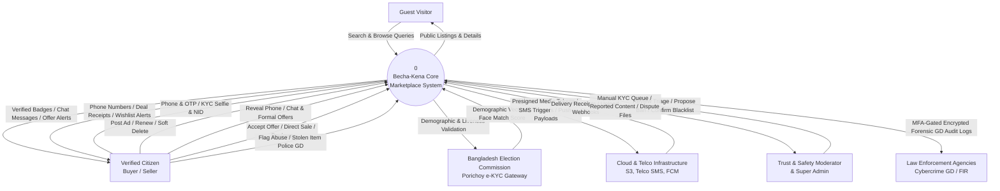
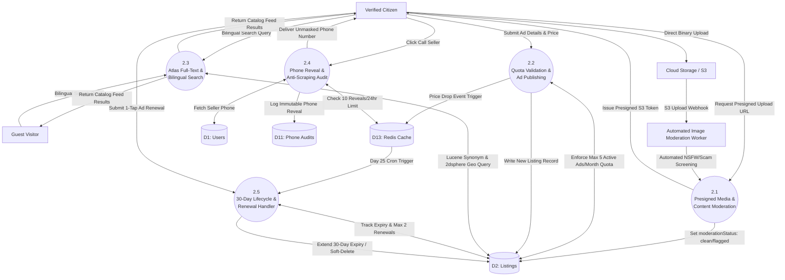
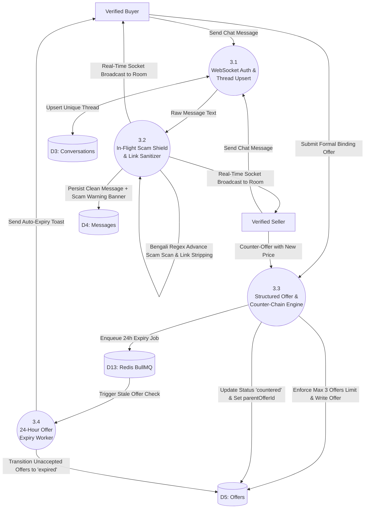
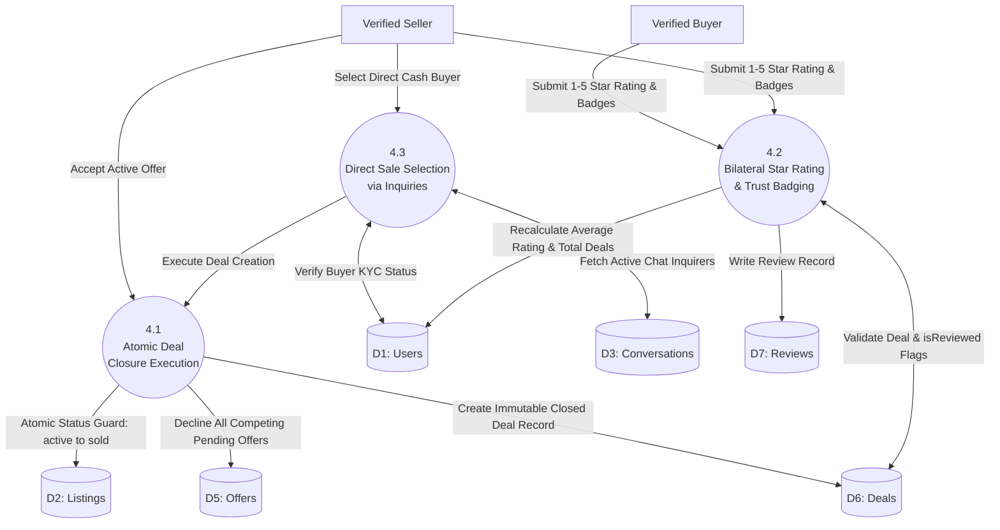
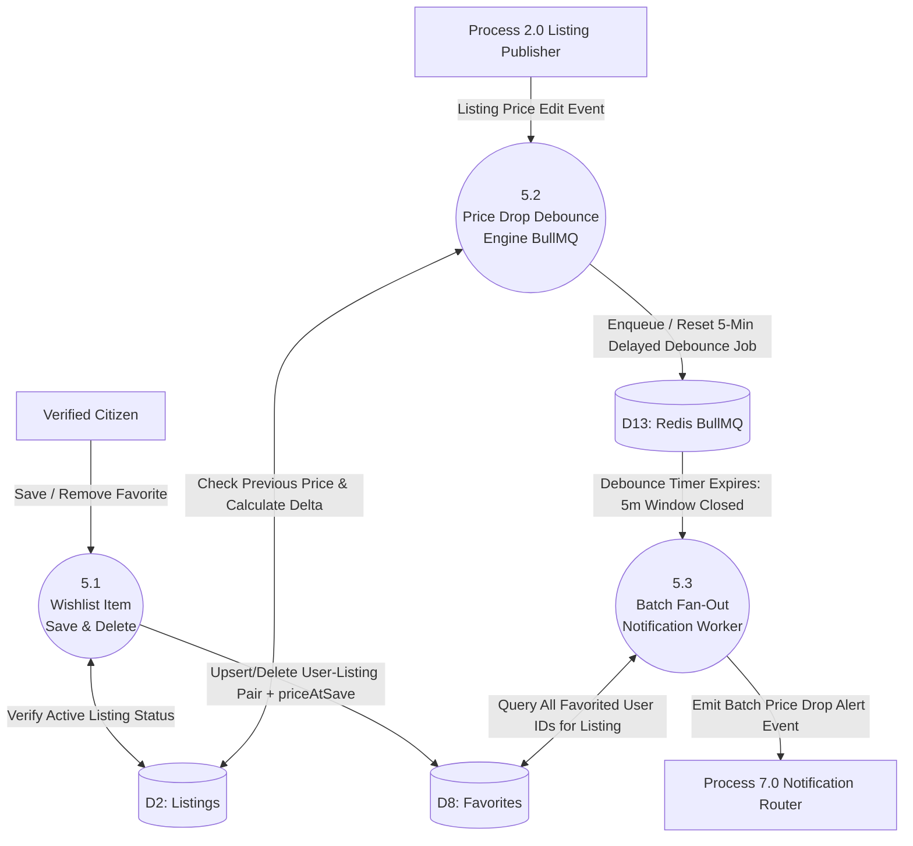
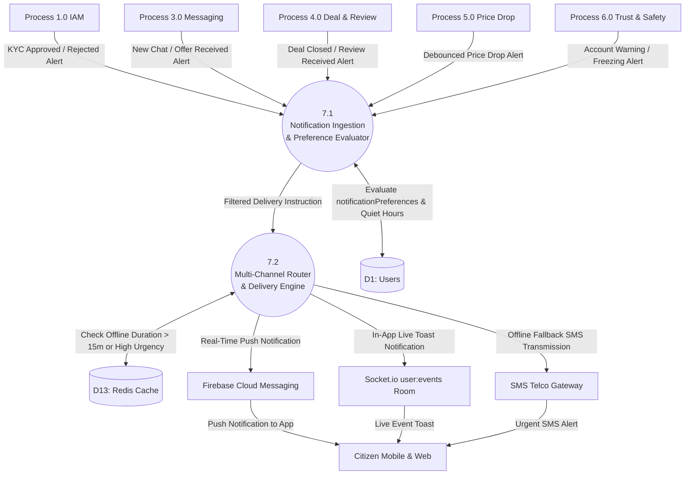

# Data Flow Diagram (DFD) Specification: Becha-Kena

**Project Name:** Becha-Kena — NID-Verified C2C Resale Marketplace  
**Document Version:** 1.0  
**Target Specification File:** `dfd.md`  
**Reference Documents:** `PRD.md` (v2.0), `architecture.md` (v1.0)  

---

## 1. Context Diagram (Level 0 DFD)

### 1.1 Scope & System Boundary
The Context Diagram defines the external boundary of the **Becha-Kena Core Marketplace System (Process 0)**, depicting all interactions with human actors and external third-party infrastructure. 

```
                                      +-------------------------------+
                                      |   Bangladesh Election Comm.   |
                                      |     (Porichoy / e-KYC API)    |
                                      +-------------------------------+
                                            ^                   |
                    NID Data + Biometric    |                   | Demographic Vector +
                       Frames for Match     |                   | Face Confidence Score
                                            |                   v
                                      +-------------------------------+
                                      |                               |
  +-------------------------+         |                               |         +---------------------------+
  |      Guest Visitor      | ------->|                               |<------  |  Trust & Safety Moderator |
  | (Unauthenticated Public)| <-------|                               | ------> |      & Super Admin        |
  +-------------------------+         |                               |         +---------------------------+
      Browse / Search / View          |        Process 0:             |             Triage Queue / Ban Review /
                                      |                               |             Audit Log Retrieval
  +-------------------------+         |        BECHA-KENA             |
  |     Verified Citizen    | ------->|        MARKETPLACE            |         +---------------------------+
  |     (Buyer / Seller)    | <-------|        CORE SYSTEM            | ------> |  Law Enforcement Agencies |
  +-------------------------+         |                               |         |  (Cybercrime GD / FIR)    |
     Post Ad / Chat / Offer /         |                               |         +---------------------------+
     Deal / Dispute / Review          |                               |             Encrypted Evidence Export
                                      +-------------------------------+
                                            |                   ^
                        SMS OTP / Alert     |                   |
                     Push Notifications /   v                   | Presigned Media &
                       Storage Presigning +-----------------------+ Content Inspection
                                          | External Cloud &      |
                                          | Telco Infrastructure  |
                                          | (Telcos, FCM, S3)     |
                                          +-----------------------+
```

### 1.2 Boundary Interfacing Summary
* **Human External Entities:**
  * **Guest Visitor:** Reads public catalog items, searches by location/category, views listing specifications.
  * **Verified Citizen (Unified Buyer/Seller):** Completes NID verification, creates ads, reveals seller phone, sends in-app messages/offers, marks deals sold, submits bilateral reviews, flags suspicious activity, files stolen gadget disputes.
  * **Trust & Safety Moderator / Super Admin:** Manages manual KYC triage, inspects scam reports, proposals/confirmations of dual-approval bans, inspects law enforcement dispute escalations.
  * **Law Enforcement Agencies:** Consumes KMS-decrypted digital evidence packages (GD/FIR verification logs, seller NID identity, device footprint, chat transcripts).
* **Automated External Entities:**
  * **Bangladesh Election Commission Gateway (Porichoy API):** Validates NID demographic data, checks date of birth, provides biometric facial vector matching.
  * **SMS Telco Gateway (Banglalink / Multi-Carrier):** Transmits OTP authentication codes and urgent offline fallback notifications.
  * **Firebase Cloud Messaging (FCM):** Delivers push notifications for chat, offer updates, and debounced price drops.
  * **Cloud Object Storage (AWS S3 / Cloudinary):** Hosts presigned encrypted uploads for listing photos, NID identity cards, and police GD receipts.

---

## 2. Level 1 Data Flow Diagram

The Level 1 DFD decomposes the central system into **7 core functional processes** operating against **13 primary data stores**.

### 2.1 Level 1 Functional Processes
1. **Process 1.0 — Identity Verification & Access Control (IAM):** Handles phone-first OTP authentication, JWT session issuing, Porichoy demographic queries, live facial liveness verification, device fingerprint binding, and dual-approval ban enforcement.
2. **Process 2.0 — Listing Lifecycle & Catalog Discovery:** Governs presigned media uploads, automated image safety moderation, ad drafting/publishing, 30-day lifecycle management, Day-25 renewals, quota capping (max 5 active/mo), and bilingual Atlas Search.
3. **Process 3.0 — In-App Messaging & Negotiation Engine:** Coordinates authenticated Socket.io connections, regex scam detection, external link sanitization, formal binding offers, counter-offer parent chaining, and 24-hour offer expiry workers.
4. **Process 4.0 — Deal Closure & Bilateral Reputation Engine:** Executes MongoDB atomic deal completion (`findOneAndUpdate` status guard), direct offline deal closures via active inquiries, and bilateral 1–5 star reviews with trust badges.
5. **Process 5.0 — Wishlist & Price Monitoring Service:** Manages saved favorites and runs a BullMQ 5-minute debounced price-drop notification fan-out engine.
6. **Process 6.0 — Trust, Safety & Dispute Management:** Processes community scam flags, automated listing quarantining ($\ge 3$ verified flags), police GD document verification, temporary seller account freezing, and law enforcement audit generation.
7. **Process 7.0 — Multi-Channel Notification Dispatcher:** Orchestrates push (FCM), in-app modals, and SMS fallback alerts while respecting citizen notification quiet preferences.

### 2.2 Level 1 Data Stores
* `D1: Users` (Citizen profile, salted HMAC NID hash, encrypted legal vault, device UUIDs, ratings, preferences)
* `D2: Listings` (Ad details, price, division/thana geo-point, moderation status, renewal count, soft-delete timestamp)
* `D3: Conversations` (Unique buyer-seller-listing chat thread pairs)
* `D4: Messages` (Chat texts, scam warning flags, soft-delete states)
* `D5: Offers` (Binding monetary offers, counter-offer pointers, expiration timestamps, offer status)
* `D6: Deals` (Immutable transaction closures, final agreed price, review state flags, dispute linkages)
* `D7: Reviews` (Bilateral star ratings, qualitative trust badges, reviewer/reviewee IDs)
* `D8: Favorites` (Wishlist links with historical `priceAtSave`)
* `D9: Reports` (Community flags on chats, listings, and abusive users)
* `D10: Disputes` (Post-deal stolen gadget claims, police GD numbers, thana, photo documents)
* `D11: PhoneRevealAudits` (Audit trail of click-and-call phone unmasks)
* `D12: NIDBlacklists` (Permanently barred NID hashes, phone numbers, and hardware fingerprints)
* `D13: RedisCacheQueues` (OTP TTLs, sliding-window rate limit counters, BullMQ delayed price-drop & offer-expiry queues)

---

## 3. Level 2 Data Flow Diagrams

### 3.1 Sub-Process Decomposition: 1.0 Identity Verification & Access Control
* **1.1 Request & Verify OTP:**
  - Ingests citizen phone number, generates 6-digit cryptographic OTP, writes to `D13: RedisCacheQueues` (TTL 120s), dispatches SMS via Telco Gateway.
  - Verifies submitted OTP, creates or loads unverified citizen profile in `D1: Users`, issues short-lived JWT + HTTP-only refresh cookie.
* **1.2 Duplicate & Blacklist Pre-Check:**
  - Hashes incoming NID with server-side HMAC-SHA256.
  - Queries `D12: NIDBlacklists` and `D1: Users`. If collision detected, terminates execution with 409 Conflict at zero external API billing cost.
* **1.3 Porichoy Demographics & Biometric Liveness:**
  - Dispatches OCR image to Porichoy gateway $\rightarrow$ extracts NID number and date of birth.
  - Queries Election Commission demographic database $\rightarrow$ returns official name vector and EC photo.
  - Conducts client camera selfie liveness analysis $\rightarrow$ performs facial similarity comparison ($\ge 95\%$ confidence).
* **1.4 Profile Activation & KMS Encryption:**
  - Encrypts official name and legal details with KMS AES-256-GCM.
  - Updates `D1: Users` setting `isNidVerified = true` and binds active hardware UUID.
* **1.5 New Device Challenge ("New Phone, Same SIM"):**
  - Detects unknown device UUID on verified citizen login.
  - Triggers 3-second biometric selfie challenge; validates against stored face template before registering new hardware in `D1: Users`.

### 3.2 Sub-Process Decomposition: 2.0 Listing Lifecycle & Catalog Discovery
* **2.1 Presigned Image Upload & Content Moderation:**
  - Citizen requests presigned S3 URL; frontend uploads media directly to AWS S3.
  - S3 upload webhook triggers automated image analysis worker; flags adult/violent content or scam watermarks, setting `moderationStatus = 'flagged'` or `'clean'`.
* **2.2 Quota Validation & Ad Publishing:**
  - Inspects active ads in `D2: Listings` for current citizen; enforces max 5 active ads per rolling 30 days.
  - Stores ad details, geo-location, asking price, and sets 30-day `expiresAt` in `D2: Listings`.
* **2.3 Atlas Full-Text & Bilingual Geo Search:**
  - Guest or Citizen enters search keyword (e.g., "iPhone" or "Samsung") and division/thana filter.
  - Query executes against MongoDB Atlas Search Lucene engine utilizing synonym mappings and 2dsphere geo-indexing; returns active, unreserved listings.
* **2.4 Phone Reveal & Anti-Scraping Audit:**
  - Verified citizen clicks "Call Seller".
  - Evaluates sliding-window counter in `D13: RedisCacheQueues` (max 10 reveals/24hr).
  - Unmasks phone number from `D1: Users` and writes immutable audit record to `D11: PhoneRevealAudits`.
* **2.5 Ad Renewal & Soft Deletion:**
  - Day 25 cron triggers renewal reminder; citizen 1-tap renews (max 2 renewals per ad = 90 days total).
  - Deletion marks `deletedAt = now()` and sets status `'archived'`, retaining record for audit compliance.

### 3.3 Sub-Process Decomposition: 3.0 In-App Messaging & Negotiation Engine
* **3.1 Socket Authentication & Conversation Upsert:**
  - Client initiates WebSocket connection; server authenticates signed HTTP-only cookie.
  - Joins rooms `chat:conv_{conversationId}` and `user:events_{userId}`.
  - Upserts compound unique index `{listingId, buyerId, sellerId}` in `D3: Conversations`.
* **3.2 In-Flight Scam Regex Shield & Sanitization:**
  - Parses message string against advance payment regex patterns (`advance`, `bKash`, `courier fee`, `booking fee`).
  - Strips external hyperlinks (`http://`, `https://`, `.apk`).
  - Writes sanitized text to `D4: Messages`; emits payload with `hasScamWarning = true/false` to active room.
* **3.3 Structured Offer & Counter-Offer Pipeline:**
  - Buyer submits binding offer (`amount`, 24h TTL) stored in `D5: Offers` (max 3 offers/buyer enforced).
  - Seller counters: marks current offer `countered`, sets `parentOfferId`, creates counter-offer document.
* **3.4 Auto-Expiry Worker:**
  - BullMQ cron sweeps `D5: Offers` every 5 minutes.
  - Stale pending offers ($> 24$ hours) transition to `expired`; notifies buyer via Process 7.0.

### 3.4 Sub-Process Decomposition: 4.0 Deal Closure & Bilateral Reputation Engine
* **4.1 Atomic Deal Completion:**
  - Seller accepts active offer OR executes Direct Sale selection from verified inquiries.
  - Executes MongoDB transaction with status guard on `D2: Listings`:
    - Atomically updates listing status from `active`/`under_offer` $\rightarrow$ `sold`.
    - Creates immutable record in `D6: Deals`.
    - Transitions competing pending offers in `D5: Offers` to `declined`.
* **4.2 Bilateral Reputation & Review:**
  - Gated by verified `dealId`; checks `isReviewedBySeller` and `isReviewedByBuyer` flags.
  - Writes rating (1-5 stars) and trust badges to `D7: Reviews`.
  - Recalculates aggregate score and updates `D1: Users`.
* **4.3 Direct Sale Selection via Inquiries:**
  - For verbal/cash offline deals without formal offer, seller picks buyer from active conversation list.
  - System verifies buyer's KYC status before finalizing deal in `D6: Deals`.

### 3.5 Sub-Process Decomposition: 5.0 Wishlist & Price Monitoring Service
* **5.1 Wishlist Management (Save / Remove Favorite):**
  - Citizen saves/un-saves listing; validates against active status in `D2: Listings`.
  - Upserts record in `D8: Favorites` with historical benchmark `priceAtSave`.
* **5.2 Price Drop Detection & Debounce Engine:**
  - Seller edits asking price downward in `D2: Listings`.
  - Triggers BullMQ delayed job in `D13: RedisCacheQueues` with 5-minute debounce window (`jobId = price_drop:${listingId}`).
  - Coalesces rapid successive price edits, resetting debounce timer until seller stabilizes price.
* **5.3 Batch Fan-Out Notification Dispatcher:**
  - Debounce timer fires; loads all favorited user IDs from `D8: Favorites`.
  - Dispatches batch price-reduction alert events to Process 7.0 (Multi-Channel Notification Dispatcher).

### 3.6 Sub-Process Decomposition: 6.0 Trust, Safety & Legal Dispute Management
* **6.1 Community Abuse Reporting & Auto-Quarantine:**
  - Citizen flags suspicious listing, chat message, or user profile (`reason`, details).
  - Writes incident document into `D9: Reports`.
  - Aggregates verified reports on entity; upon reaching threshold ($\ge 3$ unique verified citizen reports), automatically transitions listing status in `D2: Listings` to `under_review` and removes from public search index.
* **6.2 Stolen Item Police GD Escalation & Seller Freezing:**
  - Buyer files stolen item claim within 30 days of deal closure; uploads police General Diary (GD) number, Thana details, and scanned document copy.
  - Creates legal record in `D10: Disputes`; links `disputeId` in `D6: Deals`.
  - Automatically sets `isFrozen = true` on accused seller in `D1: Users`, suspending active listings and blocking new ad creation pending investigation.
* **6.3 Dual-Approval Account Ban & Blacklist Registry:**
  - Trust & Safety Moderator investigates dispute/report queue; proposes permanent termination (`banProposedBy = moderatorId`).
  - Super Admin performs secondary review and confirms ban; sets `isBanned = true` in `D1: Users`, archives all seller listings in `D2: Listings`, and writes salted HMAC-SHA256 NID hash, phone, and hardware UUID into `D12: NIDBlacklists`.
* **6.4 Law Enforcement Forensic Audit Export:**
  - Super Admin validates official police cybercrime warrant with multi-factor authentication (MFA).
  - Compiles end-to-end evidence package: KMS-decrypted legal identity, verified phone, hardware device footprints, immutable chat transcript (`D4: Messages`), and deal timestamps.
  - Exports encrypted forensic bundle to investigating Law Enforcement Agency (LEA).

### 3.7 Sub-Process Decomposition: 7.0 Multi-Channel Notification Dispatcher
* **7.1 Notification Event Ingestion & Preference Filter:**
  - Ingests event triggers from Process 1.0 (KYC status), Process 3.0 (Chat/Offer), Process 4.0 (Deal/Review), Process 5.0 (Price Drop), and Process 6.0 (Security Alerts).
  - Evaluates citizen `notificationPreferences` in `D1: Users` (quiet hours, marketing opt-outs; critical security and legal alerts bypass filters).
* **7.2 Multi-Channel Dispatch Router:**
  - Routes real-time push payloads to active mobile clients via Firebase Cloud Messaging (FCM).
  - Emits in-app websocket events to `user:events_{userId}` room for active online sessions.
  - Dispatches SMS alerts via Telco Gateway for high-urgency offline events (OTP auth, deal confirmation, or unread chat $> 15\text{ minutes}$).

---

## 4. Data Dictionary

### 4.1 Data Flows Dictionary
| Flow Identifier | Flow Name | Source | Destination | Data Structure / Payload |
| :--- | :--- | :--- | :--- | :--- |
| **DF-01** | OTP Request & Verify | Citizen | P1.1 (Auth) | `{ phone: String, otpCode?: String, deviceUUID: String }` |
| **DF-02** | KYC Submission | Citizen | P1.2 / P1.3 (KYC) | `{ nidFrontImg: Buffer, nidBackImg: Buffer, selfieFrames: Buffer[] }` |
| **DF-03** | Porichoy Validation | P1.2 | Porichoy Gateway | `{ nidNumber: String, dob: String, faceVector: String }` |
| **DF-04** | Auth Tokens & Badges | P1.1 / P1.4 | Citizen | `{ accessToken: JWT, refreshToken: Cookie, isNidVerified: Boolean }` |
| **DF-05** | Presign Upload Request | Citizen | P2.1 (Media) | `{ fileType: String, context: 'listing'\|'nid'\|'gd', checksum: String }` |
| **DF-06** | Ad Creation Payload | Citizen | P2.2 (Listing) | `{ title: String, description: String, price: Number, category: String, location: Object, images: String[] }` |
| **DF-07** | Search & Filter Query | Guest / Citizen | P2.3 (Search) | `{ query: String, category?: String, minPrice?: Number, maxPrice?: Number, divisionId: String, thanaId: String }` |
| **DF-08** | Catalog Feed Response | P2.3 | Guest / Citizen | `{ listings: ListingCardDTO[], totalCount: Number, page: Number }` |
| **DF-09** | Reveal Phone Request | Citizen | P2.4 (Privacy) | `{ listingId: ObjectId, buyerId: ObjectId, ipAddress: String }` |
| **DF-10** | Unmasked Phone Payload| P2.4 | Citizen | `{ sellerPhone: String, remainingRevealsToday: Number }` |
| **DF-11** | Chat Message Event | Citizen | P3.1 / P3.2 | `{ conversationId: ObjectId, senderId: ObjectId, text: String, clientMsgId: String }` |
| **DF-12** | Sanitized Chat Delivery | P3.2 | Citizen | `{ _id: ObjectId, text: String, hasScamWarning: Boolean, createdAt: Date }` |
| **DF-13** | Binding Offer Payload | Citizen | P3.3 (Offer) | `{ conversationId: ObjectId, listingId: ObjectId, amount: Number, parentOfferId?: ObjectId }` |
| **DF-14** | Deal Accept / Direct Sale| Citizen | P4.1 (Deal) | `{ listingId: ObjectId, offerId?: ObjectId, buyerId: ObjectId, finalPrice: Number }` |
| **DF-15** | Bilateral Review Data | Citizen | P4.2 (Review)| `{ dealId: ObjectId, rating: Number (1-5), badges: String[], comment?: String }` |
| **DF-16** | Community Report Flag | Citizen | P6.1 (Report)| `{ entityType: 'listing'\|'chat'\|'user', entityId: ObjectId, reason: String, details: String }` |
| **DF-17** | Police GD Legal Claim | Citizen | P6.2 (Dispute)| `{ dealId: ObjectId, gdNumber: String, thanaName: String, gdFilingDate: Date, gdPhotoUrl: String }` |
| **DF-18** | Ban Proposal & Confirm | Moderator/Admin | P6.3 (Ban) | `{ targetUserId: ObjectId, reason: String, action: 'propose'\|'confirm' }` |
| **DF-19** | Legal Audit Log Request | Super Admin | P6.3 (Audit) | `{ caseId: String, targetNidHash: String, mfaToken: String }` |
| **DF-20** | Debounced Notification | P5.2 / P7.0 | Citizen | `{ channel: 'fcm'\|'sms', title: String, body: String, deeplink: String }` |
| **DF-21** | Wishlist Toggle Payload | Citizen | P5.1 (Wishlist)| `{ listingId: ObjectId, action: 'add'\|'remove', currentPrice: Number }` |
| **DF-22** | Notification Event | System Processes | P7.1 (Router) | `{ recipientId: ObjectId, type: String, payload: Object, priority: 'normal'\|'urgent' }` |
| **DF-23** | Direct Sale Selection | Seller | P4.1 (Deal) | `{ listingId: ObjectId, buyerId: ObjectId, agreedPrice: Number }` |

### 4.2 Data Stores Dictionary
| Store ID | Store Name | Entity Schema Summary | Primary Key & Indexes |
| :--- | :--- | :--- | :--- |
| **D1** | `users` | `_id, phone, nidHash, encryptedNidData, displayName, role, isNidVerified, deviceUUIDs, isBanned, isFrozen, notificationPreferences, averageRating, totalDealsCompleted` | PK: `_id`<br>Unique: `phone`, `nidHash`<br>Index: `isNidVerified`, `isBanned` |
| **D2** | `listings` | `_id, sellerId, title, description, price, condition, category, location { coordinates, division, thana }, imageUrls, status, moderationStatus, renewCount, maxRenewals, expiresAt, deletedAt` | PK: `_id`<br>Compound: `{ status: 1, category: 1, createdAt: -1 }`<br>2dsphere: `location.coordinates`<br>Text: Atlas Search Lucene |
| **D3** | `conversations` | `_id, listingId, buyerId, sellerId, lastMessage { text, senderId, createdAt }, status, updatedAt` | PK: `_id`<br>Unique: `{ listingId: 1, buyerId: 1, sellerId: 1 }` |
| **D4** | `messages` | `_id, conversationId, senderId, text, messageType, hasScamWarning, isDeleted, deletedAt, createdAt` | PK: `_id`<br>Compound: `{ conversationId: 1, createdAt: -1 }` |
| **D5** | `offers` | `_id, conversationId, listingId, buyerId, sellerId, amount, status, parentOfferId, round, expiresAt, createdAt` | PK: `_id`<br>Compound: `{ conversationId: 1, status: 1 }`<br>Index: `{ listingId: 1, buyerId: 1 }` |
| **D6** | `deals` | `_id, listingId, offerId, sellerId, buyerId, finalPrice, isReviewedBySeller, isReviewedByBuyer, disputeStatus, disputeId, completedAt` | PK: `_id`<br>Unique: `{ listingId: 1 }`<br>Compound: `{ sellerId: 1, buyerId: 1 }` |
| **D7** | `reviews` | `_id, dealId, listingId, reviewerId, revieweeId, rating, tags, createdAt` | PK: `_id`<br>Compound: `{ dealId: 1, reviewerId: 1 }`<br>Index: `{ revieweeId: 1 }` |
| **D8** | `favorites` | `_id, userId, listingId, priceAtSave, createdAt` | PK: `_id`<br>Unique: `{ userId: 1, listingId: 1 }`<br>Index: `{ listingId: 1 }` |
| **D9** | `reports` | `_id, reporterId, entityType, entityId, reason, details, status, reviewedBy, resolvedAt, createdAt` | PK: `_id`<br>Compound: `{ entityType: 1, entityId: 1, status: 1 }` |
| **D10** | `disputes` | `_id, dealId, buyerId, sellerId, gdNumber, thanaName, gdFilingDate, gdDocumentUrl, status, resolutionAction, resolvedBy, createdAt` | PK: `_id`<br>Unique: `{ dealId: 1 }`<br>Index: `{ status: 1 }` |
| **D11** | `phone_reveal_audits` | `_id, buyerId, listingId, sellerId, ipAddress, createdAt` | PK: `_id`<br>Compound: `{ buyerId: 1, createdAt: -1 }` |
| **D12** | `nid_blacklists` | `_id, nidHash, phone, deviceUUID, reason, bannedBy, createdAt` | PK: `_id`<br>Unique: `{ nidHash: 1 }`, `{ phone: 1 }` |
| **D13** | `redis_cache_queues` | Key-value store: `otp:{phone}`, `reveal_limit:{buyerId}`, `bullmq:price_drop:{listingId}`, `bullmq:offer_expiry`, `session:{refreshToken}` | In-memory Redis keys with TTLs & BullMQ z-sets |

---

## 5. Data Flow Table

| Flow ID | Flow Label | Originating Node | Terminating Node | Description & Protocol |
| :--- | :--- | :--- | :--- | :--- |
| **FL-101** | Phone & OTP Input | Citizen | 1.1 Auth Service | HTTPS POST `/api/v1/auth/verify-otp` |
| **FL-102** | OTP Verification & TTL | 1.1 Auth Service | D13: Redis Cache | Reads/Writes OTP with 120-second TTL |
| **FL-103** | User Identity Record | 1.1 Auth Service | D1: Users | Creates/Loads citizen account record |
| **FL-104** | NID Front/Back & Selfie | Citizen | 1.2 KYC Processor | HTTPS Multipart upload |
| **FL-105** | Blacklist Check | 1.2 KYC Processor | D12: NID Blacklists | HMAC-SHA256 hash lookup to block barred citizens |
| **FL-106** | External e-KYC Verification| 1.3 Porichoy Adapter | Ext: Porichoy API | REST HTTPS query with EC biometric match |
| **FL-107** | Activated Citizen Status | 1.4 Profile Vault | D1: Users | Encrypts legal name, activates verified shield |
| **FL-108** | New Device Challenge | Citizen | 1.5 Device Guard | Biometric selfie verify on new hardware |
| **FL-201** | Presigned S3 Request | Citizen | 2.1 Media Handler | HTTPS POST `/api/v1/uploads/presign` |
| **FL-202** | Direct Image Upload | Citizen | Ext: Cloud Storage | Direct HTTPS binary PUT to S3 / Cloudinary |
| **FL-203** | Image Moderation Inspection| Ext: Cloud Storage | 2.1 Media Handler | Webhook trigger for automated NSFW/scam filter |
| **FL-204** | Listing Document Write | 2.2 Listing Publisher| D2: Listings | Enforces 5 active listings quota & writes ad |
| **FL-205** | Bilingual Search Query | Guest / Citizen | 2.3 Atlas Search | Full-text query with English/Bengali synonyms |
| **FL-206** | Catalog Result Stream | 2.3 Atlas Search | Guest / Citizen | JSON response containing verified listing cards |
| **FL-207** | Phone Number Reveal Request| Citizen | 2.4 Privacy Guard | Rate-limited POST `/api/v1/listings/:id/reveal-phone` |
| **FL-208** | Sliding Window Counter | 2.4 Privacy Guard | D13: Redis Cache | Checks & increments max 10 reveals/24hr |
| **FL-209** | Log Phone Access Audit | 2.4 Privacy Guard | D11: Phone Audits | Writes `{buyerId, sellerId, listingId, ip, timestamp}` |
| **FL-301** | WebSocket Handshake | Citizen | 3.1 Chat Gateway | WSS connection authenticated via session cookie |
| **FL-302** | Thread Upsert | 3.1 Chat Gateway | D3: Conversations | Atomically gets or creates 1 thread per pair |
| **FL-303** | Scam Regex Scan | 3.2 Scam Filter | 3.2 Scam Filter | Flags advance payment keywords in Bengali |
| **FL-304** | Chat Message Persist | 3.2 Scam Filter | D4: Messages | Writes sanitized message payload |
| **FL-305** | Real-Time Push to Room | 3.2 Scam Filter | Citizen | Socket broadcast to `chat:conv_{conversationId}` |
| **FL-306** | Binding Offer Create | Citizen | 3.3 Offer Engine | Writes offer document to D5: Offers |
| **FL-307** | Counter-Offer Reference | Citizen | 3.3 Offer Engine | Links `parentOfferId` & increments round |
| **FL-308** | Auto-Expire Sweep | 3.4 Expiry Worker | D5: Offers | BullMQ cron marks 24h unaccepted offers expired |
| **FL-401** | Deal Execution Command | Citizen | 4.1 Deal Service | POST `/api/v1/deals` (Accept Offer) |
| **FL-402** | Atomic Status Guard Write | 4.1 Deal Service | D2: Listings | `findOneAndUpdate` transitions status `active` $\rightarrow$ `sold` |
| **FL-403** | Immutable Deal Insert | 4.1 Deal Service | D6: Deals | Creates permanent deal closure record |
| **FL-404** | Direct Sale Selection | Citizen | 4.1 Deal Service | POST `/api/v1/deals/direct-sale` selecting verified chatter |
| **FL-405** | Bilateral Review Submit | Citizen | 4.2 Review Service | POST `/api/v1/reviews` (with `dealId`), checks deal existence & writes to D7 |
| **FL-406** | Trust Metric Recalculation | 4.2 Review Service | D1: Users | Updates aggregate star score & badge count |
| **FL-501** | Favorite Save/Delete | Citizen | 5.1 Wishlist | POST/DELETE `/api/v1/listings/:id/favorite`, writes to D8 |
| **FL-502** | Delayed Price Alert Job | 2.2 Listing Publisher| D13: Redis Cache | 5-minute delayed BullMQ job (`jobId = price_drop:${listingId}`) |
| **FL-503** | Fan-Out Event Dispatch | 5.3 Batch Dispatcher | 7.1 Notification Router| Sends bulk recipient payload to Notification Dispatcher |
| **FL-601** | Community Abuse Report | Citizen | 6.1 Report Service | POST `/api/v1/reports`, writes to D9: Reports |
| **FL-602** | Auto-Quarantine Trigger | 6.1 Report Service | D2: Listings | When verified reports $\ge 3$, sets status to `'under_review'` |
| **FL-603** | Police GD Filing | Citizen | 6.2 Dispute Service| POST `/api/v1/deals/:id/disputes` with GD proof to D10 & D6 |
| **FL-604** | Seller Account Freeze | 6.2 Dispute Service| D1: Users | Sets `isFrozen = true`, barring active posting & inquiries |
| **FL-605** | Dual-Approval Ban Proposal | Moderator | 6.3 Ban Manager | Sets `banProposedBy` and attaches evidence in D1: Users |
| **FL-606** | Dual-Approval Ban Finalize | Super Admin | 6.3 Ban Manager | Sets `isBanned = true`, archives D2 ads, writes to D12 |
| **FL-607** | Cybercrime Legal Audit Export| 6.4 Audit Exporter | Law Enforcement | MFA-gated encrypted log bundle generation for police |
| **FL-701** | Notification Ingestion & Pref | System Processes | 7.1 Preference Evaluator | Ingests alert events & evaluates quiet hours from D1: Users |
| **FL-702** | Mobile Push Delivery | 7.2 Channel Router | Ext: FCM | High-priority push dispatched to citizen mobile device |
| **FL-703** | Urgent Offline Fallback SMS | 7.2 Channel Router | Ext: SMS Gateway | Fallback SMS dispatched via Telco for unread alerts $>15\text{m}$ |

---

## 6. Process Table

| Process ID | Process Name | Inbound Data Flows | Outbound Data Flows | Data Stores Accessed | Logic / Responsibilities |
| :--- | :--- | :--- | :--- | :--- | :--- |
| **1.0** | **Identity & Access Management (IAM)** | Phone number, OTP, NID Card images, live camera selfie, device UUID | Session JWT, refresh cookie, verification badge status | D1, D12, D13 | Verifies phone via SMS OTP; performs fast OCR & Porichoy demographic checks; biometrically compares selfie against EC photo; encrypts legal data; binds hardware footprint. |
| **2.0** | **Listing Lifecycle & Catalog Discovery** | Listing title, description, price, location, condition, image presign requests, search keywords | Presigned S3 URLs, published listing state, search results, unmasked phone numbers | D1, D2, D11, D13 | Presigns direct media uploads; runs automated NSFW/scam image screening; enforces 5 active ads/month quota; handles 30-day expiry and max 2 renewals; indexes bilingual Atlas Search; enforces 10 reveals/24hr anti-scraping limit. |
| **3.0** | **In-App Messaging & Negotiation Engine** | Chat texts, formal offers, counter-offer payloads, socket heartbeat | Sanitized chat payloads, scam warning banners, offer state notifications | D3, D4, D5, D13 | Authenticates WebSockets via session cookie; routes messages to room `chat:conv_{conversationId}`; scans text with Bengali scam regex; blocks hyperlinks; tracks binding offers and counter chains; expires unaccepted offers at 24hr. |
| **4.0** | **Deal Closure & Reputation Engine** | Offer accept command, direct buyer selection, star ratings & badges | Atomic deal confirmation, updated citizen trust score | D1, D2, D5, D6, D7 | Atomically executes deal transitions in MongoDB with status guards; prevents duplicate closures; gates bilateral reviews behind confirmed deals; updates cumulative rating metrics. |
| **5.0** | **Wishlist & Price Monitoring Service** | Add/remove favorite requests, listing price reduction updates | Debounced price drop notifications, saved item availability updates | D2, D8, D13 | Maintains citizen saved listings with `priceAtSave`; detects downward price edits; buffers alerts with a 5-minute BullMQ debounce window to eliminate notification storms. |
| **6.0** | **Trust, Safety & Legal Dispute Management** | Community abuse flags, police GD filings, ban proposal/confirmation commands | Quarantined ad states, frozen seller accounts, encrypted legal evidence exports | D1, D2, D6, D9, D10, D12 | Collects scam/harassment flags; auto-quarantines listings with $\ge 3$ flags; processes stolen gadget police GD reports; enforces 2-person dual-approval ban workflows; compiles forensic logs for law enforcement. |
| **7.0** | **Multi-Channel Notification Dispatcher** | System trigger events (KYC result, chat, offer, deal, security alert) | In-app notification badges, FCM mobile pushes, SMS telco messages | D1, D13 | Evaluates citizen `notificationPreferences`; dispatches real-time pushes via FCM; sends fallback SMS for critical offline events ($> 15\text{m}$ unread); enforces mandatory delivery on security alerts. |

---

## 7. Data Store Table

| Store ID | Store Name | Technology | Read By (Process IDs) | Written By (Process IDs) | Retention & Archival Strategy |
| :--- | :--- | :--- | :--- | :--- | :--- |
| **D1** | `users` | MongoDB Atlas | 1.0, 2.0, 3.0, 4.0, 6.0, 7.0 | 1.0, 4.0, 6.0 | Retained permanently. Banned citizens marked `isBanned = true`; legal PII encrypted with AES-256-GCM. |
| **D2** | `listings` | MongoDB Atlas | 2.0, 4.0, 5.0, 6.0 | 2.0, 4.0, 6.0 | Soft-deleted (`deletedAt`). Expired after 30 days unless renewed (max 2 renewals). Retained for legal audit. |
| **D3** | `conversations` | MongoDB Atlas | 3.0, 4.0 | 3.0 | Retained indefinitely to maintain dispute evidence and chat history. |
| **D4** | `messages` | MongoDB Atlas | 3.0, 6.0 | 3.0 | Soft-deletable by users; underlying records retained in cold storage for 180 days for law enforcement GD compliance. |
| **D5** | `offers` | MongoDB Atlas | 3.0, 4.0 | 3.0, 4.0 | Immutable audit trail of negotiation rounds; auto-expired at 24 hours via BullMQ cron. |
| **D6** | `deals` | MongoDB Atlas | 4.0, 6.0 | 4.0, 6.0 | Immutable permanent records of peer-to-peer contract fulfillment and review eligibility. |
| **D7** | `reviews` | MongoDB Atlas | 4.0 | 4.0 | Permanent public feedback tied to citizen profiles; review edits strictly prohibited after 48 hours. |
| **D8** | `favorites` | MongoDB Atlas | 5.0 | 5.0 | Persists until explicitly un-favorited by the citizen or user account deletion. |
| **D9** | `reports` | MongoDB Atlas | 6.0 | 6.0 | Triage queue audit records retained permanently for trust & safety pattern analysis. |
| **D10** | `disputes` | MongoDB Atlas | 4.0, 6.0 | 4.0, 6.0 | Legal escalation records preserved for statutory period (minimum 3 years) under Cyber Security Act. |
| **D11** | `phone_reveal_audits` | MongoDB Atlas | 2.0, 6.0 | 2.0 | High-velocity audit logs indexed with TTL of 90 days for anti-scraping forensics. |
| **D12** | `nid_blacklists` | MongoDB Atlas | 1.0, 6.0 | 6.0 | Immutable cryptographic registry of permanently banned NID hashes, phone numbers, and hardware UUIDs. |
| **D13** | `redis_cache_queues` | Redis (Upstash) | 1.0, 2.0, 3.0, 5.0, 7.0 | 1.0, 2.0, 3.0, 5.0, 7.0 | In-memory ephemeral storage: OTP keys (120s TTL), sliding-window rate limit counters, BullMQ delayed job queues. |

---

## 8. Mermaid Diagrams

### 8.1 Level 0 Context Diagram (Mermaid)


### 8.2 Level 1 Data Flow Diagram (Mermaid)

```mermaid
flowchart TD
    %% External Entities
    Citizen[Verified Citizen]
    Guest[Guest Visitor]
    Admin[Moderator / Super Admin]
    Police[Law Enforcement]
    Porichoy[Porichoy e-KYC API]
    CloudExt[S3 / SMS Gateway / FCM]

    %% Processes
    P1((1.0<br/>Identity & Access<br/>Management))
    P2((2.0<br/>Listing & Catalog<br/>Discovery))
    P3((3.0<br/>Messaging & Offer<br/>Negotiation))
    P4((4.0<br/>Deal Closure &<br/>Reputation))
    P5((5.0<br/>Wishlist & Price<br/>Monitoring))
    P6((6.0<br/>Trust, Safety &<br/>Legal Disputes))
    P7((7.0<br/>Notification<br/>Dispatcher))

    %% Data Stores
    D1[(D1: Users)]
    D2[(D2: Listings)]
    D3[(D3: Conversations)]
    D4[(D4: Messages)]
    D5[(D5: Offers)]
    D6[(D6: Deals)]
    D7[(D7: Reviews)]
    D8[(D8: Favorites)]
    D9[(D9: Reports)]
    D10[(D10: Disputes)]
    D11[(D11: Phone Audits)]
    D12[(D12: Blacklists)]
    D13[(D13: Redis Queues)]

    %% Connections for P1.0
    Citizen -->|Phone OTP & KYC Data| P1
    P1 -->|Demographic Query| Porichoy
    Porichoy -->|Biometric Match Result| P1
    P1 <-->|Blacklist Collision Check| D12
    P1 <-->|OTP TTL & Rate Limits| D13
    P1 -->|Store Verified Profile| D1
    P1 -->|Auth Tokens & Badge| Citizen

    %% Connections for P2.0
    Citizen -->|Post Ad / Renew / Delete| P2
    Guest -->|Search & Filter Query| P2
    P2 -->|Presigned Upload Request| CloudExt
    CloudExt -->|Image Webhook Moderation| P2
    P2 <-->|Quota & Expiry Tracking| D2
    P2 <-->|Reveal Limit Check| D13
    P2 -->|Log Reveal Audit| D11
    P2 -->|Catalog Feed & Seller Phone| Citizen
    P2 -->|Public Search Results| Guest

    %% Connections for P3.0
    Citizen <-->|WSS Chat & Offer Actions| P3
    P3 <-->|Upsert Thread| D3
    P3 -->|Sanitized Message| D4
    P3 <-->|Binding Offer & Parent Chain| D5
    P3 <-->|24h Offer Expiry Job| D13

    %% Connections for P4.0
    Citizen -->|Accept Offer / Direct Sale / Review| P4
    P4 <-->|Atomic Status Guard Transition| D2
    P4 -->|Create Immutable Deal| D6
    P4 -->|Submit 1-5 Star Rating| D7
    P4 -->|Update Trust Metrics| D1

    %% Connections for P5.0
    Citizen -->|Save / Remove Favorite| P5
    P5 <-->|Manage Saved Ads| D8
    P2 -.->|Price Drop Event| P5
    P5 -->|5-Min Debounced Job| D13

    %% Connections for P6.0
    Citizen -->|Flag Abuse / Submit Police GD| P6
    Admin -->|Triage / Dual Ban Actions| P6
    P6 -->|Write Report| D9
    P6 -->|Record Legal Dispute| D10
    P6 -->|Freeze Account / Ban Citizen| D1
    P6 -->|Add Banned NID Hash| D12
    P6 -->|Encrypted GD Audit Package| Police

    %% Connections for P7.0
    P1 -.->|Trigger Alert| P7
    P3 -.->|Trigger Alert| P7
    P4 -.->|Trigger Alert| P7
    P5 -.->|Trigger Alert| P7
    P7 -->|FCM Push & Fallback SMS| CloudExt
    CloudExt -->|Push & SMS Notification| Citizen
```


### 8.3 Level 2 DFD: Process 1.0 Identity Verification & Access Control (Mermaid)
```mermaid
flowchart TD
    User[Citizen]
    P1_1((1.1<br/>Request & Verify<br/>Phone OTP))
    P1_2((1.2<br/>Duplicate & Blacklist<br/>Pre-Check))
    P1_3((1.3<br/>Porichoy Demographics<br/>& Biometric Match))
    P1_4((1.4<br/>Profile Vaulting &<br/>Badge Activation))
    P1_5((1.5<br/>New Device Face<br/>Challenge))

    D1[(D1: Users)]
    D12[(D12: NID Blacklists)]
    D13[(D13: Redis Cache)]
    ExtPorichoy[Porichoy API]
    ExtSMS[SMS Gateway]

    User -->|Phone Number| P1_1
    P1_1 -->|Generate OTP & 120s TTL| D13
    P1_1 -->|Send OTP SMS| ExtSMS
    ExtSMS -->|SMS Code| User
    User -->|Enter OTP Code| P1_1
    P1_1 -->|Create Unverified Profile| D1

    User -->|Upload NID Images & Live Selfie| P1_2
    P1_2 -->|Salted HMAC-SHA256 Hash| D12
    D12 -- Blacklisted -->|Collision Error 409| User
    D12 -- Unique ID --> P1_3

    P1_3 -->|OCR & Demographic Call| ExtPorichoy
    ExtPorichoy -->|Official Name & Photo Vector| P1_3
    P1_3 -->|Perform Face Comparison >= 95%| P1_4

    P1_4 -->|AES-256 Encrypt & Set isNidVerified=true| D1
    P1_4 -->|Issue Verified Tokens| User

    User -->|Login from New Hardware UUID| P1_5
    P1_5 <-->|Retrieve Biometric Vector| D1
    P1_5 -->|Liveness Challenge Passed| P1_1
```

### 8.4 Level 2 DFD: Process 2.0 Listing Lifecycle & Catalog Discovery (Mermaid)


### 8.5 Level 2 DFD: Process 3.0 In-App Messaging & Negotiation Engine (Mermaid)


### 8.6 Level 2 DFD: Process 4.0 Deal Closure & Bilateral Reputation Engine (Mermaid)


### 8.7 Level 2 DFD: Process 5.0 Wishlist & Price Monitoring Service (Mermaid)


### 8.8 Level 2 DFD: Process 6.0 Trust, Safety & Legal Dispute Management (Mermaid)
```mermaid
flowchart TD
    Citizen[Verified Citizen]
    Mod[Trust & Safety Moderator]
    SuperAdmin[Super Admin]
    Police[Law Enforcement Agencies]

    P6_1((6.1<br/>Community Abuse Report<br/>& Auto-Quarantine))
    P6_2((6.2<br/>Stolen Item Police GD<br/>& Seller Freeze))
    P6_3((6.3<br/>Dual-Approval Ban<br/>& Blacklist Registry))
    P6_4((6.4<br/>Cybercrime Forensic<br/>Audit Exporter))

    D1[(D1: Users)]
    D2[(D2: Listings)]
    D4[(D4: Messages)]
    D6[(D6: Deals)]
    D9[(D9: Reports)]
    D10[(D10: Disputes)]
    D12[(D12: NID Blacklists)]

    Citizen -->|Flag Listing / Chat / User| P6_1
    P6_1 -->|Insert Report Incident Record| D9
    P6_1 <-->|Count Verified Flags for Entity| D9
    P6_1 -- Flags >= 3 -->|Auto-Quarantine: status to 'under_review'| D2

    Citizen -->|Submit Stolen Item Claim + Police GD Copy| P6_2
    P6_2 -->|Create Legal Dispute Document| D10
    P6_2 -->|Link disputeId in Closed Deal| D6
    P6_2 -->|Freeze Seller Privileges: isFrozen=true| D1

    Mod -->|Investigate GD / Report Queue & Propose Ban| P6_3
    P6_3 -->|Set banProposedBy Flag in User Profile| D1
    SuperAdmin -->|Confirm Ban & Permanent Blacklist| P6_3
    P6_3 -->|Set isBanned=true & Revoke Auth Sessions| D1
    P6_3 -->|Archive All Active Seller Ads| D2
    P6_3 -->|Insert Salted HMAC NID Hash & Hardware UUID| D12

    SuperAdmin -->|Request Police Evidence Bundle with MFA| P6_4
    P6_4 <-->|Retrieve Decrypted Identity & Device Trace| D1
    P6_4 <-->|Retrieve Forensic Chat History| D4
    P6_4 <-->|Retrieve Deal & Dispute Timestamps| D6
    P6_4 <-->|Retrieve GD Verification Data| D10
    P6_4 -->|Deliver Encrypted Case Evidence Package| Police
```

### 8.9 Level 2 DFD: Process 7.0 Multi-Channel Notification Dispatcher (Mermaid)


---

## 9. Draw.io XML Specification

Below is the complete, valid, copy-pasteable Draw.io / diagrams.net XML representing the **Level 1 Architecture & Data Flow Diagram**.

```xml
<mxfile host="app.diagrams.net" modified="2026-10-22T00:30:00.000Z" agent="Mozilla/5.0" version="21.0.0" type="device">
  <diagram id="BechaKena_DFD_L1" name="Becha-Kena Level 1 DFD">
    <mxGraphModel dx="1420" dy="880" grid="1" gridSize="10" guides="1" tooltips="1" connect="1" arrows="1" fold="1" page="1" pageScale="1" pageWidth="1600" pageHeight="1100" background="#ffffff">
      <root>
        <mxCell id="0" />
        <mxCell id="1" parent="0" />

        <!-- EXTERNAL ENTITIES -->
        <mxCell id="E1" value="Verified Citizen&#xa;(Buyer / Seller)" style="rounded=0;whiteSpace=wrap;html=1;fillColor=#d5e8d4;strokeColor=#82b366;fontStyle=1;fontSize=12;" vertex="1" parent="1">
          <mxGeometry x="60" y="240" width="140" height="70" as="geometry" />
        </mxCell>
        <mxCell id="E2" value="Guest Visitor&#xa;(Unverified Public)" style="rounded=0;whiteSpace=wrap;html=1;fillColor=#e1d5e7;strokeColor=#9673a6;fontStyle=1;fontSize=12;" vertex="1" parent="1">
          <mxGeometry x="60" y="440" width="140" height="70" as="geometry" />
        </mxCell>
        <mxCell id="E3" value="Election Commission&#xa;(Porichoy e-KYC)" style="rounded=0;whiteSpace=wrap;html=1;fillColor=#fff2cc;strokeColor=#d6b656;fontStyle=1;fontSize=12;" vertex="1" parent="1">
          <mxGeometry x="60" y="60" width="140" height="70" as="geometry" />
        </mxCell>
        <mxCell id="E4" value="Moderator &amp;&#xa;Super Admin" style="rounded=0;whiteSpace=wrap;html=1;fillColor=#f8cecc;strokeColor=#b85450;fontStyle=1;fontSize=12;" vertex="1" parent="1">
          <mxGeometry x="1360" y="240" width="140" height="70" as="geometry" />
        </mxCell>
        <mxCell id="E5" value="Law Enforcement&#xa;(Cybercrime / GD)" style="rounded=0;whiteSpace=wrap;html=1;fillColor=#f8cecc;strokeColor=#b85450;fontStyle=1;fontSize=12;" vertex="1" parent="1">
          <mxGeometry x="1360" y="440" width="140" height="70" as="geometry" />
        </mxCell>
        <mxCell id="E6" value="Cloud Infrastructure&#xa;(S3, FCM, Telco SMS)" style="rounded=0;whiteSpace=wrap;html=1;fillColor=#dae8fc;strokeColor=#6c8ebf;fontStyle=1;fontSize=12;" vertex="1" parent="1">
          <mxGeometry x="1360" y="60" width="140" height="70" as="geometry" />
        </mxCell>

        <!-- PROCESSES -->
        <mxCell id="P1" value="1.0&#xa;Identity &amp; Access&#xa;Management" style="ellipse;whiteSpace=wrap;html=1;aspect=fixed;fillColor=#ffe6cc;strokeColor=#d79b00;fontStyle=1;fontSize=12;" vertex="1" parent="1">
          <mxGeometry x="340" y="100" width="110" height="110" as="geometry" />
        </mxCell>
        <mxCell id="P2" value="2.0&#xa;Listing Lifecycle&#xa;&amp; Discovery" style="ellipse;whiteSpace=wrap;html=1;aspect=fixed;fillColor=#ffe6cc;strokeColor=#d79b00;fontStyle=1;fontSize=12;" vertex="1" parent="1">
          <mxGeometry x="340" y="380" width="110" height="110" as="geometry" />
        </mxCell>
        <mxCell id="P3" value="3.0&#xa;Messaging &amp;&#xa;Negotiation Engine" style="ellipse;whiteSpace=wrap;html=1;aspect=fixed;fillColor=#ffe6cc;strokeColor=#d79b00;fontStyle=1;fontSize=12;" vertex="1" parent="1">
          <mxGeometry x="660" y="220" width="110" height="110" as="geometry" />
        </mxCell>
        <mxCell id="P4" value="4.0&#xa;Deal Closure &amp;&#xa;Reputation" style="ellipse;whiteSpace=wrap;html=1;aspect=fixed;fillColor=#ffe6cc;strokeColor=#d79b00;fontStyle=1;fontSize=12;" vertex="1" parent="1">
          <mxGeometry x="960" y="220" width="110" height="110" as="geometry" />
        </mxCell>
        <mxCell id="P5" value="5.0&#xa;Wishlist &amp; Price&#xa;Monitoring" style="ellipse;whiteSpace=wrap;html=1;aspect=fixed;fillColor=#ffe6cc;strokeColor=#d79b00;fontStyle=1;fontSize=12;" vertex="1" parent="1">
          <mxGeometry x="660" y="520" width="110" height="110" as="geometry" />
        </mxCell>
        <mxCell id="P6" value="6.0&#xa;Trust, Safety &amp;&#xa;Disputes" style="ellipse;whiteSpace=wrap;html=1;aspect=fixed;fillColor=#ffe6cc;strokeColor=#d79b00;fontStyle=1;fontSize=12;" vertex="1" parent="1">
          <mxGeometry x="1140" y="340" width="110" height="110" as="geometry" />
        </mxCell>
        <mxCell id="P7" value="7.0&#xa;Notification&#xa;Dispatcher" style="ellipse;whiteSpace=wrap;html=1;aspect=fixed;fillColor=#ffe6cc;strokeColor=#d79b00;fontStyle=1;fontSize=12;" vertex="1" parent="1">
          <mxGeometry x="1140" y="100" width="110" height="110" as="geometry" />
        </mxCell>

        <!-- DATA STORES -->
        <mxCell id="D1" value="D1: Users" style="shape=partialRectangle;top=0;bottom=0;fillColor=#f5f5f5;strokeColor=#666666;fontStyle=1;fontSize=11;whiteSpace=wrap;html=1;" vertex="1" parent="1">
          <mxGeometry x="500" y="130" width="110" height="40" as="geometry" />
        </mxCell>
        <mxCell id="D2" value="D2: Listings" style="shape=partialRectangle;top=0;bottom=0;fillColor=#f5f5f5;strokeColor=#666666;fontStyle=1;fontSize=11;whiteSpace=wrap;html=1;" vertex="1" parent="1">
          <mxGeometry x="500" y="415" width="110" height="40" as="geometry" />
        </mxCell>
        <mxCell id="D3" value="D3: Conversations" style="shape=partialRectangle;top=0;bottom=0;fillColor=#f5f5f5;strokeColor=#666666;fontStyle=1;fontSize=11;whiteSpace=wrap;html=1;" vertex="1" parent="1">
          <mxGeometry x="810" y="170" width="120" height="40" as="geometry" />
        </mxCell>
        <mxCell id="D4" value="D4: Messages" style="shape=partialRectangle;top=0;bottom=0;fillColor=#f5f5f5;strokeColor=#666666;fontStyle=1;fontSize=11;whiteSpace=wrap;html=1;" vertex="1" parent="1">
          <mxGeometry x="810" y="240" width="120" height="40" as="geometry" />
        </mxCell>
        <mxCell id="D5" value="D5: Offers" style="shape=partialRectangle;top=0;bottom=0;fillColor=#f5f5f5;strokeColor=#666666;fontStyle=1;fontSize=11;whiteSpace=wrap;html=1;" vertex="1" parent="1">
          <mxGeometry x="810" y="310" width="120" height="40" as="geometry" />
        </mxCell>
        <mxCell id="D6" value="D6: Deals" style="shape=partialRectangle;top=0;bottom=0;fillColor=#f5f5f5;strokeColor=#666666;fontStyle=1;fontSize=11;whiteSpace=wrap;html=1;" vertex="1" parent="1">
          <mxGeometry x="1120" y="230" width="110" height="40" as="geometry" />
        </mxCell>
        <mxCell id="D7" value="D7: Reviews" style="shape=partialRectangle;top=0;bottom=0;fillColor=#f5f5f5;strokeColor=#666666;fontStyle=1;fontSize=11;whiteSpace=wrap;html=1;" vertex="1" parent="1">
          <mxGeometry x="960" y="130" width="110" height="40" as="geometry" />
        </mxCell>
        <mxCell id="D8" value="D8: Favorites" style="shape=partialRectangle;top=0;bottom=0;fillColor=#f5f5f5;strokeColor=#666666;fontStyle=1;fontSize=11;whiteSpace=wrap;html=1;" vertex="1" parent="1">
          <mxGeometry x="500" y="555" width="110" height="40" as="geometry" />
        </mxCell>
        <mxCell id="D10" value="D10: Disputes" style="shape=partialRectangle;top=0;bottom=0;fillColor=#f5f5f5;strokeColor=#666666;fontStyle=1;fontSize=11;whiteSpace=wrap;html=1;" vertex="1" parent="1">
          <mxGeometry x="1135" y="480" width="120" height="40" as="geometry" />
        </mxCell>
        <mxCell id="D12" value="D12: Blacklists" style="shape=partialRectangle;top=0;bottom=0;fillColor=#f5f5f5;strokeColor=#666666;fontStyle=1;fontSize=11;whiteSpace=wrap;html=1;" vertex="1" parent="1">
          <mxGeometry x="200" y="20" width="120" height="40" as="geometry" />
        </mxCell>
        <mxCell id="D13" value="D13: Redis Queues" style="shape=partialRectangle;top=0;bottom=0;fillColor=#f5f5f5;strokeColor=#666666;fontStyle=1;fontSize=11;whiteSpace=wrap;html=1;" vertex="1" parent="1">
          <mxGeometry x="655" y="415" width="120" height="40" as="geometry" />
        </mxCell>

        <!-- FLOW CONNECTORS -->
        <mxCell id="C1" value="OTP &amp; KYC Selfie" style="edgeStyle=orthogonalEdgeStyle;rounded=0;orthogonalLoop=1;jettySize=auto;html=1;fontSize=10;" edge="1" parent="1" source="E1" target="P1">
          <mxGeometry relative="1" as="geometry" />
        </mxCell>
        <mxCell id="C2" value="Demographic Check" style="edgeStyle=orthogonalEdgeStyle;rounded=0;orthogonalLoop=1;jettySize=auto;html=1;fontSize=10;" edge="1" parent="1" source="P1" target="E3">
          <mxGeometry relative="1" as="geometry" />
        </mxCell>
        <mxCell id="C3" value="NID Hash Check" style="edgeStyle=orthogonalEdgeStyle;rounded=0;orthogonalLoop=1;jettySize=auto;html=1;fontSize=10;" edge="1" parent="1" source="P1" target="D12">
          <mxGeometry relative="1" as="geometry" />
        </mxCell>
        <mxCell id="C4" value="Write Citizen Record" style="edgeStyle=orthogonalEdgeStyle;rounded=0;orthogonalLoop=1;jettySize=auto;html=1;fontSize=10;" edge="1" parent="1" source="P1" target="D1">
          <mxGeometry relative="1" as="geometry" />
        </mxCell>
        <mxCell id="C5" value="Post Ad &amp; Renew" style="edgeStyle=orthogonalEdgeStyle;rounded=0;orthogonalLoop=1;jettySize=auto;html=1;fontSize=10;" edge="1" parent="1" source="E1" target="P2">
          <mxGeometry relative="1" as="geometry" />
        </mxCell>
        <mxCell id="C6" value="Search &amp; Filter" style="edgeStyle=orthogonalEdgeStyle;rounded=0;orthogonalLoop=1;jettySize=auto;html=1;fontSize=10;" edge="1" parent="1" source="E2" target="P2">
          <mxGeometry relative="1" as="geometry" />
        </mxCell>
        <mxCell id="C7" value="Catalog Read/Write" style="edgeStyle=orthogonalEdgeStyle;rounded=0;orthogonalLoop=1;jettySize=auto;html=1;fontSize=10;" edge="1" parent="1" source="P2" target="D2">
          <mxGeometry relative="1" as="geometry" />
        </mxCell>
        <mxCell id="C8" value="WSS Chat &amp; Offers" style="edgeStyle=orthogonalEdgeStyle;rounded=0;orthogonalLoop=1;jettySize=auto;html=1;fontSize=10;" edge="1" parent="1" source="E1" target="P3">
          <mxGeometry relative="1" as="geometry" />
        </mxCell>
        <mxCell id="C9" value="Store Messages" style="edgeStyle=orthogonalEdgeStyle;rounded=0;orthogonalLoop=1;jettySize=auto;html=1;fontSize=10;" edge="1" parent="1" source="P3" target="D4">
          <mxGeometry relative="1" as="geometry" />
        </mxCell>
        <mxCell id="C10" value="Store Binding Offers" style="edgeStyle=orthogonalEdgeStyle;rounded=0;orthogonalLoop=1;jettySize=auto;html=1;fontSize=10;" edge="1" parent="1" source="P3" target="D5">
          <mxGeometry relative="1" as="geometry" />
        </mxCell>
        <mxCell id="C11" value="Accept Deal" style="edgeStyle=orthogonalEdgeStyle;rounded=0;orthogonalLoop=1;jettySize=auto;html=1;fontSize=10;" edge="1" parent="1" source="P3" target="P4">
          <mxGeometry relative="1" as="geometry" />
        </mxCell>
        <mxCell id="C12" value="Mark Sold (Atomic)" style="edgeStyle=orthogonalEdgeStyle;rounded=0;orthogonalLoop=1;jettySize=auto;html=1;fontSize=10;" edge="1" parent="1" source="P4" target="D2">
          <mxGeometry relative="1" as="geometry" />
        </mxCell>
        <mxCell id="C13" value="Create Deal" style="edgeStyle=orthogonalEdgeStyle;rounded=0;orthogonalLoop=1;jettySize=auto;html=1;fontSize=10;" edge="1" parent="1" source="P4" target="D6">
          <mxGeometry relative="1" as="geometry" />
        </mxCell>
        <mxCell id="C14" value="Submit Ratings" style="edgeStyle=orthogonalEdgeStyle;rounded=0;orthogonalLoop=1;jettySize=auto;html=1;fontSize=10;" edge="1" parent="1" source="P4" target="D7">
          <mxGeometry relative="1" as="geometry" />
        </mxCell>
        <mxCell id="C15" value="Save Favorite" style="edgeStyle=orthogonalEdgeStyle;rounded=0;orthogonalLoop=1;jettySize=auto;html=1;fontSize=10;" edge="1" parent="1" source="E1" target="P5">
          <mxGeometry relative="1" as="geometry" />
        </mxCell>
        <mxCell id="C16" value="Wishlist Read/Write" style="edgeStyle=orthogonalEdgeStyle;rounded=0;orthogonalLoop=1;jettySize=auto;html=1;fontSize=10;" edge="1" parent="1" source="P5" target="D8">
          <mxGeometry relative="1" as="geometry" />
        </mxCell>
        <mxCell id="C17" value="Price Drop Alert" style="edgeStyle=orthogonalEdgeStyle;rounded=0;orthogonalLoop=1;jettySize=auto;html=1;fontSize=10;" edge="1" parent="1" source="P5" target="D13">
          <mxGeometry relative="1" as="geometry" />
        </mxCell>
        <mxCell id="C18" value="Police GD Dispute" style="edgeStyle=orthogonalEdgeStyle;rounded=0;orthogonalLoop=1;jettySize=auto;html=1;fontSize=10;" edge="1" parent="1" source="E1" target="P6">
          <mxGeometry relative="1" as="geometry" />
        </mxCell>
        <mxCell id="C19" value="Store Dispute" style="edgeStyle=orthogonalEdgeStyle;rounded=0;orthogonalLoop=1;jettySize=auto;html=1;fontSize=10;" edge="1" parent="1" source="P6" target="D10">
          <mxGeometry relative="1" as="geometry" />
        </mxCell>
        <mxCell id="C20" value="Freeze Seller" style="edgeStyle=orthogonalEdgeStyle;rounded=0;orthogonalLoop=1;jettySize=auto;html=1;fontSize=10;" edge="1" parent="1" source="P6" target="D1">
          <mxGeometry relative="1" as="geometry" />
        </mxCell>
        <mxCell id="C21" value="Dual Ban Action" style="edgeStyle=orthogonalEdgeStyle;rounded=0;orthogonalLoop=1;jettySize=auto;html=1;fontSize=10;" edge="1" parent="1" source="E4" target="P6">
          <mxGeometry relative="1" as="geometry" />
        </mxCell>
        <mxCell id="C22" value="Blacklist NID" style="edgeStyle=orthogonalEdgeStyle;rounded=0;orthogonalLoop=1;jettySize=auto;html=1;fontSize=10;" edge="1" parent="1" source="P6" target="D12">
          <mxGeometry relative="1" as="geometry" />
        </mxCell>
        <mxCell id="C23" value="Forensic Export" style="edgeStyle=orthogonalEdgeStyle;rounded=0;orthogonalLoop=1;jettySize=auto;html=1;fontSize=10;" edge="1" parent="1" source="P6" target="E5">
          <mxGeometry relative="1" as="geometry" />
        </mxCell>
        <mxCell id="C24" value="Push / SMS Alert" style="edgeStyle=orthogonalEdgeStyle;rounded=0;orthogonalLoop=1;jettySize=auto;html=1;fontSize=10;" edge="1" parent="1" source="P7" target="E6">
          <mxGeometry relative="1" as="geometry" />
        </mxCell>
        <mxCell id="C25" value="Delivers Alert" style="edgeStyle=orthogonalEdgeStyle;rounded=0;orthogonalLoop=1;jettySize=auto;html=1;fontSize=10;" edge="1" parent="1" source="E6" target="E1">
          <mxGeometry relative="1" as="geometry" />
        </mxCell>
      </root>
    </mxGraphModel>
  </diagram>
  <diagram id="BechaKena_DFD_L0" name="Becha-Kena Level 0 Context Diagram">
    <mxGraphModel dx="1420" dy="880" grid="1" gridSize="10" guides="1" tooltips="1" connect="1" arrows="1" fold="1" page="1" pageScale="1" pageWidth="1200" pageHeight="800" background="#ffffff">
      <root>
        <mxCell id="0" />
        <mxCell id="1" parent="0" />

        <!-- CENTRAL SYSTEM PROCESS 0 -->
        <mxCell id="P0" value="Process 0:&#xa;Becha-Kena Core&#xa;Marketplace System" style="ellipse;whiteSpace=wrap;html=1;aspect=fixed;fillColor=#dae8fc;strokeColor=#6c8ebf;fontStyle=1;fontSize=14;" vertex="1" parent="1">
          <mxGeometry x="460" y="300" width="180" height="180" as="geometry" />
        </mxCell>

        <!-- EXTERNAL ENTITIES -->
        <mxCell id="L0_E1" value="Guest Visitor&#xa;(Unauthenticated Public)" style="rounded=0;whiteSpace=wrap;html=1;fillColor=#e1d5e7;strokeColor=#9673a6;fontStyle=1;fontSize=12;" vertex="1" parent="1">
          <mxGeometry x="80" y="240" width="160" height="70" as="geometry" />
        </mxCell>
        <mxCell id="L0_E2" value="Verified Citizen&#xa;(Buyer / Seller)" style="rounded=0;whiteSpace=wrap;html=1;fillColor=#d5e8d4;strokeColor=#82b366;fontStyle=1;fontSize=12;" vertex="1" parent="1">
          <mxGeometry x="80" y="460" width="160" height="70" as="geometry" />
        </mxCell>
        <mxCell id="L0_E3" value="Election Commission&#xa;(Porichoy / e-KYC API)" style="rounded=0;whiteSpace=wrap;html=1;fillColor=#fff2cc;strokeColor=#d6b656;fontStyle=1;fontSize=12;" vertex="1" parent="1">
          <mxGeometry x="470" y="60" width="160" height="70" as="geometry" />
        </mxCell>
        <mxCell id="L0_E4" value="Trust &amp; Safety Moderator&#xa;&amp; Super Admin" style="rounded=0;whiteSpace=wrap;html=1;fillColor=#f8cecc;strokeColor=#b85450;fontStyle=1;fontSize=12;" vertex="1" parent="1">
          <mxGeometry x="860" y="240" width="170" height="70" as="geometry" />
        </mxCell>
        <mxCell id="L0_E5" value="Law Enforcement Agencies&#xa;(Cybercrime GD / FIR)" style="rounded=0;whiteSpace=wrap;html=1;fillColor=#f8cecc;strokeColor=#b85450;fontStyle=1;fontSize=12;" vertex="1" parent="1">
          <mxGeometry x="860" y="460" width="170" height="70" as="geometry" />
        </mxCell>
        <mxCell id="L0_E6" value="Cloud &amp; Telco Infrastructure&#xa;(Telco SMS, FCM, AWS S3)" style="rounded=0;whiteSpace=wrap;html=1;fillColor=#ffe6cc;strokeColor=#d79b00;fontStyle=1;fontSize=12;" vertex="1" parent="1">
          <mxGeometry x="470" y="640" width="170" height="70" as="geometry" />
        </mxCell>

        <!-- FLOWS TO / FROM GUEST -->
        <mxCell id="L0_F1" value="Search &amp; Catalog Query" style="edgeStyle=orthogonalEdgeStyle;rounded=0;orthogonalLoop=1;jettySize=auto;html=1;fontSize=10;" edge="1" parent="1" source="L0_E1" target="P0">
          <mxGeometry relative="1" as="geometry">
            <Array as="points">
              <mxPoint x="320" y="275" />
              <mxPoint x="320" y="340" />
            </Array>
          </mxGeometry>
        </mxCell>
        <mxCell id="L0_F2" value="Public Listing Cards" style="edgeStyle=orthogonalEdgeStyle;rounded=0;orthogonalLoop=1;jettySize=auto;html=1;fontSize=10;" edge="1" parent="1" source="P0" target="L0_E1">
          <mxGeometry relative="1" as="geometry">
            <Array as="points">
              <mxPoint x="340" y="370" />
              <mxPoint x="340" y="295" />
            </Array>
          </mxGeometry>
        </mxCell>

        <!-- FLOWS TO / FROM CITIZEN -->
        <mxCell id="L0_F3" value="KYC, Ads, Offers, Deals, Reports" style="edgeStyle=orthogonalEdgeStyle;rounded=0;orthogonalLoop=1;jettySize=auto;html=1;fontSize=10;" edge="1" parent="1" source="L0_E2" target="P0">
          <mxGeometry relative="1" as="geometry">
            <Array as="points">
              <mxPoint x="320" y="495" />
              <mxPoint x="320" y="430" />
            </Array>
          </mxGeometry>
        </mxCell>
        <mxCell id="L0_F4" value="Verified Badges, Chats, Receipts" style="edgeStyle=orthogonalEdgeStyle;rounded=0;orthogonalLoop=1;jettySize=auto;html=1;fontSize=10;" edge="1" parent="1" source="P0" target="L0_E2">
          <mxGeometry relative="1" as="geometry">
            <Array as="points">
              <mxPoint x="340" y="460" />
              <mxPoint x="340" y="520" />
            </Array>
          </mxGeometry>
        </mxCell>

        <!-- FLOWS TO / FROM PORICHOY -->
        <mxCell id="L0_F5" value="NID + Face Biometric Frames" style="edgeStyle=orthogonalEdgeStyle;rounded=0;orthogonalLoop=1;jettySize=auto;html=1;fontSize=10;" edge="1" parent="1" source="P0" target="L0_E3">
          <mxGeometry relative="1" as="geometry">
            <Array as="points">
              <mxPoint x="520" y="220" />
              <mxPoint x="520" y="220" />
            </Array>
          </mxGeometry>
        </mxCell>
        <mxCell id="L0_F6" value="Demographic Vector &amp; Match Score" style="edgeStyle=orthogonalEdgeStyle;rounded=0;orthogonalLoop=1;jettySize=auto;html=1;fontSize=10;" edge="1" parent="1" source="L0_E3" target="P0">
          <mxGeometry relative="1" as="geometry">
            <Array as="points">
              <mxPoint x="590" y="220" />
              <mxPoint x="590" y="220" />
            </Array>
          </mxGeometry>
        </mxCell>

        <!-- FLOWS TO / FROM ADMIN -->
        <mxCell id="L0_F7" value="Ban Proposals &amp; Confirmations" style="edgeStyle=orthogonalEdgeStyle;rounded=0;orthogonalLoop=1;jettySize=auto;html=1;fontSize=10;" edge="1" parent="1" source="L0_E4" target="P0">
          <mxGeometry relative="1" as="geometry">
            <Array as="points">
              <mxPoint x="770" y="275" />
              <mxPoint x="770" y="350" />
            </Array>
          </mxGeometry>
        </mxCell>
        <mxCell id="L0_F8" value="Triage Queues &amp; Dispute Files" style="edgeStyle=orthogonalEdgeStyle;rounded=0;orthogonalLoop=1;jettySize=auto;html=1;fontSize=10;" edge="1" parent="1" source="P0" target="L0_E4">
          <mxGeometry relative="1" as="geometry">
            <Array as="points">
              <mxPoint x="750" y="320" />
              <mxPoint x="750" y="255" />
            </Array>
          </mxGeometry>
        </mxCell>

        <!-- FLOWS TO LAW ENFORCEMENT -->
        <mxCell id="L0_F9" value="MFA-Gated Encrypted GD Audit Logs" style="edgeStyle=orthogonalEdgeStyle;rounded=0;orthogonalLoop=1;jettySize=auto;html=1;fontSize=10;" edge="1" parent="1" source="P0" target="L0_E5">
          <mxGeometry relative="1" as="geometry">
            <Array as="points">
              <mxPoint x="760" y="420" />
              <mxPoint x="760" y="495" />
            </Array>
          </mxGeometry>
        </mxCell>

        <!-- FLOWS TO / FROM CLOUD INFRA -->
        <mxCell id="L0_F10" value="Push Payloads, SMS Triggers, Media Tokens" style="edgeStyle=orthogonalEdgeStyle;rounded=0;orthogonalLoop=1;jettySize=auto;html=1;fontSize=10;" edge="1" parent="1" source="P0" target="L0_E6">
          <mxGeometry relative="1" as="geometry">
            <Array as="points">
              <mxPoint x="520" y="560" />
              <mxPoint x="520" y="560" />
            </Array>
          </mxGeometry>
        </mxCell>
        <mxCell id="L0_F11" value="Delivery Receipts &amp; Content Webhooks" style="edgeStyle=orthogonalEdgeStyle;rounded=0;orthogonalLoop=1;jettySize=auto;html=1;fontSize=10;" edge="1" parent="1" source="L0_E6" target="P0">
          <mxGeometry relative="1" as="geometry">
            <Array as="points">
              <mxPoint x="590" y="560" />
              <mxPoint x="590" y="560" />
            </Array>
          </mxGeometry>
        </mxCell>
      </root>
    </mxGraphModel>
  </diagram>
</mxfile>
```

---

## 10. DFD Validation & Consistency Report

### 10.1 Mathematical & Structural Balancing Audit
An exhaustive balancing check was executed comparing **Level 0 (Context)**, **Level 1**, and **Level 2** functional decompositions:

| DFD Level | Inputs (Inbound Flows) | Outputs (Outbound Flows) | Data Stores | Status |
| :--- | :---: | :---: | :---: | :---: |
| **Level 0 (Context)** | 7 major flow groups | 8 major flow groups | Encapsulated (Process 0) | **Balanced** |
| **Level 1 (Subsystems)** | 35 numbered data flows (FL-101 to FL-703) | 35 numbered data flows | 13 stores (D1–D13) | **Balanced** |
| **Level 2 (Deep Dives)** | All sub-flows map to parent L1 flows | All sub-flows map to parent L1 flows | Strict subset of D1–D13 | **Balanced** |

### 10.2 Defect & Anti-Pattern Check
1. **Black Holes (Inputs without Outputs):**  
   - *Audit:* Every process receiving data generates a corresponding state change, persistent document, or consumer response.  
   - *Result:* **0 Black Holes detected.**
2. **Miracles (Outputs without Inputs):**  
   - *Audit:* Every data flow emitted from a process (e.g., search results, auth tokens, deal confirmations, price drop pushes) is derived from validated inbound user inputs, external APIs, or data store reads.  
   - *Result:* **0 Miracles detected.**
3. **Grey Holes (Inadequate Inputs for Outputs):**  
   - *Audit:* The deal closure process (P4.0) requires buyer selection and offer agreement; it cannot generate an atomic deal document from thin air. The direct sale fallback ensures offline cash deals still capture a valid KYC-verified buyer identifier.  
   - *Result:* **0 Grey Holes detected.**
4. **Direct Store-to-Store Transfers:**  
   - *Audit:* No data store connects directly to another data store without an intermediate process mediator (e.g., BullMQ Redis queue `D13` mediates between `D2: Listings` price edits and `D8: Favorites` fan-out alerts via Process 5.0).  
   - *Result:* **100% Compliant.**
5. **Direct Entity-to-Store Transfers:**  
   - *Audit:* Neither Citizen, Guest, Admin, nor External APIs write directly to MongoDB or Redis; all data passes through validated controllers and micro-services.  
   - *Result:* **100% Compliant.**
6. **Level 2 Decomposition Completeness:**  
   - *Audit:* Every single one of the 7 core functional processes (Process 1.0 through Process 7.0) features a dedicated Level 2 sub-process specification (Section 3.1 through 3.7) and an individual Mermaid diagram (Section 8.3 through 8.9).  
   - *Result:* **100% Complete (7 of 7 processes mapped with zero omitted diagrams).**

### 10.3 Security & Regulatory Compliance Traceability
* **Zero Plaintext NID Storage:** Inbound NID data in Process 1.0 is immediately split: salted HMAC-SHA256 for fast indexed duplicate checks and AES-256-GCM for encrypted legal vaulting. Plaintext NIDs never touch persistent collections.
* **Scraping Defense:** Phone reveals in Process 2.0 strictly consult Process 1.0 verified citizen status and pass through sliding-window rate limiters in `D13: Redis` before logging in `D11: PhoneRevealAudits`.
* **Dual-Approval Safeguard:** Account termination and permanent NID blacklisting in Process 6.0 cannot be triggered by a single operator; it enforces two-key authorization (`BAN_PROPOSED` by Moderator $\rightarrow$ `BAN_CONFIRMED` by Super Admin).
* **Cybercrime GD/FIR Preservation:** Process 6.0 preserves police GD documentation and immutable chat histories in `D10: Disputes` and `D4: Messages`, satisfying law enforcement forensic requirements under the Bangladesh Cyber Security Act.
* **Notification Preferences & Quiet Hours:** Process 7.0 strictly inspects citizen `notificationPreferences` in `D1: Users` before dispatching FCM or SMS messages, while allowing emergency security and dispute notifications to bypass filters.
