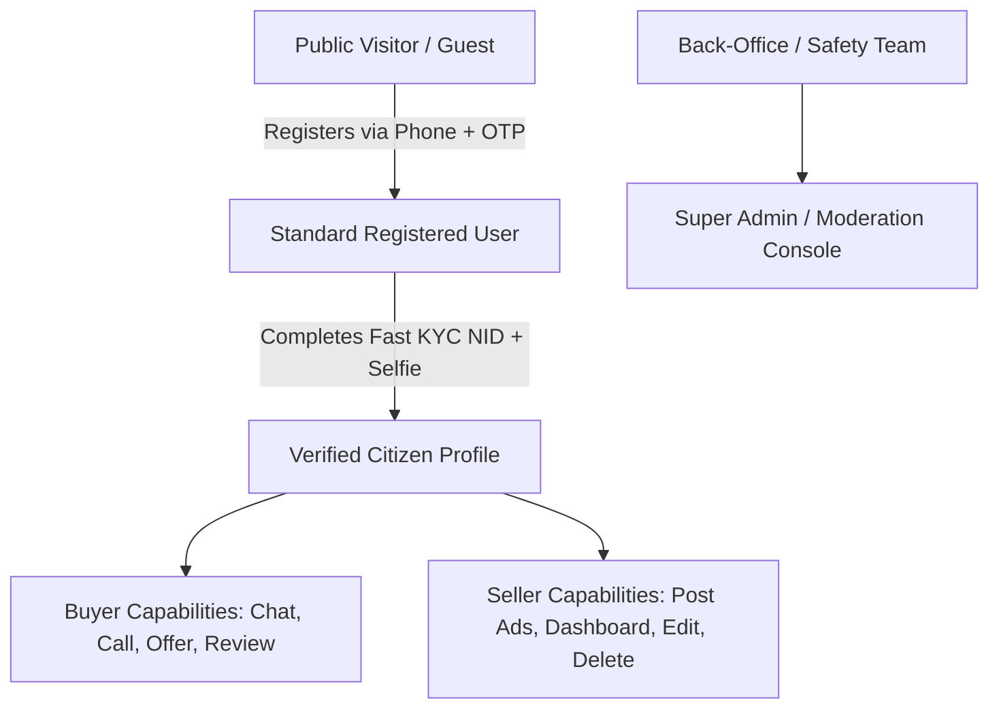

# Product & Business Analysis Report: Becha-Kena

**Document Type:** Senior Product Analyst (PA) & Business Analyst (BA) Review  
**Subject Document:** `PRD.md` (v1.0) & `idea.md`  
**Target File:** `prd-analysis.md`  
**Date:** October 2026  
**Status:** Under Review & Clarification  

---

## 1. Executive Summary & Strategic Overview

### 1.1 Product Thesis
**Becha-Kena** targets the single greatest systemic bottleneck in Bangladesh's peer-to-peer (C2C) digital commerce: **the trust deficit caused by identity anonymity**. Legacy platforms (Bikroy, Facebook Marketplace) operate on zero-accountability classified models, resulting in rampant advance-payment scams (bKash/Nagad), stolen device laundering, phishing courier links, and personal harassment.

By establishing **mandatory dual-sided National ID (NID) and biometric verification**, Becha-Kena creates a closed-loop, accountable ecosystem where bad actors cannot burn and recreate accounts.

### 1.2 Analyst Strategic Assessment
| Evaluation Dimension | Rating (1–5) | Analyst Observation |
| :--- | :---: | :--- |
| **Market Opportunity** | ⭐⭐⭐⭐⭐ | Huge demand for safe second-hand electronics and high-value item trading in Bangladesh. |
| **Value Proposition** | ⭐⭐⭐⭐⭐ | "Trust & Verification" is a clear, defensible differentiator against Bikroy & Facebook. |
| **Product Usability / Friction** | ⭐⭐⭐☆☆ | Mandatory NID before discovery or interaction may create high drop-offs if not gated intelligently. |
| **Technical & Unit Economics** | ⭐⭐⭐☆☆ | Porichoy API and SMS OTP incur fixed operating costs; monetization strategy is currently unspecified. |
| **Requirement Completeness** | ⭐⭐⭐⭐☆ | Core concepts are solid; significant gaps exist around phone privacy, dual roles, notifications, and dispute resolution. |

---

## 2. Product Goals & Business Objectives Analysis

### 2.1 Core Objectives
1. **Zero Anonymous Profiles:** 100% of transacting accounts backed by verified Bangladesh NIDs and live biometrics.
2. **Permanent Scam Deterrence:** Blacklisting an NID terminates the perpetrator's platform presence permanently across phone, device, and legal identity.
3. **Lean Operational Footprint (C2C Focus):** Eliminates the regulatory, logistical, and liability overhead of escrow wallets and physical delivery fleets for MVP.

### 2.2 Unaddressed Business / Economic Realities
- **KYC & OTP Cost Structure:** Every NID verification call (e.g., via Porichoy API) costs approximately 15-25 BDT, and each SMS OTP costs 0.25-0.40 BDT. If verification is completely free and unrestricted for both buyers and sellers, bots or casual signups will rapidly burn capital.
- **Monetization Mechanics:** The PRD currently lacks revenue definition (e.g., featured listings, transaction listing fees, or premium buyer badges).

---

## 3. User Types & Role Architecture

In a true C2C (Consumer-to-Consumer) marketplace, user behavior is fluid: **the same person can be both a buyer and a seller simultaneously.**

### 3.1 User Matrix
| User Type | Authentication Level | Permitted Actions | Restrictions |
| :--- | :--- | :--- | :--- |
| **Guest / Anonymous Visitor** | None | Browse public feed, search keywords, view public product details. | Cannot chat, view seller phone number, make offers, or post ads. |
| **Unverified Registered User** | Phone OTP verified | Save favorites, configure profile settings, initiate KYC. | Cannot message sellers, view direct phone numbers, or publish listings. |
| **Verified C2C User (Dual Role)** | NID + Biometric Match | Full Buyer privileges + Full Seller privileges (Post, Edit, Delete, Dashboard). | Ad limit per month (anti-commercial spam cap). |
| **Trust & Safety Admin** | Role-Based Access Control (MFA) | Audit flagged chats, manual KYC dispute review, blacklist NIDs, ban accounts. | Cannot execute personal marketplace transactions. |

---

## 4. Functional Requirements Deep-Dive

### 4.1 Features Analyzed vs. PRD Baseline
| Module | Current PRD Status | Analyst Assessment & Identified Gaps |
| :--- | :--- | :--- |
| **Auth & KYC** | Documented | Needs clarity on retry limits for failed biometric scans and support for 10-digit Smart Card vs 13/17-digit old NID. |
| **Seller Dashboard** | Mentioned in Stories | Needs explicit requirements for ad lifecycle states: `Draft`, `Active`, `Under Offer`, `Sold`, `Archived`. |
| **Product Detail & Contact** | Updated | **Major Conflict:** Displaying raw phone numbers vs in-app chat privacy. Direct calls invite off-platform scams and harassment. |
| **Direct Call Action** | Added | Needs privacy controls (e.g., seller toggle to "Show/Hide Phone Number" or virtual call routing). |
| **Search & Discovery** | Documented | Location taxonomy needs rigid structure: Division $\rightarrow$ District $\rightarrow$ Thana/Upazila $\rightarrow$ Prominent Neighborhood/Area. |
| **In-App Messaging** | Documented | Needs typing indicators, image attachments (for inspection receipts), and delivery/read receipts. |

---

## 5. Non-Functional Requirements (NFR) Assessment

| NFR Category | PRD Specification | Gap / Senior Analyst Recommendation |
| :--- | :--- | :--- |
| **Security & Data Privacy** | AES-256 at rest, TLS 1.3 in transit | **Critical:** Raw NID photos and biometric vectors must not be accessible via public CDN. NID numbers must be salted and hashed for indexing to comply with BD Data Protection principles. |
| **Performance** | $<300\text{ ms}$ search, $\le 90\text{ s}$ KYC | Search must utilize indexed full-text caching (e.g., Elasticsearch or Meilisearch) and thumbnail optimization (WebP format with max 200KB per image). |
| **Reliability & Offline-First** | 99.9% uptime target | High mobile data instability in BD requires optimistic UI updates for chat and automatic draft saving for ad creation. |
| **Device & Browser Reach** | Mobile PWA + Android APK | Must support low-end Android devices (Android 8.0+, 2GB-3GB RAM) with light DOM footprint. |

---

## 6. Critical Gaps & Missing Requirements (The "Red Flag" Analysis)

### 🚩 Gap 1: Phone Number Exposure vs. Safe In-App Ecosystem (High Risk)
- **The Issue:** The recent addition allows buyers to click and call the seller's phone number directly.
- **The Risk:** Once a conversation moves to direct GSM cellular calls, Becha-Kena's automated chat warnings (against advance bKash/Nagad payments) cannot protect the buyer. Furthermore, female sellers and privacy-conscious users may experience harassment or persistent late-night calls.
- **Recommended Fix:** 
  1. Make phone number visibility **opt-in by the seller** (toggle: "Allow direct phone calls from verified buyers").
  2. Gated visibility: Phone numbers can only be revealed *after* the buyer has an active verified account and clicks "Reveal Number" (logged for audit purposes).

### 🚩 Gap 2: Guest Browsing vs. Mandatory Registration Wall
- **The Discrepancy:** PRD Section 7 states *"Buyer signs up with phone number, completes fast KYC, then searches"*, whereas Section 4 Flow 3 allows *"Buyer browses feed... prompts verification before chat"*.
- **The Risk:** Forcing users to download an app, verify phone, and submit NID *before* they can even browse available items will cause an estimated 70–85% bounce rate.
- **Recommended Fix:** Adopt the **"Browse Freely, Verify to Transact"** model. Guests can browse, filter, and view items. The moment they click **Contact Seller**, **Make Offer**, or **Post Ad**, the verification modal is triggered.

### 🚩 Gap 3: Dual-Role Architecture (Single Account for Buying & Selling)
- **The Issue:** The PRD describes "Buyer Journey" and "Seller Journey" as if they are separate account types.
- **The Risk:** In peer-to-peer commerce, individuals sell an old laptop and buy a phone on the same account. Creating separate buyer and seller accounts creates confusion and duplicate NID verification collisions.
- **Recommended Fix:** Consolidate into a unified account architecture. Once verified with NID, the user holds both Buyer and Seller capabilities with a unified switchable navigation or combined dashboard.

### 🚩 Gap 4: KYC Failure & Dispute Management Edge Cases
- **The Issue:** What happens if the Porichoy server is temporarily down, or OCR misreads an old laminated NID, or a user recently had cosmetic changes/aging?
- **Missing Requirement:** 
  1. Graceful fallback retry (maximum 3 attempts).
  2. Fallback to manual queue for human admin review.
  3. Clear error messaging in English (e.g., *"Your NID photo is not clearly visible. Please retake the photo in good lighting."*).

### 🚩 Gap 5: Notification & Alert Mechanism
- **The Issue:** If a buyer clicks "Contact" or sends an offer, how does the seller know immediately?
- **Missing Requirement:**
  1. FCM (Firebase Cloud Messaging) Push Notifications for Mobile App / PWA.
  2. Instant SMS trigger for high-value events (e.g., *"You have a verified offer on your iPhone ad"* if offline for >15 minutes).
  3. In-app badge count.

### 🚩 Gap 6: Listing Lifecycle & Deal Completion Feedback Loop
- **The Issue:** How does the platform know a deal actually succeeded?
- **Missing Requirement:**
  1. Seller marks ad as `Reserved` or `Sold`.
  2. If marked `Sold`, the platform prompts the seller to select which verified chat partner purchased it.
  3. Both parties unlock the ability to leave a bilateral trust rating (1 to 5 stars + review tags).

---

## 7. Requirement Traceability Matrix (RTM)

| ID | User Story / Feature | PRD Coverage | Status | Implementation in PRD v1.1 |
| :--- | :--- | :---: | :---: | :--- |
| **REQ-01** | Dual-sided NID Verification | Section 3.1 | ✅ Implemented | Integrated Porichoy API + liveness match + 3-attempt retry & admin fallback. |
| **REQ-02** | Browse & Search with Geo-filter | Section 3.3 | ✅ Implemented | Open discovery model with Division $\rightarrow$ District $\rightarrow$ Thana hierarchy. |
| **REQ-03** | Product Details with Verified Badge | Section 3.2, 7 | ✅ Implemented | Displays verified badge, trust metrics, masked name, and item specs. |
| **REQ-04** | Direct Chat & Offer Negotiation | Section 3.4, 7 | ✅ Implemented | In-app messaging, automated scam detection, link blocking, and formal offer tool. |
| **REQ-05** | Direct Phone Call from Details Page | Section 3.2, 7 | ✅ Implemented | Visible to verified buyers with click-to-call, seller privacy toggle, and audit logging. |
| **REQ-06** | Seller Dashboard (Add, Edit, Delete) | Section 3.3, 7 | ✅ Implemented | Full ad lifecycle states: `Draft`, `Active`, `Under Offer/Reserved`, `Sold`, `Archived`. |
| **REQ-07** | Unified Dual-Role User Profile | Section 2.1, 7 | ✅ Implemented | Single citizen account (1 NID, 1 Phone) allows seamless buying and selling. |
| **REQ-08** | Notification & Alert Framework | Section 3.6 | ✅ Implemented | FCM Push Notifications + automated unread SMS alerts (>15 min) + notification tab. |
| **REQ-09** | Deal Closure & Rating System | Section 3.5 | ✅ Implemented | Seller selects verified buyer on "Sold"; bilateral 1-5 star ratings and review badges. |
| **REQ-10** | Admin Back-Office Panel | Section 3.7 | ✅ Implemented | Manual KYC review desk, reported content moderation, and permanent NID blacklist. |

---

## 8. Stakeholder Alignment & Confirmed Decisions

Based on the Product Analyst review and stakeholder alignment, the following key product decisions are now **confirmed and locked**:

| Strategic Area | Confirmed Decision | Implementation Specification |
| :--- | :--- | :--- |
| **Phone Number Visibility** | **Visible to Verified Buyers** | Seller's phone number is displayed directly on the Product Details page, but **only accessible to logged-in, NID-verified buyers**. Guests/unverified visitors see a prompt to verify before unlocking the number/click-to-call. |
| **Browsing Architecture** | **Open Discovery ("Browse Freely")** | Any visitor or guest can freely search, filter, and view product details without friction. NID verification is triggered dynamically only when the user attempts to **Post an Ad**, **Send a Chat Message**, or **Reveal Phone / Call**. |
| **Account Architecture** | **Unified Account (Dual-Role)** | A single citizen account tied to one NID allows the user to act as both **Buyer** and **Seller**. No duplicate signups or account fragmentation. |

