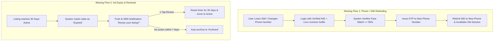
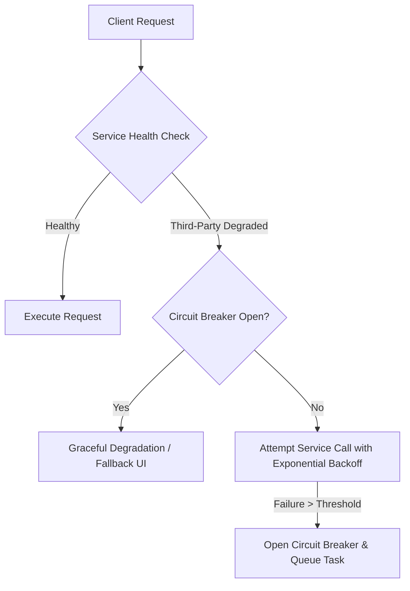

# System Requirements Validation & Technical Robustness Specification

## Project: Becha-Kena
**Document:** System Edge Cases, Error Handling, Security, Permissions & Validation Matrix  
**Target File:** `requiremment-validation.md`  
**Version:** 1.0  
**Target Audience:** Engineering Leads, QA Engineers, Security Auditors & System Architects  

---

## 1. Missing Flows & Gap Analysis



### 1.1 Flow 1: Lost SIM / Account Recovery (NID-First Rebinding)
* **Problem:** In Bangladesh, SIM cards are frequently lost, stolen, or reassigned. Because each NID can only be bound to one active account, a user whose SIM is deactivated would otherwise be permanently locked out.
* **Flow Specification:**
  1. User selects *"Lost my registered phone number"* on the login screen.
  2. User enters their registered NID number and date of birth.
  3. System triggers mandatory **Biometric Liveness Match** via front camera.
  4. Upon $\ge 95\%$ confidence match against stored NID facial vectors, user enters their new mobile number.
  5. OTP is sent to the new number; upon successful entry, the account rebinds to the new number, and all active sessions on the old number are revoked immediately.

### 1.2 Flow 2: Ad Expiry, Renewal & Inactivity Management
* **Problem:** Dead/abandoned ads clutter search results and waste buyers' time.
* **Flow Specification:**
  1. Every active listing has a **30-day Time-To-Live (TTL)**.
  2. At Day 25, the seller receives a push notification and in-app banner: *"Is your [Item Name] still available? Tap to renew for 30 more days."*
  3. If not renewed by Day 30, state transitions to `Expired` and the item is hidden from search/feed.
  4. If no renewal occurs within 7 days after expiry, state transitions to `Archived` (retaining chat history for audits).

### 1.3 Flow 3: Transaction Cancellation, Dispute & No-Show
* **Problem:** Buyer and seller agree on a deal or physical meeting, but one party fails to show up or attempts to renegotiate aggressively in person.
* **Flow Specification:**
  1. If an item is in `Under Offer / Reserved` state and the meetup falls through:
     - Seller can tap *"Cancel Reservation"* $\rightarrow$ select reason (*"Buyer did not show up"*, *"Buyer renegotiated unfairly"*, *"Mutual cancellation"*).
     - Item instantly returns to `Active` state without losing view counters or existing chats.
  2. If a buyer is marked as a *"No-Show"* by two independent verified sellers, their account receives a 7-day shadow restriction on making formal offers.

### 1.4 Flow 4: Stolen Item Claim & Post-Sale Dispute Handling
* **Problem:** A buyer purchases a smartphone, but later discovers the IMEI is blocked by BTRC or filed as stolen with the Bangladesh Police.
* **Flow Specification:**
  1. Buyer opens the archived transaction in chat and taps *"File Legal Dispute / Stolen Goods Report"*.
  2. Buyer uploads official Police GD (General Diary) copy and FIR number.
  3. Trust & Safety team receives an immediate high-priority alert.
  4. System freezes the seller's account pending investigation.
  5. Law enforcement liaison team exports encrypted audit log (full chat, NID proof hash, phone number, and IP logs) in compliance with Bangladesh legal warrants.

---

## 2. Edge Cases Matrix

| # | Edge Case Scenario | System Behavior & Mitigation Rule | Fallback Mechanism |
| :--- | :--- | :--- | :--- |
| **EC-01** | **NID Collision / Impersonation:** Someone attempts to use another person's physical NID card. | The Porichoy API validates data against the election commission database, but **biometric liveness match fails** because the face does not match the NID photo. | System logs failure; after 3 failed attempts, flags IP and device ID for fraud monitoring. |
| **EC-02** | **C2C Quota Exhaustion:** Individual seller attempts to post a 6th listing within 30 days. | System blocks submission and displays: *"A personal account can post a maximum of 5 listings per month."* | Prevents commercial shops from operating disguised retail outlets. Seller must wait for month reset or mark older ads sold. |
| **EC-03** | **Concurrent Competing Offers:** Buyer A and Buyer B both submit offers simultaneously on the same item. | Seller can view both offers with buyer trust badges and timestamps. Accepting Buyer A's offer puts item in `Under Offer`; Buyer B's offer receives automated notification: *"Item has been reserved by another buyer."* | If Buyer A deal falls through, seller can reopen negotiation with Buyer B with 1 tap. |
| **EC-04** | **Mid-Negotiation Price Modification:** Seller increases asking price while active chats are in progress. | When price is increased, all active chat threads display an automated system tag: *"Seller updated price from BDT X to BDT Y."* Existing accepted offers remain locked at the agreed price. | Prevents bait-and-switch price gouging. |
| **EC-05** | **Listing Deleted During Active Chat:** Seller deletes an ad while a buyer is travelling to the meetup. | Ad is removed from search, but the **chat thread remains accessible** with a banner: *"This listing has been deleted by the seller."* Parties can still message to complete or abort the meetup. | Prevents stranded buyers from losing contact info during transit. |
| **EC-06** | **NID Banned Mid-Transaction:** Seller is banned for fraud on Ad #1 while Ad #2 has active chats. | All listings created by that NID are instantly unpublished. Ongoing chat threads are locked with a security warning: *"This user has been permanently banned for violating platform rules."* | Protects existing transacting buyers from finalizing fraudulent deals. |
| **EC-07** | **Network Drop During KYC Upload:** Mobile data drops while streaming biometric selfie video. | Client app maintains local session state in IndexedDB/cache. Upon reconnection within 15 minutes, user resumes at the failed step rather than starting over. | Avoids redundant Porichoy API cost and user frustration. |

---

## 3. Error Handling Architecture



### 3.1 External Dependency Error Handling
| Component | Failure Mode | Circuit Breaker & Retry Strategy | User-Facing Experience (Bangla / English) |
| :--- | :--- | :--- | :--- |
| **Porichoy NID API** | HTTP 500, 502, 504 (Server Down / Slow) | Timeout at 10s. Exponential backoff (1s, 3s, 5s). Trip circuit breaker after 5 consecutive timeouts. | *"Identity verification server is temporarily busy. Your data is saved and will be verified automatically shortly."* |
| **SMS Gateway (OTP)** | Network latency / undelivered SMS | Resend button locked for **60 seconds**. After 2 failures, route via secondary fallback SMS gateway (e.g., Infobip $\rightarrow$ Banglalink). | *"Didn't receive code? Resend after 60 seconds or receive code via WhatsApp."* |
| **CDN / Media Storage** | S3 / Cloud Storage upload failure | Client-side chunked upload with checksum verification. Automatically retry dropped chunks up to 3 times. | *"Image upload incomplete. Please check your internet connection and try again."* |
| **WebSockets (Chat)** | Connection drops in transit | Client maintains heartbeat (ping every 25s). Auto-reconnect with jittered backoff. Messages queued locally in SQLite/IndexedDB until ACK. | Shows *"Connection disconnected... reconnecting"* with clock icon on pending messages. |

### 3.2 Media Upload Error Handling
- **Image Size Limit:** Maximum 10MB per raw file before upload.
- **Client-Side Compression:** Images automatically converted to **WebP (max 1280x1280px, ~200KB)** before transmission.
- **Invalid Mime Types:** Rejects non-image files (.exe, .pdf, .svg) with strict magic-byte validation (not just file extension).
- **Corrupted Image Handling:** Pre-upload canvas render test; if image fails canvas draw, it is rejected immediately with *"The image file is damaged or corrupted"*.

---

## 4. Security & Compliance Requirements

### 4.1 Cryptographic Storage of Identity Data
```
Raw NID Number ──> [Pepper + Salt] ──> HMAC-SHA256 ──> Indexed Lookup Hash (DB)
                                                  └──> AES-256 Encrypted Vault (Law Enforcement Access Only)
```
1. **Zero Plaintext NID Storage:** NID numbers must **never** be stored in plaintext in application databases or log files.
2. **Deterministic Lookup Hash:** NID numbers are hashed using `HMAC-SHA256` with a hardware-secured master pepper. This hash is used strictly for duplicate/blacklist collision detection.
3. **Encrypted Legal Vault:** Official names and NID documents are encrypted using `AES-256-GCM` with rotating AWS KMS / HashiCorp Vault keys. Only accessible under verified administrative audit logs.
4. **Ephemeral Biometric Frames:** Raw video frames from camera liveness checks are processed in-memory and deleted immediately. Only the numerical feature embeddings and similarity confidence score ($\%$) are retained.

### 4.2 Phone Number Scraping & Harvesting Prevention
To prevent bot farms and telemarketers from scraping seller phone numbers:
- **Authentication Wall:** Phone number display is strictly disabled for unauthenticated users and unverified accounts.
- **Rate Limiting:** A verified buyer can click to reveal a maximum of **10 seller phone numbers per 24 hours**. Exceeding this triggers a CAPTCHA and temporary 6-hour cooldown.
- **Audit Logging:** Every phone number reveal logs: `{buyer_nid_hash, seller_id, listing_id, timestamp, ip_address, user_agent}`.

### 4.3 Real-Time Content Moderation Engine
1. **Advance Scam Shield:** In-app chat engine scans messages with regex triggers:
   - High-risk keywords: `advance`, `bKash`, `courier fee`, `booking fee`, `send money`.
   - Action: Displays an instant red alert banner inside the chat thread warning the buyer not to pay before physical inspection.
2. **Link Stripping:** All external hyperlinks (`http://`, `https://`, `.apk`, `.xyz`) are sanitized and disabled in chat to prevent phishing courier landing pages.
3. **Image Moderation:** Listing photos are automatically processed via Google Cloud Vision / AWS Rekognition to detect explicit, violent, or weapon imagery before publishing.

---

## 5. Input & Business Rule Validation Matrix

| Field / Action | Validation Rules | Error Response Message |
| :--- | :--- | :--- |
| **Phone Number** | BD Regex: `^(?:\+8801\|01)[3-9]\d{8}$` (11 digits, valid BD telco prefixes). | *"Please enter a valid 11-digit Bangladeshi mobile number."* |
| **NID Number** | 10-digit Smart NID (`^\d{10}$`) OR 13/17-digit legacy NID (`^\d{13}$` / `^\d{17}$`). | *"Please provide a valid 10, 13, or 17-digit National ID number."* |
| **Listing Title** | Min 10 characters, Max 100 characters. No continuous uppercase / spam symbols. | *"Title must be between 10 and 100 characters."* |
| **Asking Price** | Integer between 50 and 2,500,000 BDT. Must be greater than 0. | *"Please set a valid price (minimum 50 BDT and maximum 2,500,000 BDT)."* |
| **Listing Images** | Min 1 photo, Max 8 photos. Dimensions $\ge 480\times 480\text{px}$. | *"You must upload at least 1 and at most 8 photos for the listing."* |
| **Item Description** | Min 20 characters, Max 2,000 characters. | *"Please write a detailed description of the product (at least 20 characters)."* |
| **Location** | Must match verified Division $\rightarrow$ District $\rightarrow$ Thana ID from system master database. | *"Please select a valid location from the list."* |
| **Listing Condition** | Strict enum: `brand_new`, `like_new`, `gently_used`, `heavily_used`. | *"Selecting the item condition is required."* |

---

## 6. Role-Based Access Control (RBAC) & Permission Matrix

| Feature / Resource | Guest Visitor | Unverified User | Verified Citizen (Buyer/Seller) | Trust & Safety Moderator | Super Admin |
| :--- | :---: | :---: | :---: | :---: | :---: |
| **Browse / Search Listings** | ✅ Full | ✅ Full | ✅ Full | ✅ Full | ✅ Full |
| **View Item Details Page** | ✅ Full | ✅ Full | ✅ Full | ✅ Full | ✅ Full |
| **View Seller Phone / Call** | ❌ Blocked | ❌ Blocked | ✅ Permitted (Logged) | ✅ Permitted | ✅ Permitted |
| **Send In-App Chat / Offer** | ❌ Blocked | ❌ Blocked | ✅ Permitted | ❌ Blocked | ❌ Blocked |
| **Post / Edit / Delete Own Ad** | ❌ Blocked | ❌ Blocked | ✅ Permitted (Max 5/mo) | ❌ Blocked | ❌ Blocked |
| **Access Seller Dashboard** | ❌ Blocked | ❌ Blocked | ✅ Permitted | ❌ Blocked | ❌ Blocked |
| **Submit Star Rating & Review** | ❌ Blocked | ❌ Blocked | ✅ Permitted (Post-Deal) | ❌ Blocked | ❌ Blocked |
| **Manual KYC Verification Queue** | ❌ Blocked | ❌ Blocked | ❌ Blocked | ✅ Permitted | ✅ Full |
| **Review Reported Chats & Ads** | ❌ Blocked | ❌ Blocked | ❌ Blocked | ✅ Permitted | ✅ Full |
| **Blacklist NID / Ban Account** | ❌ Blocked | ❌ Blocked | ❌ Blocked | ⚠️ Requires 2-Admin Approval | ✅ Full Instant |
| **Export Legal Audit Logs (GD/FIR)** | ❌ Blocked | ❌ Blocked | ❌ Blocked | ❌ Blocked | ✅ MFA Required |

---

## 7. Multi-Channel Notification Matrix

| Event Trigger | Recipient | In-App Banner | Push Notification (FCM) | SMS Notification | Email Alert |
| :--- | :--- | :---: | :---: | :---: | :---: |
| **KYC Approved** | User | ✅ Immediate | ✅ Instant | ✅ Short Confirmation | ✅ Optional |
| **KYC Needs Retake** | User | ✅ Action modal | ✅ High Priority | ❌ No | ❌ No |
| **New Message in Chat** | Seller / Buyer | ✅ Tab badge | ✅ Instant | ⚠️ Fallback if offline $>15\text{m}$ | ❌ No |
| **Formal Offer Received** | Seller | ✅ Header alert | ✅ Instant with Sound | ⚠️ Fallback if offline $>15\text{m}$ | ❌ No |
| **Offer Accepted / Countered** | Buyer | ✅ Header alert | ✅ Instant | ❌ No | ❌ No |
| **Ad Nearing Expiry (Day 25)** | Seller | ✅ Dashboard alert | ✅ Day 25 reminder | ❌ No | ✅ Summary |
| **Item Marked Sold (Review Prompt)** | Buyer | ✅ Dialog modal | ✅ High Priority | ❌ No | ❌ No |
| **Account Ban / Suspension** | User | ✅ Full-screen lock | ✅ Critical alert | ✅ Legal Notice SMS | ✅ Full Notice |
| **Security Login from New Device** | User | ✅ Toast notification | ✅ Instant alert | ✅ Immediate SMS alert | ❌ No |

---

## 8. Exception Handling & Disaster Recovery

### 8.1 Transactional Atomicity (Database Concurrency)
- **Problem:** Two concurrent actions (e.g., Seller marks item as `Sold` while another buyer clicks `Accept Offer`).
- **Mitigation:** Use strict **Pessimistic Locking / Atomic Database Transactions**:
  ```sql
  BEGIN TRANSACTION;
  SELECT status FROM listings WHERE id = :listing_id FOR UPDATE;
  -- Validate that status is currently 'Active' or 'Under Offer'
  UPDATE listings SET status = 'Sold', buyer_id = :buyer_id, updated_at = NOW() WHERE id = :listing_id;
  COMMIT;
  ```

### 8.2 Disaster Recovery & Uptime
- **Database Backups:** Automated continuous Point-in-Time Recovery (PITR) with WAL archiving + daily full snapshot replicated to secondary geographic zone.
- **Failover Target:** Recovery Point Objective (RPO) $\le 5\text{ minutes}$; Recovery Time Objective (RTO) $\le 30\text{ minutes}$.
- **Graceful Maintenance Mode:** In case of emergency migrations, application displays a localized maintenance screen with real-time status updates without dropping queued WebSocket messages.
